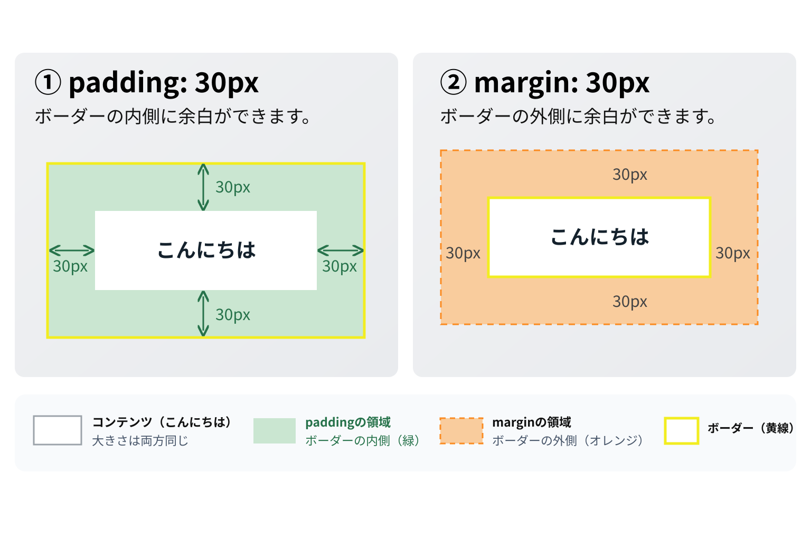
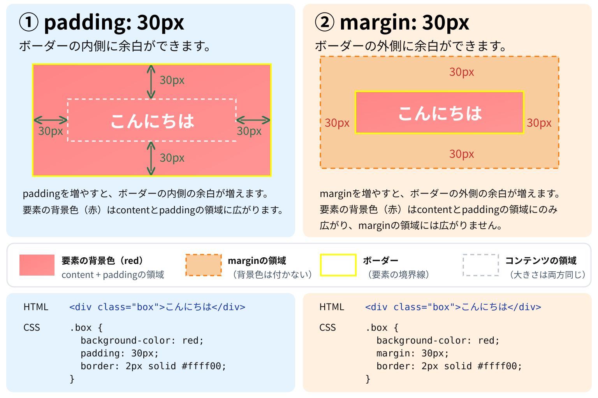

# marginとpaddingの違い

まずは、marginとpaddingの違いを確認します。ここを理解してから、上下marginが指定値どおりの足し算にならない理由へ進みます。

## marginとpaddingは何が違う？

どちらも余白を作るCSSですが、余白を作る場所が違います。

この図では、内側から順に次の構造になっています。

1. `content`：文章や画像などの内容
2. `padding`：内容とborderの間
3. `border`：要素の境界線
4. `margin`：borderの外側



図の白・緑・黄・オレンジは、content・padding・border・marginの領域を区別するための色です。

### 実際にCSSで指定すると

```html
<div class="box">こんにちは</div>
```

```css
.box {
  margin: 30px;
  padding: 20px;
  border: 2px solid #f2ed20;
  background-color: lightblue;
}
```

この場合、

- `margin: 30px` → 境界線の外側に30px
- `padding: 20px` → 境界線の内側に20px
- `border: 2px` → 2pxの境界線

という構造になります。

図はpaddingとmarginをそれぞれ30pxにした比較ですが、このコードは一つの箱にmargin 30pxとpadding 20pxを指定する別の例です。

### 何が違うのか

例えば、背景色を持つ箱の中に文章があるとします。



この比較図では、要素の背景を赤で示しています。緑の矢印と数値は、paddingの範囲を示す説明用の表示です。内容の大きさをそろえ、paddingとmarginをそれぞれ30pxにした別々の例です。

#### paddingを増やす場合

内容の大きさを保ったままpaddingを増やすと、背景が付く内側の領域が広がり、文章とborderの間が離れます。

#### marginを増やす場合

箱の外側に余白ができ、周囲との距離が変わります。外側の余白には箱自身の背景色は付きません。

## ここで覚えること

| 比較 | margin | padding |
| --- | --- | --- |
| 場所 | borderの外 | borderの内 |
| 背景色 | 自身の背景は付かない | 自身の背景が付く |
| 負の値 | 使える | 使えない |
| マージン相殺 | 起こる場合がある | 起こらない |

判断の基本は二つだけです。

- 箱と周囲の距離を変えたい → `margin`
- 箱の内側で内容との距離を変えたい → `padding`

ただし、marginは指定した値が必ずそのまま要素間の距離になるとは限りません。

その理由が、次の[マージン相殺](./03_兄弟要素のマージン相殺.md)です。
