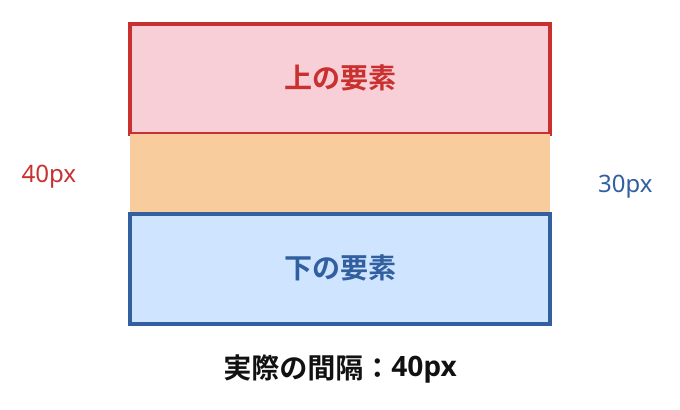

# ② マージン相殺（margin collapsing）

次は、上下のmarginが重なった場合です。

まずは兄弟要素の例だけ説明します。

### 1. 上下のmarginは必ずしも足されない

```xml
<div class="parent">
  <div class="child-a">上の要素</div>
  <div class="child-b">下の要素</div>
</div>
```

```css
.child-a {
  margin-bottom: 40px;
}

.child-b {
  margin-top: 30px;
}
```

通常フローのブロック要素で、相殺の条件を満たしている場合です。



オレンジ色はmarginを説明するための色です。実際には背景色は付きません。

普通に足せば、

$$
40+30=70\text{px}
$$

ですが、マージン相殺が起こると、

$$
\max(40,30)=\boxed{40\text{px}}
$$

になります。

### 2. なぜ40pxになるのか

上下のmarginがそれぞれ別の余白として並ぶのではなく、一つの相殺結果として扱われるからです。

両方が正の値の場合、大きい方のmarginが結果になります。

| 上のmargin-bottom | 下のmargin-top | 実際の間隔 |
| --- | --- | --- |
| 40px | 30px | 40px |
| 20px | 50px | 50px |
| 30px | 30px | 30px |
| 0px | 40px | 40px |

### 3. ここで覚えること

- 相殺するのは、条件を満たした上下のmargin。
- 左右のmarginでは起こらない。
- 正のmargin同士が相殺すると、大きい方が残る。
- Flex・Gridアイテムのmarginは相殺しない。

つまり、`margin-bottom: 40px` と `margin-top: 30px` を書いても、必ず70px離れるわけではありません。

ここまでが兄弟要素の基本です。

親と子の場合は、[親子要素のマージン相殺まとめ](./04_親子要素のマージン相殺.md)へ進みます。
