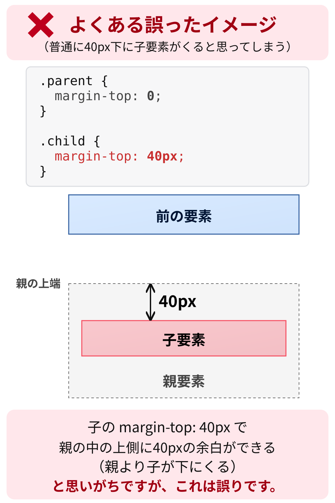
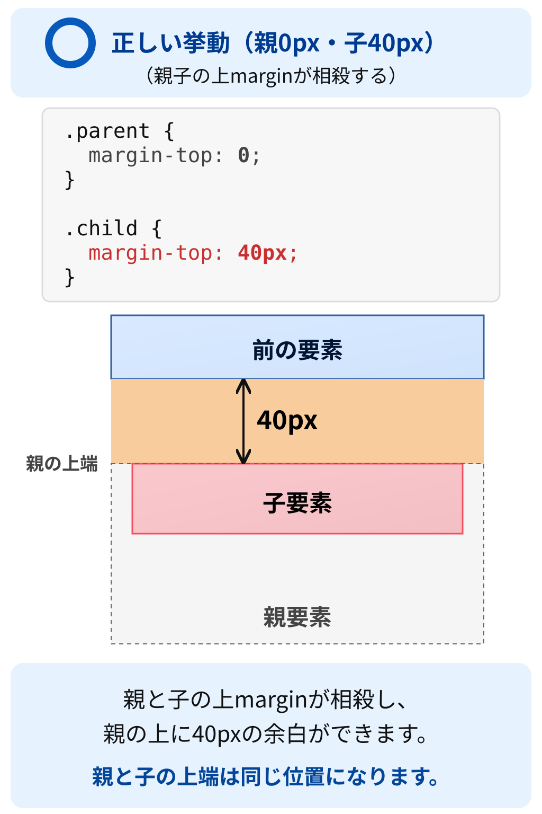
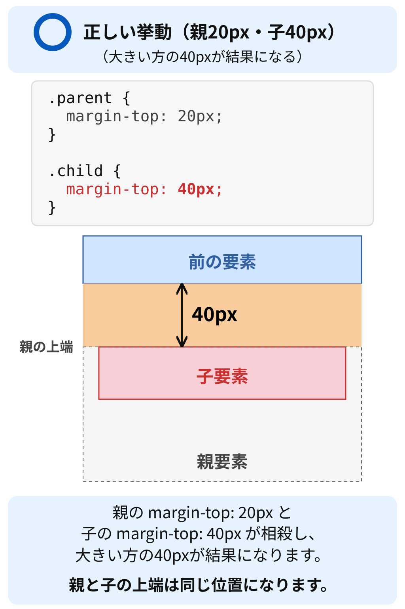

# 親子要素のマージン相殺まとめ

### 1. 親と子のmarginも相殺する

```xml
<div class="parent">
  <div class="child">子要素</div>
</div>
```

```css
.parent {
  margin-top: 0;
}

.child {
  margin-top: 40px;
}
```

親子間で相殺の条件を満たす場合、子の `margin-top: 40px` は親の内側に40pxの空間を作るのではなく、親の箱の外側の配置に作用します。

そのため、子だけでなく親の箱全体が下に移動することがあります。

以下の図は、親子間の相殺条件を満たし、前の要素にmarginがない例です。灰色の点線は親の位置と範囲を示す補助線で、実際のCSSのborderではありません。

**誤った予想：子だけが親の内側で下がる**



**相殺した結果：親0px・子40px**



### 2. 親のmarginが0である必要はない

正のmargin同士の場合、大きい方が相殺結果になります。

| 親のmargin-top | 子のmargin-top | 相殺結果 |
| --- | --- | --- |
| 0px | 40px | 40px |
| 20px | 40px | 40px |
| 60px | 40px | 60px |
| 40px | 40px | 40px |

つまり、

$$
\max(\text{親のmargin},\text{子のmargin})
$$

で計算できます。

ただし、これは正のmargin同士で相殺する場合です。

### 3. 相殺してもCSSの指定値は変わらない

```css
.parent {
  margin-top: 20px;
}

.child {
  margin-top: 40px;
}
```

相殺結果は40pxですが、親の `margin-top` が40pxに書き換えられるわけではありません。

- 親の指定値：20px
- 子の指定値：40px
- 相殺結果：40px

継承や指定値の変更ではなく、CSSのレイアウト計算によるものです。

#### 「親を突き破る」とは

上のコードの「親20px・子40px」を図にすると、次のようになります。



第1節の「誤った予想」の図では、子のmarginが親の内側に40pxの空間を作ると考えています。相殺する条件ではこの配置にはなりません。

第1節の「親0px・子40px」の図でも、上の「親20px・子40px」の図でも、親子の上marginが相殺され、一つの40pxの余白として親の上側に作用します。親と子の上端はそろい、子だけが親の上端から40px下がることはありません。

「親を突き破る」は、子の上marginが親の内側にとどまらず、親の上marginと相殺されて、親の外側の配置に作用するというイメージです。子の箱自体は親の中にあり、DOM上の親子関係も変わりません。

### 4. 兄弟要素との違い

| 関係 | 相殺したときの結果 |
| --- | --- |
| 兄弟 | 二つの要素間の余白が一つの相殺結果になる |
| 親子 | 子のmarginが親の外側の配置に作用することがある |

どちらも同じマージン相殺という仕組みですが、DOM上の関係によって、配置への影響が違います。

結論：親子間のマージン相殺は、親のmarginが0のときだけ起こるわけではありません。親子の上下marginが相殺する条件を満たしていれば、双方の値を使って相殺結果が計算されます。

次に説明するのは、親にpaddingやborderがあると、なぜこの相殺が起こらなくなるのかという部分です。
