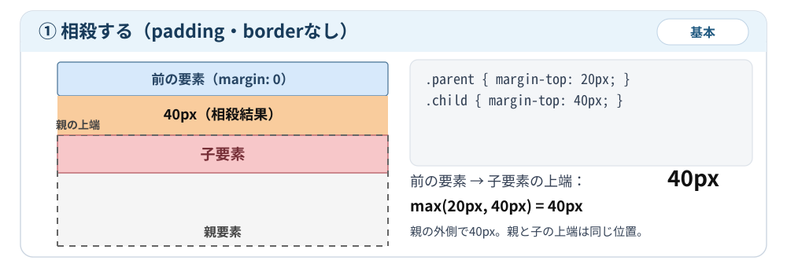
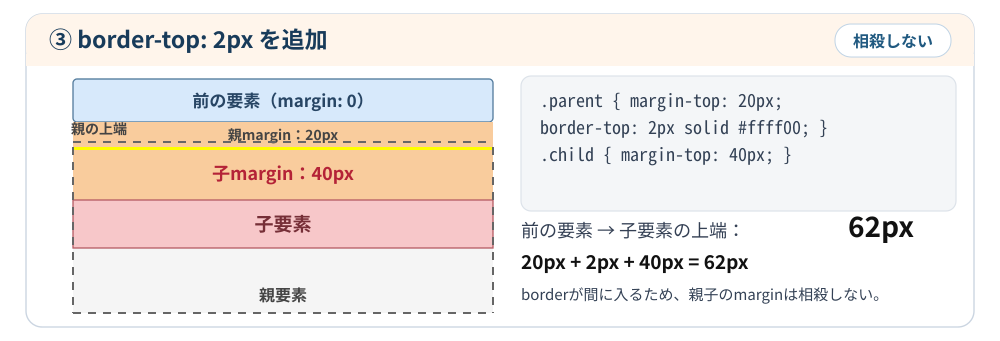

# ⑤ paddingやborderがあると親子のマージン相殺は起こらない

親要素に `padding-top` や `border-top` があると、親と最初の子の上marginは相殺しません。画像の順に、何もない場合、paddingを追加した場合、borderを追加した場合を比べます。

通常フローのブロック要素で、paddingやborder以外の相殺を阻止する条件がなく、前の要素にはmarginがない例です。

### 1. まずはpaddingもborderもない場合

```css
.parent {
  margin-top: 20px;
}

.child {
  margin-top: 40px;
}
```

親と子のmarginが相殺するため、

$$
\max(20,40)=40\text{px}
$$

となります。

親の内側には40pxの余白ができず、親と子の上端がそろいます。



### 2. 親にpaddingを追加する

```css
.parent {
  margin-top: 20px;
  padding-top: 30px;
}

.child {
  margin-top: 40px;
}
```


親の `padding-top: 30px` が親と子のmarginを隔てるため、相殺が起こらなくなります。

前の要素の下端から子要素の上端までの距離は、

$$
20+30+40=\boxed{90\text{px}}
$$

となります。

- 親の外側：親のmarginが20px
- 親の内側：親のpaddingが30px、その下に子のmarginが40px

親の上端から子要素の上端までは、`30 + 40 = 70px` です。paddingを追加しても、子のmarginが消えるわけではありません。

### 3. 親にborderを追加する

今度はpaddingを付けず、代わりに `border-top` を付けます。

```css
.parent {
  margin-top: 20px;
  border-top: 2px solid #ffff00;
}

.child {
  margin-top: 40px;
}
```



灰色の点線は親要素の位置と範囲を示す補助線です。実際のCSSのborderではありません。③の黄線だけが実際のborderです。図は模式図で、寸法は縮尺どおりではありません。

`border-top: 2px` が親と子のmarginを隔てるため、相殺が起こらなくなります。

前の要素から子要素の上端までの距離は、

$$
20+2+40=\boxed{62\text{px}}
$$

### 4. 三つの違いを比べる

| 比較項目 | padding・borderなし | paddingあり | borderあり |
| --- | --- | --- | --- |
| 親margin-top | 20px | 20px | 20px |
| 親padding-top | 0px | 30px | 0px |
| 親border-top | 0px | 0px | 2px |
| 子margin-top | 40px | 40px | 40px |
| 相殺 | する | しない | しない |
| 前の要素から子まで | 40px | 90px | 62px |

※ 前の要素にはmarginがなく、ほかに配置へ影響する指定もない前提です。

### 5. 今回覚えること

親要素の上側にpaddingやborderがあると、親と最初の子の上marginは相殺しません。

paddingもborderも親子間のマージン相殺を防ぎますが、役割は異なります。

- `padding`：内側の余白を作る
- `border`：境界線を作る
