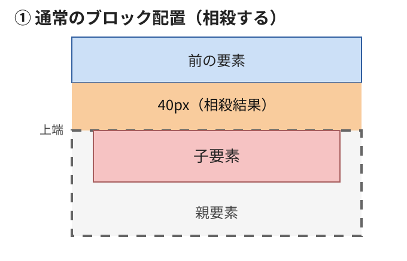
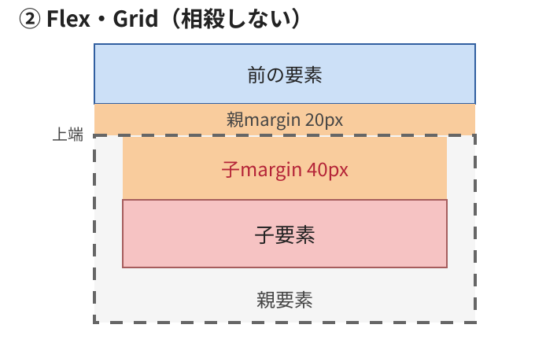

# ⑥ Flex・Gridではマージン相殺が起こらない

これまでは、通常のブロック配置で親子のmarginが相殺する例を見てきました。

今回は、親要素をFlex・Gridにした場合です。

### 1. 通常のブロック配置

```css
.parent {
  margin-top: 20px;
}

.child {
  margin-top: 40px;
}
```

親子の上marginが相殺するため、

$$
\max(20,40)=40\text{px}
$$

親の外側に40pxの余白ができ、親と子の上端がそろいます。



### 2. 親をFlex・Gridにする

```css
.parent {
  display: flex;
  flex-direction: column;
  margin-top: 20px;
}

.child {
  margin-top: 40px;
}
```

`display: grid` でも同じように、親と子の上marginは相殺しません。



灰色の点線は親要素の範囲を示す説明用の補助線で、実際のCSSのborderではありません。前の要素のmarginは0pxとします。図は模式図です。

Flex・Gridでは、親の上marginと子の上marginは別々に作用します。

$$
20+40=\boxed{60\text{px}}
$$

### 3. 比較

| 比較項目 | 通常のブロック配置 | Flex・Grid |
| --- | --- | --- |
| 親margin-top | 20px | 20px |
| 子margin-top | 40px | 40px |
| 親子間の相殺 | する | しない |
| 前の要素から子まで | 40px | 60px |

### 4. 兄弟要素でも違う

Flex・Gridアイテム同士の場合も、上下marginは相殺しません。

```css
.parent {
  display: flex;
  flex-direction: column;
}

.child-a {
  margin-bottom: 40px;
}

.child-b {
  margin-top: 30px;
}
```

この場合、子要素同士の間隔は、

$$
40+30=\boxed{70\text{px}}
$$

となります。

### 今回覚えること

Flex・Gridアイテムのmarginは相殺しない。

ただし、Flex・Gridコンテナ自身の外側のmarginまで、すべて相殺しなくなるという意味ではありません。

ここまでで、padding・border・Flex・Gridによる違いを説明しました。

次は ⑦ 負のmarginの基本 です。`margin-top: -40px` が要素をどのように配置するかを、マージン相殺とは分けて説明します。
