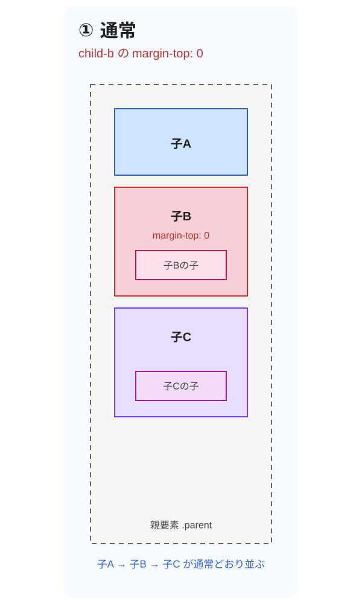
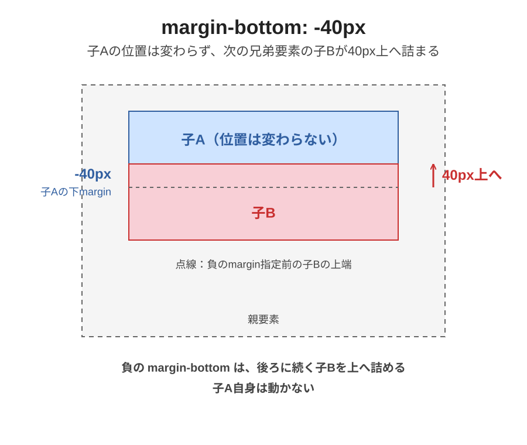
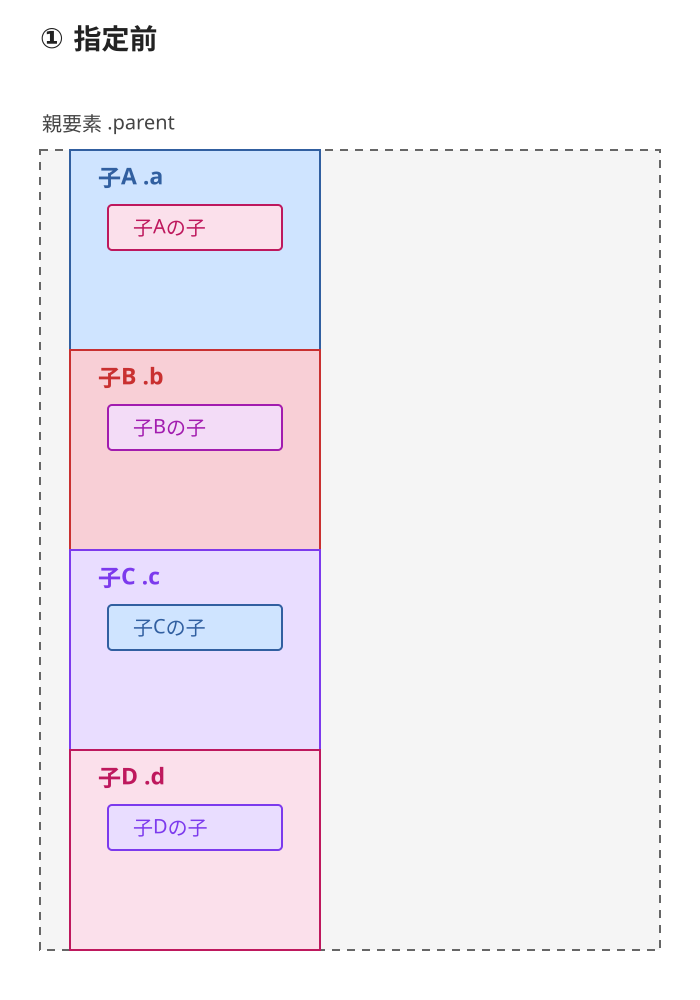

# ⑦ 負のmarginの基本（通常のブロック配置）

今回はFlexを使いません。

負のmarginを指定した要素、その中の子要素、後ろに続く兄弟要素がどう動くかを確認します。

### 1. HTMLの親子関係

```xml
<div class="parent">
  <div class="child-a">子A</div>

  <div class="child-b">
    子B
    <div class="grandchild-b">子Bの子</div>
  </div>

  <div class="child-c">
    子C
    <div class="grandchild-c">子Cの子</div>
  </div>
</div>
```

構造はこうです。

```text
親要素 .parent
├── 子A .child-a
├── 子B .child-b
│   └── 子Bの子 .grandchild-b
└── 子C .child-c
    └── 子Cの子 .grandchild-c
```

子A・子B・子Cは兄弟要素です。一方、「子Bの子」は子Bの内側にある子孫要素です。

**① 子Bに負のmarginを指定する前**



図は親子関係と配置の変化を示す模式図です。点線は親要素の範囲を示す補助線で、実際のCSSのborderではありません。箱の高さや間隔は縮尺どおりではなく、正確な位置は第3節の表で確認します。

### 2. CSSで子Bに負のmarginを指定

```css
.child-a,
.child-b,
.child-c {
  height: 100px;
}

.child-b {
  margin-top: -40px;
}
```

この例では、各要素にほかのmarginやpadding、borderなどは設定していないものとします。

**② 子Bに上-marginを指定した後**



### 3. どの要素が動くのか

| 要素 | 結果 | 理由 |
| --- | --- | --- |
| 子A | 動かない | 負のmarginより前に配置される |
| 子B | 40px上がる | 自身の負のmargin |
| 子Bの子 | 40px上がる | 子Bと一緒に移動 |
| 子C | 40px上がる | 後続の兄弟要素が詰まる |
| 子Cの子 | 40px上がる | 子Cと一緒に移動 |

高さ100pxの子A・子B・子Cについて、親の上端を0pxとすると次の位置になります。

| 要素 | 通常 | 負のmargin指定後 |
| --- | --- | --- |
| 子Aの上端 | 0px | 0px |
| 子Bの上端 | 100px | 60px |
| 子Cの上端 | 200px | 160px |

子Bが子Aに40px重なり、子Cも40px上に詰まります。

### 4. margin-bottomにも負の値を指定できる

`margin-bottom` に負の値を指定することもあります。要素同士を重ねたり、下側の余白を詰めたりする場合に使います。

ただし、矢印の向きは下ではなく、上です。

以下は、通常のブロック配置で、ほかのmarginとの相殺や位置指定が配置へ影響しない単純な例です。前の例と同じ高さ100pxの子A・子B・子Cを使い、二つの指定はそれぞれ別々に確認します。

**① 子Bにmargin-top: -40px**

```css
.child-b {
  margin-top: -40px;
}
```

子B自身が40px上がります。後続の子Cも40px上に詰まります。

**② 子Aにmargin-bottom: -40px**

```css
.child-a {
  margin-bottom: -40px;
}
```

子A自身の位置は変わりません。次の兄弟要素である子Bが40px上に詰まり、後続の子Cも40px上に詰まります。



図では子A・子B・子Cと、子Bの子・子Cの子を示しています。子Aの下marginの指定は青、後続する兄弟要素の子B・子Cの移動は、それぞれ赤・紫の上向き矢印で示しています。その中の子も、それぞれの親と一緒に移動します。子B内の点線は指定前の上端、親を囲む点線は範囲を示す補助線で、実際のCSSのborderではありません。箱の高さは模式的に示しています。

| CSS | 移動を示す矢印 | 移動する要素 |
| --- | --- | --- |
| 子Bの `margin-top: -40px` | ↑ | 子B自身と後続の子C |
| 子Aの `margin-bottom: -40px` | ↑ | 後続の子B・子C |

それぞれの子孫要素も、外側の要素と一緒に移動します。

`top` と `bottom` は「どちら側のmarginを操作するか」の違いです。移動方向を表すものではありません。

したがって、負の `margin-bottom` の図では、子Aの下側に指定があることを示し、子Bが上がる矢印を描くのが正確です。marginの表記は指定元である子Aの色、移動矢印は移動する子Bの色に対応させます。

### 5. 上下の負のmarginをベクトルのイメージで考える

子Bの上下にそれぞれ`-40px`を指定すると、子B自身は40px上へ、後続の子C・Dは80px上へ詰まります。

この配置の変化は、**上向きのベクトルが、作用する要素ごとに蓄積する**とイメージすると追いやすくなります。

#### 比較する構造と条件

ここでは子Dを加え、子A〜Dのそれぞれに子要素を一つ入れます。この比較でのクラス名は、子Aが`.a`、子Bが`.b`、子Cが`.c`、子Dが`.d`です。

```text
親要素 .parent
├── 子A .a
│   └── 子Aの子
├── 子B .b
│   └── 子Bの子
├── 子C .c
│   └── 子Cの子
└── 子D .d
    └── 子Dの子
```

通常フローのブロック配置で、各兄弟の高さを100pxとし、ほかの上下margin・padding・borderや位置指定は加えないものとします。中の子にもmarginを指定しません。

```css
.a,
.b,
.c,
.d {
  width: 200px;
  height: 100px;
  margin: 0 auto;
}
```

横方向の`auto`は、親に残り幅がある場合の中央寄せです。ここでは上下の配置変化を追います。

図の親の灰色点線と箱の色付き外枠は、範囲・要素を識別する補助表示で、実際のCSSのborderではありません。横幅と内部の子の寸法は模式的に示しています。

#### ① 子Bに負のmarginを指定する前

子A〜Dが順に並び、それぞれの子は親となる箱の中にあります。



#### ② 子Bに上-margin

```css
.b {
  margin-top: -40px;
}
```

上向き40pxのベクトルを、**子B自身と後続の子C・D**に描くイメージです。それぞれの子も、その親と一緒に40px上へ動きます。前にある子Aとその子は動きません。



#### ③ 子Bに上下-margin

```css
.b {
  margin: -40px auto;
}
```

これは`margin-top: -40px`と`margin-bottom: -40px`を同時に指定する書き方です。

下marginによる上向き40pxのベクトルは、**後続の子C・D**に加わります。子B自身とその子の位置は、②からさらに上がりません。

子C・Dには、上marginによる40pxと下marginによる40pxの変化が蓄積します。

```text
子B：↑ 40px             → 合計40px上
子C：↑ 40px ＋ ↑ 40px   → 合計80px上
子D：↑ 40px ＋ ↑ 40px   → 合計80px上
```



図③は「指定前 → 上margin適用 → 下marginも適用」の順に動きます。上向きの矢印は指定前からの位置変化を示します。図②は14秒、図③は18秒周期で繰り返し、動きを減らす設定では指定後の静止図を表示します。

| 要素 | 上marginによる変化 | 下marginによる追加の変化 | 指定前からの合計 |
| --- | --- | --- | --- |
| 子Aとその子 | 0px | 0px | 0px |
| 子Bとその子 | −40px | 0px | −40px |
| 子Cとその子 | −40px | −40px | −80px |
| 子Dとその子 | −40px | −40px | −80px |

ここでの「蓄積」は、子Bの上下2か所の指定による変化が、後続要素に合わさるという意味です。後ろへ進むたびに80px、120px、160pxと増える意味ではありません。子Cも子Dも、指定前から80px上へ詰まります。

#### イメージモデルとマージン相殺を区別する

ベクトルは、どの要素にどれだけ位置の変化が生じるかを捉えるための**イメージモデル**です。CSSが移動ベクトルを2回適用しているわけではなく、実際にはmarginを含むレイアウト計算で配置が決まります。

この例では、子Bに高さがあるため、子B自身の上marginと下marginは互いに相殺しません。通常のブロック配置では、子Aと子B、子Bと子Cの間でそれぞれマージン相殺が起こりますが、隣のmarginが0なので、どちらの間も相殺結果は`-40px`です。

ほかのmarginを加えた場合は、その相殺結果を確認してから位置の変化を考えます。[負のmarginを含むマージン相殺](./09_負のmarginを含むマージン相殺.md)は、その計算を扱います。相殺の条件と計算は[CSS仕様のCollapsing margins](https://www.w3.org/TR/CSS2/box.html#collapsing-margins)でも確認できます。

### 6. ここで覚えること

負のmarginは、指定した要素の見た目だけを移動させるものではありません。

負のmarginが通常フローの配置計算に作用するため、後続の兄弟要素の位置も変わります。

そして、子要素の中にある子孫要素も、その外側の要素と一緒に移動します。

つまり今回は、

- 子B自身が上がる。
- 子Bの子も一緒に上がる。
- 次の兄弟である子Cも上がる。
- 子Cの子も一緒に上がる。

という4つの動きです。

正のmarginにも共通する配置のつながりは、[正のmarginと後続のY座標](./08_正のmarginと後続のY座標.md)で、隣同士の間隔と基準からの位置を分けて確認します。

次に、これと `transform: translateY(-40px)` の違いを確認すると、負のmarginがレイアウトに作用する意味も区別できます。
