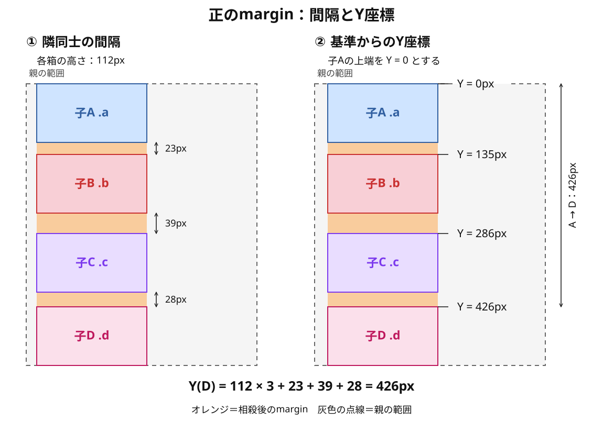

# 正のmarginと、後続に反映されるY座標

正のmarginを「隣との間に余白ができる」と捉えていても、その間隔は後続の配置に反映されています。**ある箱のY座標には、それまでに並んだ箱の高さと、相殺などを考慮した有効な間隔が反映されています。**

負のmarginも、この配置計算に関わります。ここでは正のmarginを例に、「隣同士の間隔」と「基準からの位置」を分け、前の記事で使ったベクトル表現を捉え直します。

## 負のmarginで「蓄積する」と表したもの

[負のmarginの基本](./07_負のmarginの基本.md)の通常フローの例では、負のmargin-bottomを指定しても、指定した箱自身の上端は変わらず、後続の兄弟要素とその子孫の位置が上へ詰まります。

同じ箱に負の上marginと下marginがある場合、上marginによる位置の変化に、下marginによる後続への変化が重なります。高さを持つ箱で、その箱自身の上下marginが相殺せず、隣接するほかのmarginが0である例では、後続には両方の変化が反映されます。

ここでの「蓄積」は、後ろの兄弟へ進むたびに同じ変化量が追加される意味ではありません。すでに生じた配置の変化を、後続も引き継ぐという意味です。

## 正のmarginも、後続の座標に反映される

次の例は、上から順に並ぶ通常フローのブロックです。各箱の高さを112pxとし、padding・border・float・clear・位置指定は加えません。各箱には高さがあるため、自身の上marginと下marginは互いに相殺せず、隣り合う兄弟間の上下marginが相殺します。最初の子Aの上端を、座標を測る基準のY = 0とします。

```text
親 div
├─ 子A .a
├─ 子B .b
├─ 子C .c
└─ 子D .d
```

```html
<div>
  <div class="a">A</div>
  <div class="b">B</div>
  <div class="c">C</div>
  <div class="d">D</div>
</div>
```

```css
.a, .b, .c, .d {
  height: 112px;
  margin: 0;
}

.a { margin-bottom: 23px; }
.b { margin-top: 15px; margin-bottom: 39px; }
.c { margin-top: 21px; margin-bottom: 28px; }
.d { margin-top: 16px; }
```

### 先に、隣同士の有効な間隔を求める

相殺する正の上下marginは、二つの指定値を単純に足しません。大きい方が、二つの箱の間隔になります。[CSS仕様のマージン相殺](https://www.w3.org/TR/CSS2/box.html#collapsing-margins)

| 間 | 前の箱の下margin | 次の箱の上margin | 相殺後の間隔 |
| --- | --- | --- | --- |
| AとB | 23px | 15px | 23px |
| BとC | 39px | 21px | 39px |
| CとD | 28px | 16px | 28px |

### その間隔が、後続の位置に反映される

この例の配置は、次の計算で追えます。

```text
次の箱の上端Y = 前の箱の上端Y + 前の箱の高さH + 有効な間隔M
```

ここでHは箱の上端から下端までの高さ、Mは相殺の条件を考慮した後の間隔です。すべてのmarginの指定値を、生のまま足す式ではありません。

| 箱 | 上端のY座標 |
| --- | --- |
| A | 0px |
| B | 0 + 112 + 23 = 135px |
| C | 135 + 112 + 39 = 286px |
| D | 286 + 112 + 28 = 426px |



図のオレンジは相殺後のmarginの範囲を示す説明用の色で、実際の背景色ではありません。箱の色付き外枠と親の灰色点線も補助表示で、実際のCSSのborderではありません。黒い両矢印は実際の間隔・基準からの距離を測っています。縦の寸法は指定値に対応させ、横幅は模式的に示しています。

子Dだけを見れば、「子Cとの間隔は28px」です。しかし子Aを基準にした子DのY座標には、A・B・Cの高さに加えて、A-B・B-C・C-Dの間隔がすべて反映されています。

```text
Y(D) = 112 × 3 + (23 + 39 + 28)
     = 336 + 90
     = 426px
```

**隣同士の余白を決めることと、それまでの配置が後続の座標へ反映されることは、同じ配置の異なる見方です。** 通常のブロック配置では、箱が上から順に並び、兄弟間の距離にmarginが関わります。[CSS仕様の通常フロー](https://www.w3.org/TR/CSS2/visuren.html#block-formatting)

## 負のmarginだけが特別な「力」を持つわけではない

有効な間隔が正なら、次の箱の位置を下へ離す方向に作用します。負なら、上へ詰める方向に作用します。この違いを、正は「斥力」、負は「引力」と呼ぶのは、配置を追うための比喩です。要素同士に物理的な力が働いているわけではありません。

この例の画面座標では、下へ進むほどYの値が大きくなります。正のmarginは、後続のYを増やす側に関わり、負のmarginは減らす側に関わります。ただし、実際に使う間隔は相殺条件を確認してから求めます。

正のmarginでも、前の箱の高さと間隔を引き継いで次の箱が配置されています。負のmarginをベクトルで表したのは、**指定した側と、動く箱と、後続が引き継ぐ変化を意識しやすくするため**です。これは配置結果を理解するモデルで、ブラウザが力や移動ベクトルを順に加えて処理するという説明ではありません。

## 「余白」として理解してきたときの違和感を整理する

正のmarginを「隣同士の空間」として扱っていると、それまでの高さや間隔が後続のY座標へ反映されていることを、毎回意識する必要はありません。

その理解のまま負のmarginへ進むと、空間が減ることに加えて、本人や後続の位置が変わること、上下の指定が別の範囲へ影響することを同時に追うため、違和感が生じる可能性があります。そこで、引力・斥力やベクトルという見方を使い、今まで意識していなかった位置のつながりを可視化します。

重力の感覚や、文章を上から読む習慣が、この捉え方に関係するのではないかという考えは、**学習上の仮説**です。人一般の認知特性として確認した説明ではなく、CSS教材で正のmarginをベクトル表示しない理由を確定するものでもありません。

この説明では、正のmarginはまず「余白」で理解し、位置のつながりを捉え直したいときに座標のモデルを使います。すべてを下向きのベクトルで表すと、隣同士の相殺と後続への影響を同時に追う必要があり、説明を複雑にする可能性があるためです。

モデルが役に立つかは、その見方で「誰のどのmarginを変えると、誰の位置がどう変わるか」を説明し、実装や修正に使えるかで確かめます。

## このページのまとめ

- 正のmarginも、相殺後の間隔として後続のY座標に反映される。
- 後続の座標を追うときは、それまでの箱の高さと有効な間隔を区別して積み上げる。
- 生のmargin指定値をすべて足すことと、相殺後の間隔が配置へ反映されることは別。
- 引力・斥力・ベクトルは、配置結果のつながりを理解するための認知モデル。人の認識についての理由は仮説として扱う。
