# ⑧ 負のmarginを含むマージン相殺

前回は、負のmarginによって要素や後続の兄弟要素が上に移動する仕組みを説明しました。

今回は、正のmarginと負のmarginが相殺すると、間隔がどう計算されるかです。

### 1. 兄弟要素で考える

```xml
<div class="parent">
  <div class="child-a">子A</div>
  <div class="child-b">子B</div>
</div>
```

```css
.child-a {
  margin-bottom: 40px;
}

.child-b {
  margin-top: -10px;
}
```

子Aの下に40pxのmarginがあり、子Bの上に-10pxのmarginがあります。

### 2. 相殺するとどうなる？

通常のブロック配置で、相殺条件を満たす場合です。

図は計算の模式図です。オレンジ色はmarginの説明用の色で、実際のmarginには背景色は付きません。



計算は、

$$
40+(-10)=\boxed{30\text{px}}
$$

です。

子Aと子Bの実際の間隔は 30px になります。

### 3. 正のmargin同士との違い

| 子Aの下margin | 子Bの上margin | 相殺結果 |
| --- | --- | --- |
| 40px | 30px | 40px |
| 40px | -10px | 30px |
| 40px | -50px | -10px |

正の値同士では大きい方が残りますが、正と負が混在すると、最大の正の値と最小の負の値を足します。

### 4. 今回覚えること

負のmarginが含まれていても、マージン相殺は起こります。

- 正＋正 → 大きい方
- 正＋負 → 足し合わせる
- 負＋負 → より小さい（絶対値が大きい）方

ただし、これは相殺する条件を満たすmargin同士の計算です。
