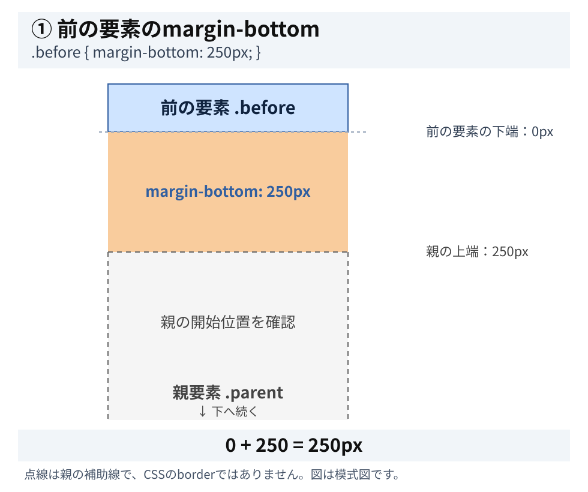
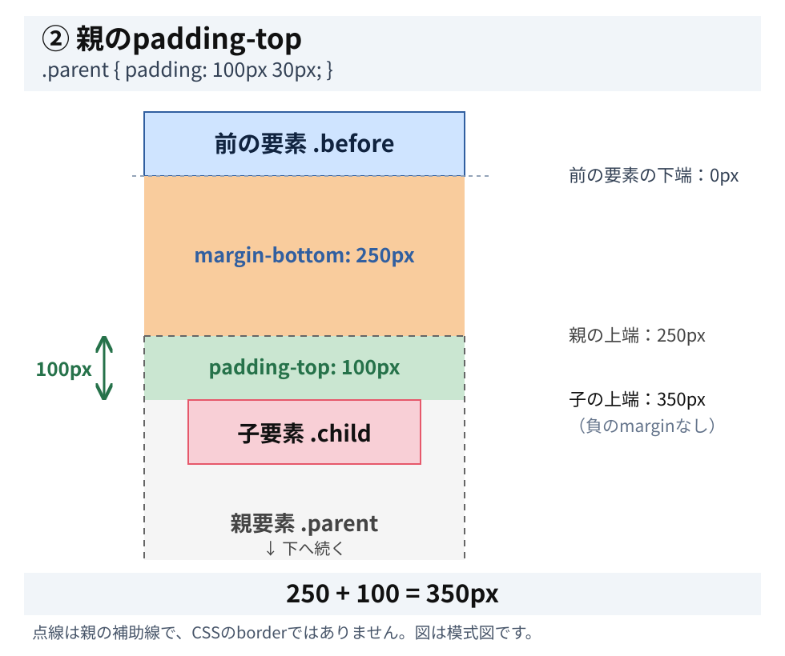

# paddingと負のmarginによる位置調整

ここまでの内容を使って、CSSによる配置を確認します。

今回は、マージン相殺ではなく、paddingと負のmarginによる位置調整です。

### 1. 一般例のCSS

```css
.before {
  margin-bottom: 250px;
}

.parent {
  padding: 100px 30px;
}

.child {
  width: 400px;
  margin: -150px auto 60px;
}
```

HTMLの関係は次のとおりです。

```text
main
├── .before
└── .parent
    ├── .child
    └── .heading
```

### 2. まず各値の役割を分ける

| CSS | 役割 |
| --- | --- |
| `.before` の `margin-bottom: 250px` | 前の要素の下に250pxの余白 |
| `.parent` の `padding-top: 100px` | 親の内側に100pxの余白 |
| `.child` の `margin-top: -150px` | 子を通常位置より150px上へ |
| `.child` の `margin-bottom: 60px` | 後続の見出しとの間隔を調整 |

### 3. 子はどこに配置される？

まず、前の要素の下端を基準の `0px` とします。

この例は、通常フローのブロック配置で、`.child` が `.parent` の最初の子であり、ほかのmarginやborder、位置指定が影響しない前提です。図の点線は親の範囲を示す補助線で、実際のCSSのborderではありません。

#### ① 前の要素のmargin-bottom

$$
0+250=250\text{px}
$$

親要素は、前の要素の下端から250px離れた位置に始まります。



#### ② 親のpadding-top

$$
250+100=350\text{px}
$$

負のmarginがなければ、子は前の要素の下端から350px下に配置されます。



#### ③ 子のmargin-top: -150px

$$
350-150=\boxed{200\text{px}}
$$

最終的に、子の上端は前の要素の下端より200px下になります。



### 4. なぜマージン相殺しない？

ポイントはここです。

```css
.parent {
  padding-top: 100px;
}

.child {
  margin-top: -150px;
}
```

親の `padding-top` が親子の上marginを隔てるため、親子間のマージン相殺は起こりません。

そのため、`padding-top: 100px` と `margin-top: -150px` がそれぞれ配置に作用します。

$$
100-150=-50\text{px}
$$

つまり、子は `.parent` の上端より50px上にはみ出します。

### 5. 今回覚えること

- `margin-bottom: 250px` は前の要素の下側の余白。
- `padding-top: 100px` は親要素の内側の余白。
- `margin-top: -150px` は子を上に配置するための負のmargin。
- 親にpaddingがあるため、子の上marginは親の上marginと相殺しない。

結論：250 + 100 − 150 = 200px。

この例は、負のmarginを使って要素を親の領域からはみ出させながら、前の要素との距離も調整する実装です。
