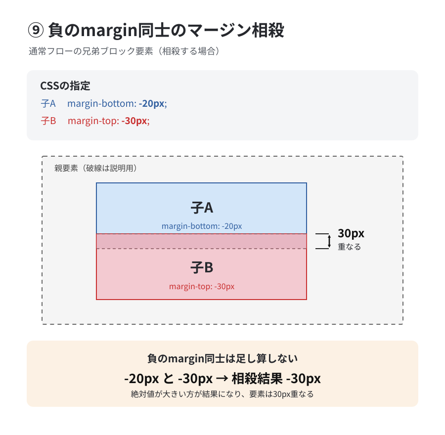

# ⑩ 負のmargin同士のマージン相殺

前回は、正のmarginと負のmarginが相殺する場合でした。

今回は、両方のmarginが負の値だった場合です。

### 1. HTMLとCSS

```xml
<div class="parent">
  <div class="child-a">子A</div>
  <div class="child-b">子B</div>
</div>
```

```css
.child-a {
  margin-bottom: -20px;
}

.child-b {
  margin-top: -30px;
}
```

子Aの下marginが `-20px`、子Bの上marginが `-30px` です。

### 2. 実際の配置

子Bは子Aの下端より30px上に配置されます。図は通常フローのブロック同士が相殺する場合です。



単純に足すと、

$$
-20+(-30)=-50\text{px}
$$

ですが、負のmargin同士が相殺すると、**より小さい値（絶対値が大きい方）**が結果になります。

$$
\boxed{-30\text{px}}
$$

つまり、子Aと子Bは30px重なります。

### 3. 計算の比較

| 子Aのmargin-bottom | 子Bのmargin-top | 相殺結果 |
| --- | --- | --- |
| -20px | -30px | -30px |
| -20px | -50px | -50px |
| -40px | -10px | -40px |
| -20px | -20px | -20px |

### 4. ここまでの計算をまとめる

| 組み合わせ | 計算方法 | 例 |
| --- | --- | --- |
| 正 ＋ 正 | 大きい方 | 40と30 → 40px |
| 正 ＋ 負 | 最大の正＋最小の負 | 40と-10 → 30px |
| 負 ＋ 負 | より小さい方 | -20と-30 → -30px |

この3種類がマージン相殺の基本的な計算方法です。

ただし、どれもマージン相殺が起こる条件を満たしている場合に限ります。
