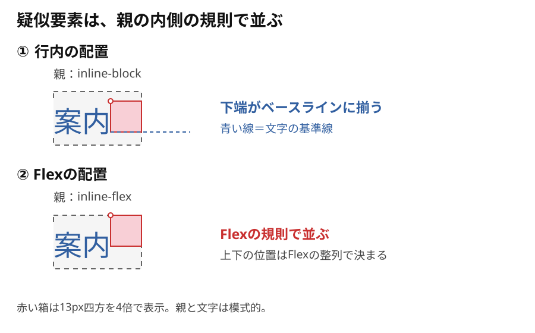

# 疑似要素は行内とFlexでどう並ぶか

**行内では文字の続きとして、FlexではFlexアイテムとして並びます。**

`::after`は、付けた要素の内容の最後に生成される疑似要素です。ここでは`span`を親と呼び、赤い四角を付けて見ます。

```html
<span class="parent">案内</span>
```

```css
.parent::after {
  content: "";
  display: inline-block;
  width: 13px;
  height: 13px;
  background: #f8cfd6;
}
```

## 行内：箱の下端がベースラインに揃う

親が`inline`・`inline-block`・`block`なら、この空の四角は文字の後ろに並びます。初期値の`vertical-align: baseline`では、下端が文字の基準線（ベースライン）に揃います。

親が`block`でも、中の文字や四角までブロックとして並ぶわけではありません。



図は一行の横書きで、空の疑似要素にmargin・padding・borderがない例です。灰色の点線は親の範囲、青い点線はベースラインです。点線は説明用で、CSSのborderではありません。赤い箱は13px四方を4倍で描き、親と文字は模式的に示しています。

## Flex：親の配置規則で並ぶ

同じ例で親を`inline-flex`または`flex`にすると、四角もFlexアイテムになります。初期状態の横並びでは文字の後ろに来ますが、上下の位置はFlexの整列で決まります。

具体的な使い分けは[inline-blockとinline-flex](../../../02_基礎/01_HTML・CSS/08_インラインと行の仕組み/03_inline-blockとinline-flexを使い分ける.md)、通常の並びから外す場合は[absoluteの配置](./04_absoluteにすると疑似要素の配置はどう変わるか.md)で確認できます。

## このページのまとめ

- `::after`は親の内容の最後に生成される。
- 行内の空の四角は、この例では下端がベースラインに揃う。
- 親がFlexなら、四角もFlexの規則で並ぶ。
