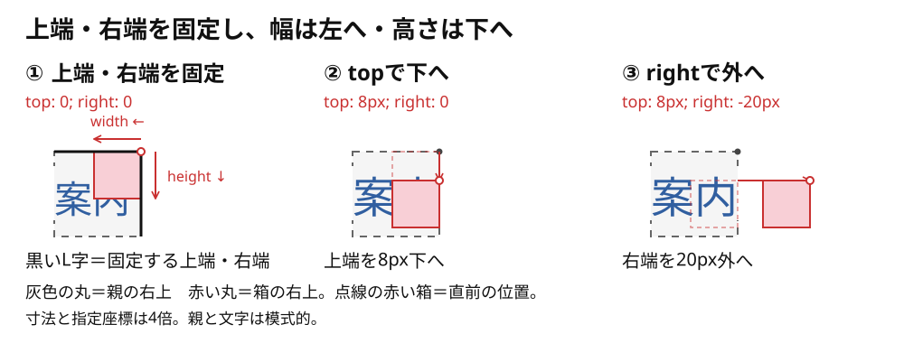

# absoluteにすると疑似要素の配置はどう変わるか

**`absolute`にすると通常の並びから外れ、文字の横に場所を取らなくなります。** この例では、親の右上を基準に`top`・`right`で位置を決めます。

赤い四角は[前の記事](./03_疑似要素は行内とFlexでどう並ぶか.md)と同じものです。親は`inline-block`にして、基準領域を作る`position: relative`を指定します。

疑似要素も、**幅と高さのある箱を通常の並びから外し、指定した端を合わせて置く**と考えると追いやすくなります。`::after`が親の内容の最後に生成されることと、箱のどの端を合わせるかは別です。

```css
.parent {
  display: inline-block;
  position: relative;
}

.parent::after {
  content: "";
  position: absolute;
  top: 8px;
  right: -20px;
  width: 13px;
  height: 13px;
  background: #f8cfd6;
}
```

## 右上の基準位置から、順にずらす

この例は`left`・`bottom`を指定していないので、**`top`で箱の上端の位置、`right`で箱の右端の位置を固定します。** 箱の右上を支点として見ると、`width`の分だけ左へ、`height`の分だけ下へ領域ができます。ここでいう支点は、位置を合わせる基準という意味です。

**`top`・`right`の値を保つ限り、幅や高さを変えても上端・右端の位置は変わりません。** `width`を増やすと左へ、`height`を増やすと下へ広がります。余白を追加しているのではなく、指定した大きさの箱をその二辺に合わせた結果です。[CSS仕様の絶対配置の幅](https://www.w3.org/TR/CSS2/visudet.html#abs-non-replaced-width)

1. **基準位置**：比較の出発点として`top: 0; right: 0`を指定し、親の右上に合わせる。
2. **topで下へ**：`top: 8px`に変え、箱の上端を8px下へ置く。
3. **rightで外へ**：`right: -20px`に変え、箱の右端を親の右端より20px外へ置く。



灰色の丸は親の右上、赤い丸は箱の右上です。①の黒いL字は固定する上端・右端を示す説明用の補助線で、CSSのborderではありません。赤い左向き・下向きの矢印は、幅と高さの領域を示しています。②・③の赤い点線の箱は直前の位置で、矢印は位置の変化を示します。動きで確認する場合は[比較図の下段](../../../img/html-css/02_08_afterのinline-blockとabsoluteの配置基準.svg)を見ます。

図は一行の横書きで、親と疑似要素にmargin・padding・borderがない例です。灰色の点線は説明用の親の範囲です。四角の寸法と指定座標は4倍、親と文字は模式的に示しています。

## 座標を省略した場合は別

指定しなかった辺の初期値は`auto`です。`auto`は`0`ではなく、座標未指定時は静的位置（static position）という仕組みが関係します。常に親の左上になるとは限りません。[Flexで中央に見える条件](../../../03_詳細/01_HTML・CSS/07_absoluteの子がFlexで中央に見える条件を調べる.md)は詳細で確認できます。

## このページのまとめ

- `absolute`は通常の並びから外れる指定。
- この例の`top`は上端、`right`は右端からの位置を決める。
- `top`・`right`の値を保つと上端・右端が固定され、幅の分だけ左へ、高さの分だけ下へ広がる。
- 座標の`auto`と、基準位置として指定した`0`は別。
