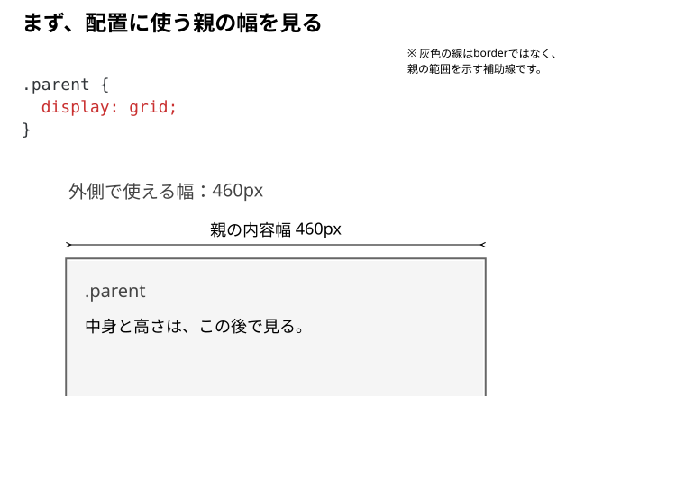
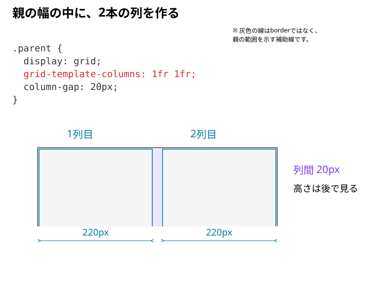
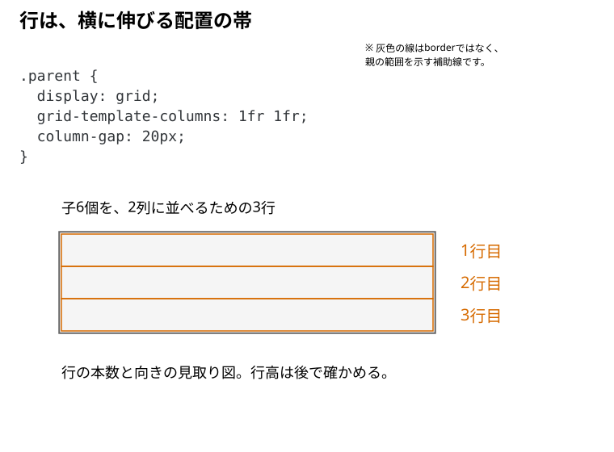
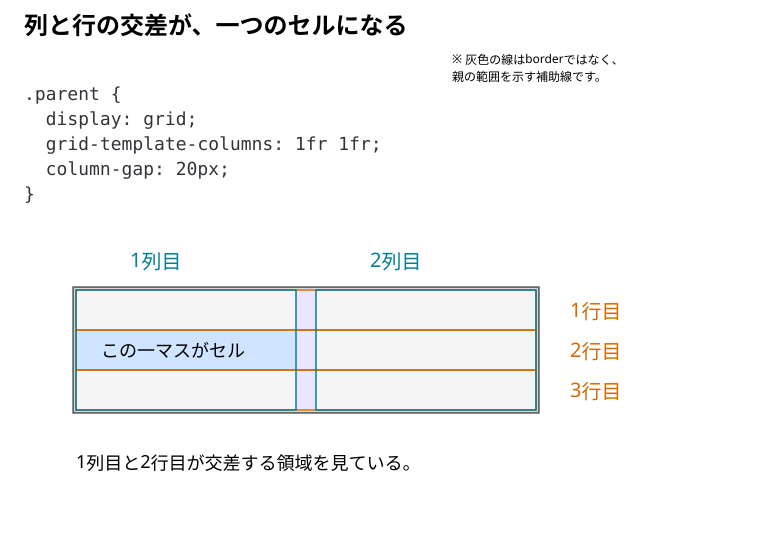
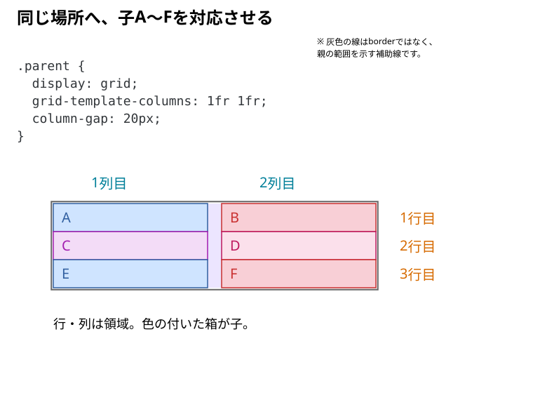
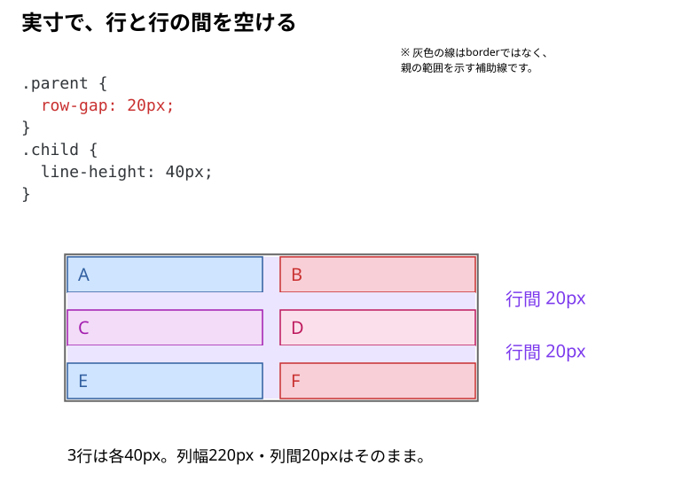
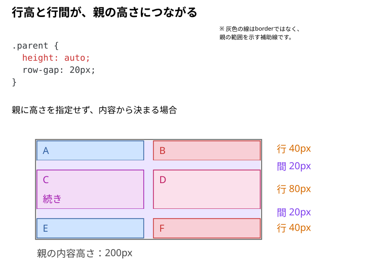

# Gridの親・行・列・中身はどうつながる？

Gridを理解するときは、**親の幅を見て、その中の列・行を捉え、そこへ子要素を置く**順に考えると追いやすい。

ここでは同じ親と子A〜Fを使い、図ごとに見る関係を一つずつ増やす。行・列は配置する領域、子要素はそこへ入る箱。その区別から、内容と親の高さがどうつながるかまで見ていく。

## まず親の幅を見る

次のHTMLで、`.parent`は6個の子を直接包む親になる。`.outer`は、その外側の箱。

```html
<div class="outer">
  <div class="parent">
    <div class="child">A</div>
    <div class="child">B</div>
    <div class="child">C</div>
    <div class="child">D</div>
    <div class="child">E</div>
    <div class="child">F</div>
  </div>
</div>
```

この親を、内容幅460pxの外側の箱に置く。横書きの通常フローで、親の幅・高さは初期値の`auto`。親にはmargin・padding・borderや最小・最大サイズの指定を加えない。

```css
.outer {
  width: 460px;
}

.parent {
  display: grid;
}
```

この条件では、親の内容幅は外側で使える幅に広がり、460pxになる。**Gridの中をどう分けるかを考える前に、配置に使う親の幅を押さえる。**



このような通常フローのブロックレベルGridでは、外側の幅の決まり方と、中で子をGrid配置する仕組みを分けて考える。`auto`は特定の数値ではなく、その状況に応じたサイズの決め方を表す。

## 列は縦に伸びる配置の帯

同じ親に、次の指定を加える。

```css
.parent {
  display: grid;
  grid-template-columns: 1fr 1fr;
  column-gap: 20px;
}
```

ここで見たいのは、2列を作ること。`1fr 1fr`は、同じ重みで幅を分ける2列の指定。今回は短い文字だけを入れるので、列間を除いた残りの幅を等分できる。`fr`による配分の違いは[基礎の列幅の記事](../../../02_基礎/01_HTML・CSS/09_レイアウト/04_Grid/03_frで列幅はどう決まる.md)で確認できる。

親の幅460pxの中に、列と列間20pxが入る。残りを等分するため、各列の幅は220pxになる。



**列は子の箱ではなく、縦に伸びる配置の帯。** 同じ列に入る子は、上下に離れていても同じ列幅を使う。

## 行は横に伸びる配置の帯

次に、子A〜Fを2列に並べるところを考える。今回は位置を個別に指定せず、通常の自動配置で左から右、次の行へと並べる。

1行に2個ずつ入るので、6個を配置するには3行が必要になる。行をあらかじめ指定していなくても、必要な行が自動で追加される。

**行は横に伸びる配置の帯。** 1行目にはA・B、2行目にはC・D、3行目にはE・Fが入る。



この段階の帯の高さは見取り図。ここでは行の意味と必要な本数を見ており、実際の行高は後で中身と対応させる。

## 列と行の交差が、子を置く場所になる

列と行を重ねると、一つずつ交差する領域ができる。この一マスを**グリッドセル**と呼ぶ。



列・行を一つずつ取り出した帯状の領域は、**トラック**と呼ぶ。「列トラック」「行トラック」と言うときのトラックは、この帯のこと。

## その場所へ子要素を入れる

先ほどのセルへ、同じ子A〜Fを対応させる。



この例では一つの子が一つのセルを使う。複数のセルにまたがせる場合もあるので、**セルと子は同じものではない**。

行・列の枠は位置とサイズを考えるための領域で、実際の枠線が自動で表示されるわけではない。図の色と線は、その関係を見るための補助表示。

また、ここまでの図は関係を理解するために分けて示している。空のGridに完成した行高が先に用意され、後からHTMLが入るというブラウザの動作を表したものではない。**内容に合わせる行では、子の中身もサイズの計算に関わる。**

## 中身が増えると、同じ行の高さに関わる

ここからは実際の寸法を対応させる。子の文字の行高を40px、行間を20pxにする。背景色は子の箱を見分ける補助指定。

```css
.parent {
  display: grid;
  grid-template-columns: 1fr 1fr;
  column-gap: 20px;
  row-gap: 20px;
}

.child {
  line-height: 40px;
  background: #cfe4ff;
}
```

最初はA〜Fがすべて1行の文字なので、各行トラックは40px。3行の間に20pxずつの行間を取る。



次にCの中身だけを2行へ変えてみる。

```html
<div class="child">C<br>続き</div>
```

Cには80pxの高さが必要になり、CとDが使う**2行目のトラック全体**が80pxになる。列数・列幅・ほかの子の文章は変えていない。



この例のDは高さを指定しておらず、既定の伸張が働いて同じ行の高さへ広がる。Dの文字が増えたわけではない。**行が確保する高さと、その中の文字に必要な高さを区別する。**

行高は「いつでも中身ぴったり」ではない。親の高さや行の固定高などを指定した場合の違いは、[行の高さはどう決まる](../../../02_基礎/01_HTML・CSS/09_レイアウト/04_Grid/07_行の高さはどう決まる.md)で比べられる。

## 行高と行間から、親の高さへつなぐ

同じ例のまま、親全体を見る。親の高さは`auto`で、外側からも高さを固定されていない。

行高は上から40px・80px・40px。3行の間には、20pxの行間が2か所ある。



この例では、行高と行間を合わせた200pxが親の内容高さになる。**横は親の幅を使って列を分け、縦は中身に必要な行高と行間から親の高さへつながる。**

ここで行間を割合へ変えると、「その割合を計算するための高さはどこから来るのか」という次の疑問が生まれる。同じ例で確かめる場合は、[Gridで割合gapの基準はどう決まる](../../../03_詳細/01_HTML・CSS/09_レイアウト/Grid/14_Gridで割合gapの基準はどう決まる.md)へ進む。

## このページのまとめ

- 親の幅を押さえ、その中の列・行と、そこへ入る子を分けて見る。
- 列は縦に伸びる帯、行は横に伸びる帯。交差する一マスがセルになる。
- 内容に合わせる行では、子の中身も行高の計算に関わる。
- 今回のように親の高さが内容から決まり、行間が固定値なら、行高と行間が親の内容高さに含まれる。

## 仕様・確認先

- [CSS Grid：Gridの構造](https://www.w3.org/TR/css-grid-1/#grid-model)
- [CSS Grid：Gridコンテナのサイズ](https://www.w3.org/TR/css-grid-1/#intrinsic-sizes)
- [CSS Grid：Gridのサイズ計算](https://www.w3.org/TR/css-grid-1/#algo-overview)
