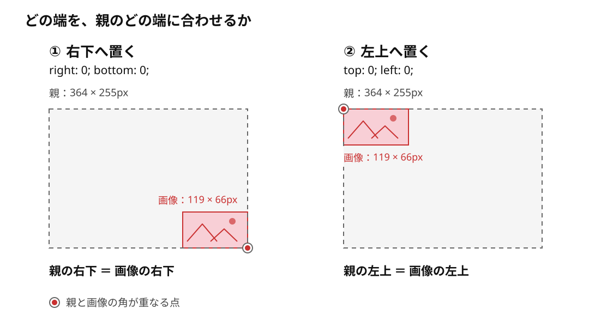

# absoluteで画像のどの端を親に合わせるか

**`right: 0; bottom: 0;`で画像を配置すると、画像の右端が親の右端に、画像の下端が親の下端に合います。つまり、親と画像の右下の角が重なります。**

ここでは、すでに表示サイズが決まっている画像を置き、「画像のどの端を、親のどの端へ合わせるか」を確認します。

## まず、同じ画像を右下へ置く

この例では、親を`position: relative`で配置の基準にし、その直接の子である画像に`position: absolute`を指定します。親と画像にはmargin・padding・borderがなく、画像の表示サイズは119px × 66pxで固定します。

```text
parent：画像の配置基準になる親
└─ image：大きさが決まっている画像
```

```html
<div class="parent">
  
</div>
```

`image.jpg`は手元にある画像のファイル名に置き換えます。この例は配置だけを確認するため、画像を装飾として扱い、`alt`を空にしています。

```css
.parent {
  position: relative;
  width: 364px;
  height: 255px;
  background: #f5f5f5;
}

.image {
  position: absolute;
  right: 0;
  bottom: 0;
}
```

`position: absolute`は画像を通常の並びから外します。ここでは親に幅・高さを指定して配置する範囲を作り、画像は親の高さを作りません。

- `right: 0`：親の右端と画像の右端の間隔を0にする。
- `bottom: 0`：親の下端と画像の下端の間隔を0にする。

画像の左上を親の右下へ置くのではなく、**画像自身の右下を、親の右下へ合わせます。** そのため、この大きさの画像は親の内側に収まります。ここでの`0`は、端どうしを重ねるための指定値です。



灰色の点線は親の範囲を示す説明用の補助線で、CSSのborderではありません。赤い箱は画像要素の表示範囲、丸印は親と画像の角が重なる点です。画像内の絵は模式的に示しています。両方の図で、親と画像の大きさは同じです。

## 左上に置くなら、合わせる端を変える

比較図の②では、`.image`の`right`・`bottom`の2行を取り除き、次の2行へ置き換えます。親と画像の大きさは変えません。

```css
.image {
  position: absolute;
  top: 0;
  left: 0;
}
```

`top: 0`で上端、`left: 0`で左端が合い、**親と画像の左上の角が重なります。** `right`・`bottom`を残して四辺を同時に指定する比較にはしません。

| 指定する組み合わせ | 親と画像で重なる角 |
| --- | --- |
| `right: 0; bottom: 0;` | 右下 |
| `top: 0; left: 0;` | 左上 |

## 配置を追う段階と、領域の広がりを追う段階

初期の学習では、すでに大きさのある画像を配置するために`absolute`や`top`などを使い、主に「どこへ置くか」を意識します。この例のように画像の表示サイズを変えないなら、面積を作る方向まで同時に考えず、どの端をどこへ合わせるかに集中できます。

この理解から入ると、`top`・`left`・`right`・`bottom`を配置だけの基準として捉えやすくなります。その後、疑似要素で四角などを作る段階では、**位置合わせと、`width`・`height`による領域の広がりを分けて考えたい**、という学習上の意識につながります。

たとえば、上端と右端を合わせたまま幅を増やすと左へ、高さを増やすと下へ広がります。これは[absoluteにすると疑似要素の配置はどう変わるか](../08_インラインと行の仕組み/04_absoluteにすると疑似要素の配置はどう変わるか.md)で図とともに確認できます。画像でも表示サイズを変える場合は、同じ視点が必要です。

この説明の前提となる、絶対配置の基準と端からの距離は[CSSの位置指定の仕様](https://www.w3.org/TR/css-position-3/#insets)で確認できます。画像上に文字や部品を重ねる実装へ進むときは、[画像の上に文字や部品を重ねる](../../../02_基礎/01_HTML・CSS/11_メディアの表示枠と重ね配置/05_画像の上に文字や部品を重ねる.md)へつなぎます。

## このページのまとめ

- この例では、`right: 0; bottom: 0;`で親と画像の右下が重なる。
- `top: 0; left: 0;`へ置き換えると、親と画像の左上が重なる。
- 大きさが決まっている画像では、まず端の位置合わせに集中できる。
- 幅・高さも変える段階では、位置合わせと領域の広がりを分けて考える。
