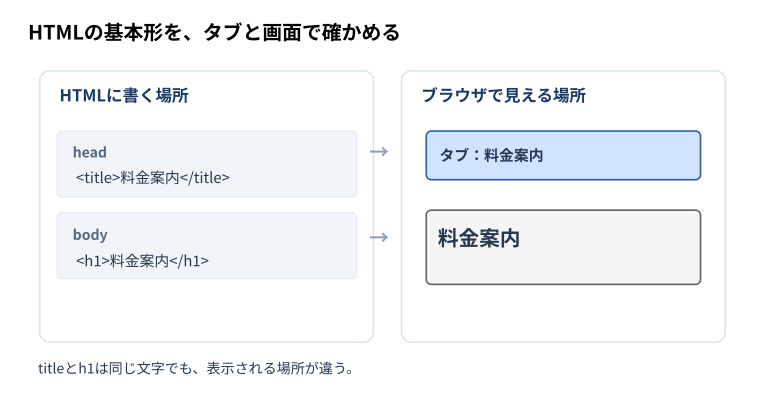

# 01_最小のHTML文書を作る

新しくページを作るとき、**まず何を`index.html`へ書けば、ブラウザで一つのページとして開けるのでしょうか。** 最初はCSSやJavaScriptを用意せず、HTMLファイル一枚で確認します。

## 最小の基本形

次の内容を`index.html`として保存して、ブラウザで開きます。

```html
<!DOCTYPE html>
<html lang="ja">
  <head>
    <meta charset="utf-8">
    <meta name="viewport" content="width=device-width, initial-scale=1">
    <title>ページタイトル</title>
  </head>
  <body>
    <h1>ページの主見出し</h1>
  </body>
</html>
```

この例は、別のファイルがなくても開けます。ブラウザの**タブ**には「ページタイトル」、画面の中には「ページの主見出し」が現れます。

まず`title`を「料金案内」に変更して、保存・再読み込みします。次に`h1`も「料金案内」に変えます。**同じ文字でも、変えた場所によって画面に反映される位置が違う**ことを確かめます。



## この形を、大きく四つに分けて読む

- `<!DOCTYPE html>`：文書の先頭に置く宣言。
- `<html>`：HTML文書全体。
- `<head>`：文書の情報や、外部ファイルの読み込みを書く場所。
- `<body>`：見出しや文章など、ページで表示する内容を書く場所。

最初から各行の仕様を全部覚える必要はありません。先頭の宣言は[DOCTYPEの役割](./02_DOCTYPEの役割を理解する.md)、`html`・`head`・`body`の違いは[三つの要素の役割](./03_html・head・bodyの役割を分ける.md)で確認できます。

`meta charset="utf-8"`は文字の解釈に、`viewport`はモバイル画面での表示の基準に関わります。このページでは、必要な基本形としてそのまま置いておきます。

## CSSやJavaScriptを使うときに追加する

HTMLだけの表示を確認できたら、必要に応じて外部ファイルを作ります。CSSファイルを`css/style.css`として作ったなら、`head`へ次を追加できます。

```html
<link rel="stylesheet" href="css/style.css">
```

JavaScriptファイルを`js/menu.js`として作ったなら、次を追加できます。

```html
<script src="js/menu.js" defer></script>
```

それぞれ、**実際に作ったファイルの場所**と`href`・`src`を合わせます。まだ作っていないファイルの参照を、見本だからという理由だけで残す必要はありません。詳しくは[CSSの読み込み](./08_CSSを読み込む.md)と[JavaScriptの読み込み](./09_JavaScriptを読み込む.md)で確認できます。

## ブラウザで確かめる

1. `index.html`が開け、画面に見出しが表示される。
2. `title`を変えると、タブの名前が変わる。
3. `h1`を変えると、画面の見出しが変わる。
4. CSSやJavaScriptを追加した場合は、そのファイルが実際に読み込まれるか確認する。

表示が変わらないときは、保存したファイルを開いているか、再読み込みしたか、外部ファイルを追加した場合はパスが正しいかを確かめます。

## このページのまとめ

**最初は一枚の`index.html`を開ける状態にすること。** `title`と`h1`の変更結果を別々に確認し、CSSとJavaScriptはファイルを用意してから追加すれば十分です。
