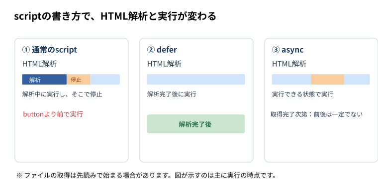

# 10_scriptの読み込みと実行タイミングを知る

JavaScriptのファイルのパスは合っているのに、**画面にあるはずのボタンをJavaScriptが見つけられない**ことがあります。原因の一つは、その処理が動いた時点で、HTMLのボタンがまだ解析されていなかったことです。

ここでは`src`を使う**外部のclassic script**を例に、通常の`script`、`defer`、`async`を比べます。ファイルを**取得すること**と、その中のコードを**実行すること**は別です。

## 同じHTML・同じJavaScriptで結果を比べる

例えば次のHTMLを`index.html`として用意します。

```html
<!DOCTYPE html>
<html lang="ja">
  <head>
    <meta charset="utf-8">
    <title>scriptの確認</title>
    <script src="js/main.js"></script>
  </head>
  <body>
    <button id="target" type="button">開く</button>
  </body>
</html>
```

`js/main.js`には、確認するため次の一行を書きます。

```js
console.log(document.querySelector("#target"));
```

このJavaScriptは、`id="target"`の要素を探してConsoleへ表示します。通常の`script`を`head`に置くと、ブラウザはHTMLの解析中にそのスクリプトを実行するため、後ろにある`body`のボタンをまだ解析しておらず、結果が`null`になることがあります。この例では、ほかのスクリプトがDOMを作り足さない限り、ボタンはまだありません。

## 通常の`script`は、解析の途中で実行する

```html
<script src="js/main.js"></script>
```

このような通常の外部classic scriptをHTMLパーサーが処理すると、**そのスクリプトの実行が終わるまで、後ろのHTMLの解析を待ちます**。

ファイルの取得は、ブラウザの先読みによってパーサーがその位置へ到達するより前から始まることがあります。したがって「解析を止める」のは実行を待つ場所の話で、**取得が必ずその時点から始まる**という意味ではありません。

## `defer`なら、HTML解析後に実行する

今度は同じ`script`に`defer`だけを追加します。

```html
<script src="js/main.js" defer></script>
```

ファイルをHTMLの解析と並行して取得し、**文書の解析が完了してから**実行します。上の例では、ボタンがDOMに作られた後に`querySelector`が動くため、Consoleへボタン要素が表示されます。



`defer`を複数指定した外部classic scriptは、HTML上の記述順で実行されます。

```html
<script src="js/a.js" defer></script>
<script src="js/b.js" defer></script>
```

この場合は`a.js`の後に`b.js`を実行します。`DOMContentLoaded`はこれらのdeferred scriptの実行後に発火します。

このWikiで、`head`から外部JavaScriptを読み込むときの基本候補として`defer`を使いやすいのは、**DOMの準備が終わった状態で処理を始められる**ためです。

## `async`は、ファイルが実行できる状態になったときに動く

```html
<script src="js/main.js" async></script>
```

`async`も解析と並行して取得できますが、**HTMLの解析完了を待つわけではありません**。スクリプトを実行できる状態になり次第実行するため、解析の途中ならそこでHTMLの解析が一時止まり、すでに解析が終わっていればその後に実行されます。

したがって、先ほどのボタンが見つかるかどうかは、取得や実行のタイミング次第です。**必ず存在する要素を探す処理に`async`を選ぶのは、この最小例では適していません。**

`async`を複数指定しても、`a.js`・`b.js`の記述順で実行される保証はありません。取得や実行の準備ができた順序に左右されるので、スクリプト同士が互いの結果に依存しない場合に向きます。

## `body`の末尾に通常の`script`を置く場合

```html
<body>
  <button id="target" type="button">開く</button>
  <script src="js/main.js"></script>
</body>
```

この場合、ボタンはスクリプトより先にHTMLパーサーによって処理されるため、見つけられます。ファイルの取得自体は先読みで始まる場合がありますが、**実行する位置はそのscript要素の位置**です。

`head`の`defer`と`body`末尾の通常scriptは、どちらも今回のボタンを扱えます。ただし、既存のコードを位置だけで機械的に移し替えず、スクリプト間の依存関係も確認してください。

## 三つの違い

| 書き方 | 解析の扱い | 実行する時点 | 複数の実行順 |
| --- | --- | --- | --- |
| 通常の外部classic script | パーサーが実行まで待つ | 通常、その位置で実行 | HTMLの記述順 |
| `defer` | 解析と取得を並行できる | HTML解析後 | 記述順 |
| `async` | 取得中は解析を続けるが、実行時に止める場合がある | 実行可能になり次第 | 保証なし |

なお、ここでの`defer`は`src`を持つ**外部classic script**が対象です。インラインのclassic scriptには`defer`の効果がありません。`type="module"`では既定の実行方式が異なるため、この比較をそのまま当てはめません。

JavaScriptから要素を選ぶ処理やクリックの登録自体は[DOMとイベント](../../02_JS/02_DOMとイベント.md)で扱います。

## 仕様確認先

- [HTML Standard：The script element](https://html.spec.whatwg.org/multipage/scripting.html#the-script-element)
- [HTML Standard：Speculative HTML parsing](https://html.spec.whatwg.org/multipage/parsing.html#speculative-html-parsing)
