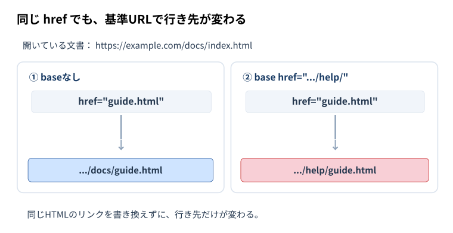

# 11_baseで相対URLの基準を変える

`href="guide.html"`と書いたリンクは、通常、今開いているHTML文書のURLを基準に行き先が決まります。**リンクの文字列を変えずに、行き先を別の場所へ変えることはできるのでしょうか。**

`base`要素を使うと、文書内で相対URLを解決するときの基準を変更できます。ただし、一つのリンクだけでなく、ほかの相対URLにも影響するため、通常の静的サイトでは必要になったときに使う要素です。

## 同じリンクを、まず`base`なしで開く

ブラウザで開いている文書が、次のURLにあるとします。

`https://example.com/docs/index.html`

```html
<a href="guide.html">ガイド</a>
```

`guide.html`はこの文書と同じ`docs/`内を指し、リンク先は次のURLになります。

`https://example.com/docs/guide.html`

## `base`を加えると、どこへ向かうか

同じ文書の`head`に、次の一行を加えます。

```html
<base href="https://example.com/help/">
```

リンクは変更しません。

```html
<a href="guide.html">ガイド</a>
```

すると、リンク先は**`https://example.com/help/guide.html`**になります。`base`に指定した`help/`が、相対URLを解決する基準になったためです。



大事なのは、**今開いている文書は`docs/index.html`のままなのに、リンクだけが`help/guide.html`を指す**という違いです。`base`は文書を移動する指定ではなく、その文書の相対URLの行き先を決める指定です。

## リンク以外の相対URLも変わる

同じ文書の`head`へ次を指定した場合を考えます。

```html
<head>
  <base href="https://example.com/assets/">
  <link rel="stylesheet" href="css/style.css">
</head>
<body>
  
  <script src="js/main.js"></script>
</body>
```

この例では、CSSは`https://example.com/assets/css/style.css`、画像は`https://example.com/assets/img/photo.jpg`、JavaScriptは`https://example.com/assets/js/main.js`を参照します。

`base`は`a`だけの特別な指定ではありません。**文書内で基準URLを利用する相対参照をまとめて変えます。** 一つの画像やCSSだけを別の場所へ向けたいなら、その要素の`href`や`src`を書き換える方が分かりやすいです。

## `#usage`のようなページ内リンクにも影響する

先ほどの`docs/index.html`を開いたまま、`base`を次のように指定したとします。

```html
<head>
  <base href="https://example.com/help/">
</head>
<body>
  <a href="#usage">使い方へ</a>
</body>
```

`#usage`も相対参照なので、行き先は`https://example.com/help/#usage`になります。今開いている`docs/index.html`内にある`id="usage"`へ移動するとは限りません。

**ページ内リンクを多く使っているサイトでは、この影響も確認する必要があります。**

## `base`を書く場所と使う条件

`base`は`head`の中に書きます。`href`を持つ`base`要素を複数置いても、文書の基準URLとして用いられるのは最初のものです。ページ内のリンクごとに基準を切り替える指定ではありません。

```html
<link rel="stylesheet" href="css/style.css">

<script src="js/main.js" defer></script>
```

通常は、このように各要素へ相対パスを指定すれば十分です。文書全体の基準を変更する明確な理由があるときだけ、`base`を検討します。

## このページのまとめ

`base`を指定すると、同じ`guide.html`でも、文書がある場所ではなく`base`のURLを基準に行き先を決められます。その変更はリンクだけでなく画像・CSS・JavaScript・`#usage`にも及ぶので、**文書全体への影響を確かめてから使う**要素です。

## 仕様確認先

- [HTML Standard：The base element](https://html.spec.whatwg.org/multipage/semantics.html#the-base-element)
- [HTML Standard：Document base URLs](https://html.spec.whatwg.org/multipage/urls-and-fetching.html#document-base-urls)
