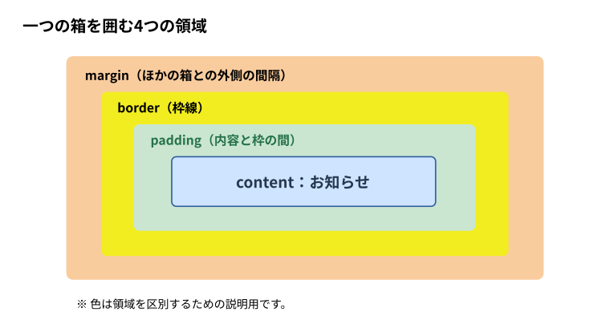
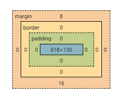

# ボックスモデルの4領域

前の[一つの箱を作る](./02_一つの箱を作る.md)では、文字の周りに余白と背景色を持つ「お知らせ」の箱を作りました。**その箱のどこまでが文字の場所で、どこからが余白なのでしょうか。**

箱の内側と外側は、`content`・`padding`・`border`・`margin`の四つに分けて考えられます。

## 作った「お知らせ」の箱と対応させる

前の記事のHTMLは、次の一つの要素です。

```html
<div class="notice">お知らせ</div>
```

CSSでは文字の周りに`padding`を指定しました。

```css
.notice {
  width: 240px;
  padding: 16px;
  background-color: #dceeff;
  color: #333;
}
```

この箱では「お知らせ」という文字が`content`に入り、その外側の`padding`が文字と箱の端の距離を作ります。背景色はcontentだけでなくpaddingの領域にも表示されます。



図は四つの領域をすべて示した**模式図**です。上のCSSで実際に`border`や`margin`を追加指定したという意味ではありません。

| 領域 | 何を表すか |
| --- | --- |
| `content` | 文字や画像などの内容が入る領域 |
| `padding` | 内容とborderの間にある内側の空間 |
| `border` | 要素の枠線が置かれる領域 |
| `margin` | borderの外側にある、周囲との間隔 |

この四つの領域を使って、箱の寸法や周囲の距離を読む考え方がボックスモデルです。

<a id="devtoolsで4領域を対応させる"></a>

## DevToolsで、実際の箱を確認する

ブラウザで「お知らせ」を表示し、DevToolsで`.notice`を選びます。Box Modelには、選択した要素の`content`・`padding`・`border`・`margin`が領域と数値で表示されます。



上のスクリーンショットは**領域名の見方を示す参考画像**です。画面上の数値が、今作った「お知らせ」の例と同じとは限りません。自分の`.notice`を選んだときの値で確認してください。

前のCSSでは`width: 240px`が指定されています。現在の`box-sizing`が初期値の`content-box`なら、これはcontentの幅です。左右に`padding: 16px`があるため、borderを指定していないこの例の背景の横幅は、240pxに左右のpaddingを加えた272pxになります。

`240 + 16 + 16 = 272px`

**CSSの`width`が、どの領域の幅を指しているか**は次の[box-sizingでwidthの範囲を決める](./04_box-sizingでwidthの範囲を決める.md)で比較します。

## 広く見える場所が、すべて余白とは限らない

例えば要素の背景が文字より横に大きく広がっていても、その差のすべてが`padding`とは限りません。`content`自体が文字より幅広くなっている場合もあります。

縦方向では、文字が折り返して行数が増えたり、子要素の高さが積み重なったりすることもあります。見た目だけでmarginやpaddingと判断せず、まず**どの要素の、どの領域が広がっているか**をDevToolsで確認します。

## このページのまとめ

「お知らせ」の文字が入るのはcontent。内側の距離はpadding、枠線はborder、周囲の外側の間隔はmarginです。四つを区別してから、次の記事で`width`の対象範囲を確かめます。
