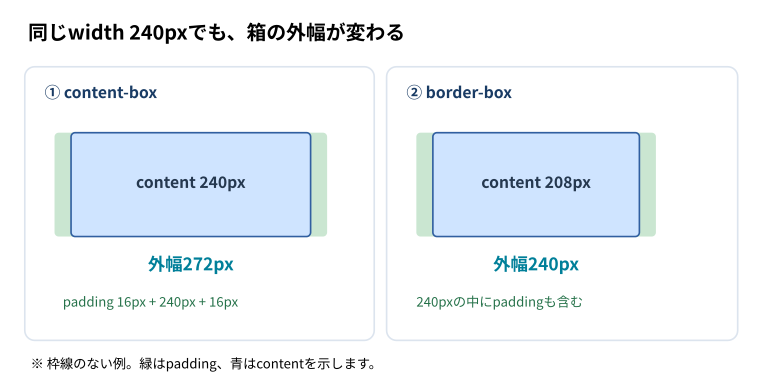

# box-sizingでwidthの範囲を決める

前のページで作った「お知らせ」の箱は、CSSに`width: 240px`と書いたのに、背景の横幅が272pxになりました。**240pxと指定したのに、なぜ箱の外側まで240pxにならないのでしょうか。**

答えは、`width`が**どの領域の幅を指定しているか**にあります。ここで使うのが`box-sizing`です。

## content-boxでは、240pxは内容の幅

前の記事から同じ要素を使います。

```html
<div class="notice">お知らせ</div>
```

```css
.notice {
  width: 240px;
  padding: 16px;
  background-color: #dceeff;
}
```

`box-sizing`を指定していない通常の要素では、初期値は`content-box`です。この状態での`width: 240px`は、**content領域**の幅を示します。左右のpaddingがそれぞれ16pxあるので、borderを指定していないこの例では、外側までの幅は次のとおりです。

`16 + 240 + 16 = 272px`

## border-boxでは、240pxにpaddingを含める

今度は`box-sizing`だけを追加します。

```css
.notice {
  box-sizing: border-box;
  width: 240px;
  padding: 16px;
  background-color: #dceeff;
}
```

今度は**contentと左右paddingを合わせた外側の幅**が240pxになります。paddingは変わらず左右16pxずつあるため、content領域は`240 - 16 - 16 = 208px`です。



二つの例で変更したのは`box-sizing`だけです。paddingが削除されたのではなく、**同じ240pxの中にpaddingを含めるか**が変わりました。

borderを指定する場合、`border-box`にはその左右のborderの幅も含まれます。今回の比較ではborderを付けず、paddingだけで違いを確かめています。

## `display`とは何が違うか

`display`は、その箱が外側や内側でどう配置されるかに関わります。`box-sizing`は、指定した`width`・`height`がcontentまでなのか、borderまで含むのかを決めます。**並び方を変える指定ではありません。**

## すべての要素へ同じ計算方法を使う場合

制作するサイト全体の計算範囲を揃えるため、次のようなCSSを使うこともあります。

```css
*,
*::before,
*::after {
  box-sizing: border-box;
}
```

この指定は`margin`や`padding`を0にするリセットではありません。ここではサイト全体へ適用するかどうかの判断より、まず同じ`.notice`で**240pxが指す範囲**を理解できれば十分です。既定の余白を消す範囲は[既定の余白をどこまで消すか決める](./13_既定の余白をどこまで消すか決める.md)で別に扱います。

## 仕様確認先

- [CSS Box Model Module Level 3](https://drafts.csswg.org/css-box-3/)
- [CSS Box Sizing Module Level 4](https://drafts.csswg.org/css-sizing-4/)
