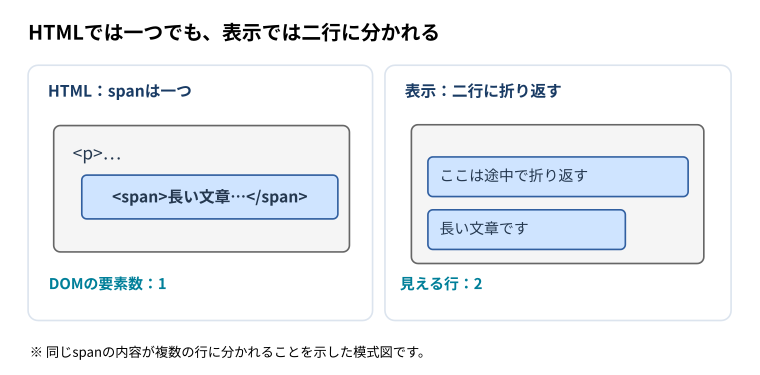

# 要素とCSSの箱の関係

HTMLで一つの`span`を書いても、ブラウザ上ではその文字が二行に折り返すことがあります。**HTMLの要素は一つなのに、表示する箱や行の数が変わるのはなぜでしょうか。**

HTMLに書かれた要素と、CSSが表示の配置に使う**箱（CSS box）**は同じものではありません。

## 一つの`span`でも、二行に分かれて見える

例えば、幅の小さい段落に長い文字列を入れてみます。

```html
<p class="sample">
  説明：<span class="mark">ここは途中で折り返す長い文章です。</span>
</p>
```

```css
.sample {
  width: 200px;
}

.mark {
  background: #cfe4ff;
}
```

幅が小さいため、`span`の文字が途中で二行以上へ分かれることがあります。それでもDOM上の`span`要素が二つに増えたわけではありません。



表示では、同じインライン要素の内容が、複数の行に分割されて配置されます。行には**行ボックス（line box）**が作られ、各行に入るインラインの箱や文字が置かれます。どのくらいの幅で何行になるかは、親の幅やフォントなどで変わります。

まず押さえたいのは、**HTMLの要素の数と、画面で使う箱の数を一対一で数えない**ことです。行ボックスの高さやベースラインは[第8章：文字の行間と高さ](../08_インラインと行の仕組み/01_文字の行間と高さを確認する.md)へ分けて確認できます。

## CSSの指定から、配置する箱が作られる

ブラウザはHTMLの要素や文字にCSSを適用し、`display`などの条件に応じて配置用の箱を作り、それらの寸法と位置を決めて表示します。この箱どうしの関係を**box tree**と呼ぶことがあります。

ここで必要なのは、HTMLの要素と画面の矩形を区別することです。ブラウザが描画する処理全体については[ブラウザの基本フロー](../07_ブラウザ挙動と表示のズレ/01_ブラウザが表示を作る基本フロー.md#基本フロー)で確認できます。

## box treeとボックスモデルは何が違うか

CSSの箱を**どう並べるか**と、ある箱の**どこを測っているか**も別々の話です。

- **CSS box**：要素やテキストを配置するために使われる箱。
- **ボックスモデル**：箱の領域を`content`・`padding`・`border`・`margin`へ分けて読む方法。
- **`box-sizing`**：指定した`width`・`height`がcontentまでか、borderまで含むかを決める指定。

`display`は配置や箱の種類に関わり、`box-sizing`は指定する幅・高さの範囲に関わります。同じ仕事のプロパティではありません。

通常のブロックの箱、インラインの箱、行の箱など、名前はいくつもありますが、この段階で全部を暗記する必要はありません。**今DevToolsで選んでいるHTML要素と、実際に幅や余白を調べたい箱が同じ対象か**を意識できれば十分です。

## このページのまとめ

HTMLの要素一つが、表示でも常に一つの四角になるわけではありません。同じ要素の内容が複数行へ分かれたり、配置に別の箱が使われたりします。要素・表示の箱・箱の中の領域を分けて考えます。

## 仕様確認先

- [CSS Display Module Level 3](https://drafts.csswg.org/css-display-3/#intro)
- [CSS Box Model Module Level 3](https://drafts.csswg.org/css-box-3/)
