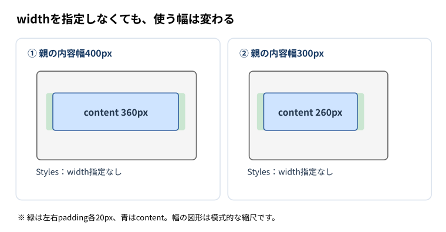

# CSSに書いた値と実際の寸法を分ける

CSSに幅を書いていない段落でも、DevToolsのBox Modelには幅の数値が表示されます。**指定していないのに、その数値はどこから決まったのでしょうか。**

CSSに書いた宣言と、画面で実際に使う寸法は同じものではありません。ここでは、幅を指定していない箱を一つ選んで確かめます。

## `width`を指定せず、親幅だけを変えてみる

```html
<div class="frame">
  <p class="text">幅を固定していない本文です。</p>
</div>
```

```css
.frame {
  width: 400px;
}

.text {
  padding-inline: 20px;
  background: #cfe4ff;
}
```

この例の`.text`には`width`を指定していません。通常フローのブロックとして、利用可能な親の内容幅と左右paddingから幅が決まります。親の内容幅が400px、paddingが左右各20pxなので、borderがないこの例でcontent領域は360pxになります。

次はHTMLと`.text`を変えず、親だけ変更します。

```css
.frame {
  width: 300px;
}
```

親が300pxになれば、同じpaddingのまま本文のcontent領域は260pxになります。



**子のCSSへ`width`を書き足していないのに、子の実寸が変わった**ことが重要です。親幅が変われば、幅の計算に使える空間も変わるからです。

## StylesとBox Modelで、見ているものが違う

Stylesには、CSSがその要素へ適用した宣言が表示されます。Box Modelには、ブラウザが現在のレイアウトで決めた`content`・`padding`・`border`・`margin`の寸法が表示されます。

`width: auto`は、値の計算の段階では`auto`であっても、実際のレイアウトでは親や周囲の条件を使って具体的な幅になります。Computedで数値が見えても、**CSSファイルへその数値を直接書いた**という意味ではありません。

ブラウザがどのような工程で表示を作るかは[ブラウザの基本フロー](../07_ブラウザ挙動と表示のズレ/01_ブラウザが表示を作る基本フロー.md#基本フロー)へ分けます。ここでは、**「指定された値」と「今表示されている寸法」**の二つを区別すれば十分です。

## 外側の幅が知りたい場合

Box Modelの中央に示されるcontent幅だけでなく、必要に応じて左右のpaddingとborderも含めて確認します。今回の子にはborderがないため、親幅400pxのときは`360 + 20 + 20 = 400px`です。

親幅を変えてもある寸法で止まる場合は、そのときはStylesに戻って`max-width`などの制約を確かめます。どの値が幅を決めているかという次の判断は、[箱の大きさが予想と違うときの確認順](./12_箱の大きさが予想と違うときの確認順.md)で扱います。

## このページのまとめ

CSSで`width`を直接指定しなくても、ブラウザは親の幅などを使って実寸を決めます。**Stylesに見える宣言と、Box Modelで測った現在の箱の寸法は別々に読む**ことが重要です。

## 仕様確認先

- [CSS Cascading and Inheritance Module Level 5：Used Values](https://www.w3.org/TR/css-cascade-5/#used)
