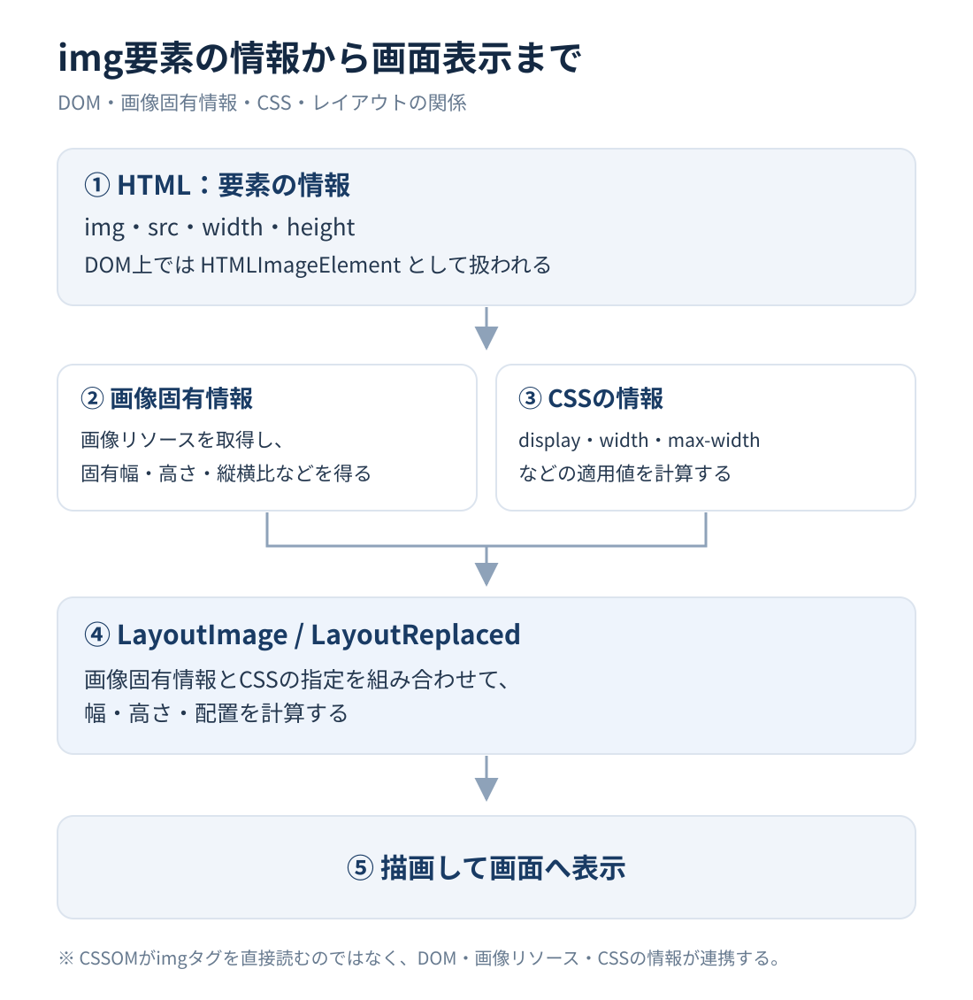
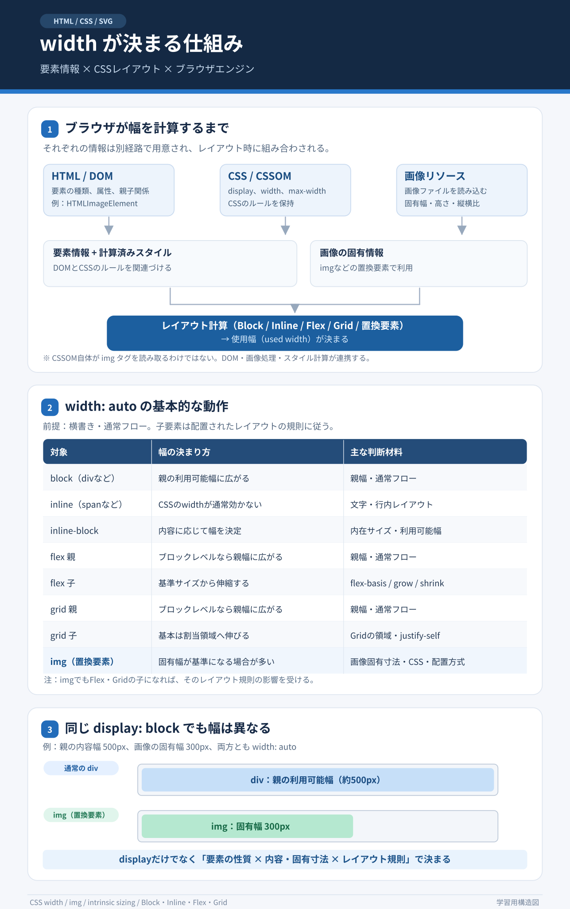

# imgの幅は、通常の要素と何が違うのか？

CSSの`width`は、`display`の種類だけで決まるわけではない。

ブラウザは、HTML要素の種類、内容のサイズ、CSSの指定、親要素の制約などを組み合わせて、最終的な表示幅を計算する。

特に`img`は**置換要素（replaced element）**であり、画像ファイルが持つ固有寸法も幅の計算に利用する。

置換要素という情報がタグのどこにあるのかは、[imgを置換要素として扱う規則はどこにあるのか](./10_imgを置換要素として扱う規則はどこにあるのか.md)で確認する。

## 01. ブラウザはimgの情報をどのように処理するのか？

HTMLに`img`要素を書くと、ブラウザはその要素をDOMとして管理する。

ChromiumのBlinkでは、DOM側の`HTMLImageElement`などが画像要素の情報を扱う。

処理の関係は次のとおり。

[](../../../00_Wiki共通/03_画像/img/html-css/02_07_09_img要素_ブラウザ処理_全体図.svg)

1. **HTML・DOM**：`img`、`src`、`width`、`height`などの要素情報を扱う。
2. **画像固有情報**：取得した画像リソースから固有幅・固有高さ・縦横比などを得る。
3. **CSS・スタイル計算**：`display`、`width`、`max-width`などの適用値を決定する。
4. **Layout**：画像固有情報とCSSの指定、親要素の制約を使ってサイズ・配置を計算する。
5. **描画**：計算された結果を画面に表示する。

※画像情報の取得とCSSの処理は、必ずしも図の番号どおりに順番に完了するわけではない。図はサイズ決定に関係する情報を整理した模式図である。

### ブラウザエンジンとの関係

ChromiumのBlinkでは、`HTMLImageElement`、`LayoutImage`、`LayoutReplaced`などのC++クラスが関係する。

これらはCSSとは別のサイズ指定方法ではなく、**HTML・CSSの仕様に基づく処理をブラウザエンジン内部で実装するための仕組み**である。

また、HTMLの`width`・`height`属性は画像の固有寸法そのものではない。属性から得られる縦横比と、画像ファイルから得られる固有寸法は区別する。

## 02. Block・Flex・Gridではwidthがどう決まるのか？

通常の要素では、`display`によるレイアウト方式が幅の計算に大きく関係する。

- **Block**：通常フローでは、`width: auto`の場合、利用可能な横幅に合わせる。
- **Inline**：通常の非置換インライン要素では、CSSの`width`が適用されず、内容と行内レイアウトによって幅が決まる。
- **Inline-block**：`width: auto`では、内容の内在サイズと利用可能幅を使って計算する。
- **Flex Item**：`flex-basis`を基準とし、伸長・縮小の規則などによって幅を計算する。
- **Grid Item**：Gridの列幅や割り当て領域、配置・伸長の規則などによって幅を決める。

ただし、これらは完全に独立した処理ではない。FlexやGridでも、子要素の内容の内在サイズが幅の計算に影響する。

前提：横書き・通常フロー。子要素は配置されたレイアウトの規則に従う。

[](../../../00_Wiki共通/03_画像/img/html-css/02_07_09_width_要素情報_CSSレイアウト_ブラウザエンジン.svg)

レイアウト方式自体の説明は、[blockとinline](../05_ボックスとdisplay/05_blockとinlineの広がり方.md)、[inline-block](../08_インラインと行の仕組み/03_inline-blockとinline-flexを使い分ける.md)、[FlexとGrid](../09_レイアウト/01_レイアウトで調整したいことから読む.md)へ進む。

### imgの場合

`img`は通常の非置換要素と異なり、画像の固有寸法を持つ。

例えば、親要素が500px、画像の固有幅が300pxの場合、次の指定では結果が異なる。

```css
div,
img {
  display: block;
  width: auto;
}
```

通常の条件では、

- `div`：親の利用可能幅に合わせて500px
- `img`：固有幅を使って300px

となる。

どちらも`display: block`だが、**置換要素かどうかによって`width: auto`のサイズ計算規則が異なる**。

さらに`img`がFlexやGridの子になると、画像固有情報に加えてFlexboxやGridの規則も適用される。

つまり、`img`の幅が常に画像固有幅になるわけではない。

## 03. 3つの役割を区別する

| 区分 | 担当するもの |
| --- | --- |
| 要素・内容情報 | HTMLの要素種別、文字の内容、画像の固有寸法など |
| CSSレイアウト規則 | Block・Inline・Flex・Grid・置換要素のサイズ計算規則 |
| ブラウザエンジン | これらの情報と規則を使い、実際にサイズや配置を計算する |

※ CSSOM自体が img タグを読み取るわけではない。DOM・画像処理・スタイル計算が連携する。

**整理すると、`display`だけで幅が決まるわけではない。**

ブラウザエンジンが、要素の種類・内容・画像固有情報・CSSのレイアウト規則を組み合わせて、最終的な使用幅（used width）を計算する。

そのため、`width: auto`の意味は、通常のBlock、Flex Item、Grid Item、置換要素で異なる場合がある。
