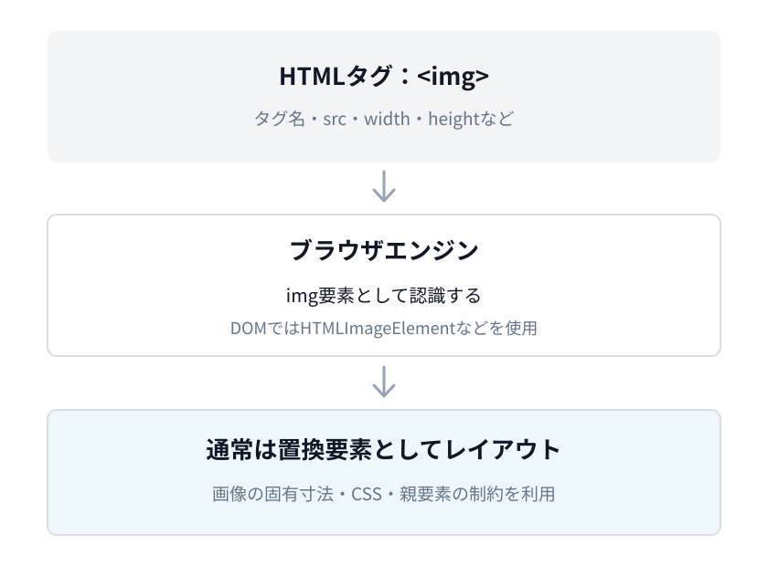

# imgを置換要素として扱う規則はどこにあるのか

## 1. タグ情報とブラウザエンジンの関係

```xml

```

このHTMLには、`replaced`（置換要素）という属性は書かれていない。

ブラウザは`img`というタグ名を認識し、画像要素として処理する。その際、通常は置換要素として扱います。

[HTML Standard：img要素](https://html.spec.whatwg.org/multipage/embedded-content.html#the-img-element)／[CSS 2.2：置換要素の定義](https://www.w3.org/TR/CSS22/conform.html#replaced-element)

[](../../../07_画像/img/html-css/02_07_10_imgタグ_ブラウザエンジン_置換要素_関係図.svg)

**HTMLタグ：**``

タグ名・src・width・heightなど

**ブラウザエンジン**

img要素として認識する

DOMではHTMLImageElementなどを使用

**通常は置換要素としてレイアウト**

画像の固有寸法・CSS・親要素の制約を利用

## 2. 分類の違い

| 分類 | どこで定義・処理される？ |
| --- | --- |
| 埋め込みコンテンツ（Embedded content） | HTML仕様上のコンテンツカテゴリー |
| 置換要素（Replaced element） | CSSの描画・レイアウトモデル上の概念 |
| `display: inline`など | CSSの指定・計算結果 |
| `HTMLImageElement` | HTML仕様で定義されたDOMインターフェース（ブラウザが実装） |
| `LayoutImage` | Blinkのレイアウト実装 |

**置換要素はHTMLのコンテンツカテゴリーとは別の分類**です。

[HTML Standard：imgのカテゴリーとDOMインターフェース](https://html.spec.whatwg.org/multipage/embedded-content.html#the-img-element)／[CSS 2.2：置換要素の定義](https://www.w3.org/TR/CSS22/conform.html#replaced-element)／[Chromium：LayoutImageの実装](https://github.com/chromium/chromium/blob/main/third_party/blink/renderer/core/layout/layout_image.h)

置換要素の定義や状態による条件は、[置換要素（img・input・video）](../../../05_参照/置換要素（img・input・video）.md)で確認する。

## 3. widthにどう影響する？

ブラウザエンジンは、要素が置換要素かどうかを考慮して、CSSのサイズ計算規則を適用します。

そのため、

- `div`の`width: auto` → 通常のブロックの計算規則
- `img`の`width: auto` → 画像の固有寸法も利用する置換要素の計算規則

という違いが生じる。

ただし、`img`でもFlexやGridの子になれば、それらのレイアウト規則も関係します。

幅の具体的な比較は、[imgの幅は、通常の要素と何が違うのか？](./09_imgの幅は通常の要素と何が違うのか.md)で確認する。

**結論：**`img`**という要素種別はHTMLから分かる。置換要素として扱う規則は仕様に定義され、ブラウザエンジンがその規則を実行する。**

だから「タグに置換要素という情報が書かれている」のではなく、**タグの種類をもとに、エンジンが置換要素として処理する**という理解が正確です。
