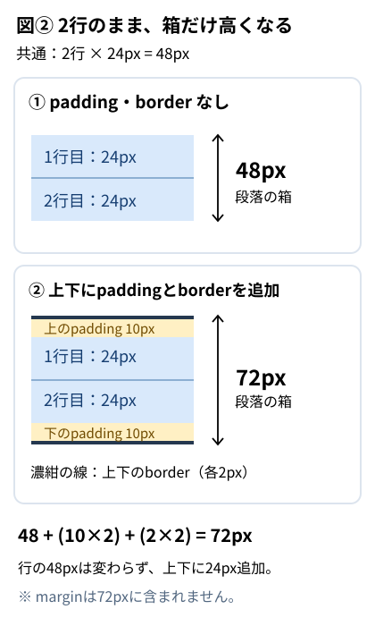

# 01_文字の行間と高さを確認する

カンプでは一行だった見出しが、ブラウザでは二行になり、その下の部品まで下がってしまうことがあります。

こんなとき、下の部品の `margin-top` を減らせば、一度は位置を合わせられるかもしれません。でも、画面幅が変わると、またずれる可能性があります。

まず見たいのは、**下の部品の余白ではなく、その上にある文章の行数**です。同じ文字サイズ・行高でも、文章が折り返せば、文章の占める高さが変わるからです。

<a id="行数から結果として生じる高さ"></a>

## 幅が変わると、なぜ下の要素も動くのか

「テキストテキスト」という文章と、そのすぐ下に置いた「テキスト」（次の要素）で考えます。

```html
<div class="parent">
  <p class="text">テキストテキスト</p>
  <p class="next">テキスト</p>
</div>
```

```css
.parent {
  width: 240px;
}

.text {
  font-size: 20px;
  line-height: 1.5;
}

.parent p {
  margin: 0;
}
```

文字サイズは20px、`line-height` はその1.5倍です。したがって、この文章では一行あたりの高さを **30px** と考えられます。段落の既定のmarginは、比較しやすいように0にしています。

ここで変えるのは、親の `.parent` の幅だけです。`240px` から `120px` にすると、何が起こるでしょうか。


240pxなら文章は一行に収まり、高さは30pxです。120pxにすると文章が二行に折り返され、高さは60pxになります。

**行高の指定を変えたわけではありません。同じ文章を置くために、必要な行が一つ増えた**のです。

段落の高さを固定していなければ、行が増えたぶん段落も高くなります。そのため、続く「次の要素」は30px下へ移動します。下の要素のmarginが増えたわけではありません。

ここでいう「一行30px」は、文字の黒い部分が30pxの高さを持つという意味ではありません。ブラウザが文字を行に並べるための高さです。字形そのものの見た目の大きさとは区別します。

## 行の高さと、段落の箱の高さは別

では、文章が二行で60pxになった段落に、上下の余白と枠線を付けるとどうなるでしょうか。

親幅は120px、文章は二行のままにして、`.text` に次の指定を追加します。

```css
.text {
  font-size: 20px;
  line-height: 1.5;
  padding-block: 10px;
  border-block: 10px solid #25384f;
}
```

追加したのは上下方向だけなので、文章の横幅も行数も変わりません。ただし、段落の箱全体は60pxより高くなります。



文章の二行分が60px。上下のpaddingを合わせると20px。上下のborderを合わせると20pxです。

**60px + 20px + 20px = 100px**

つまり、文章の行が占める部分と、その外側に足されるpadding・borderは別々です。`margin` はさらに箱の外側にあり、この100pxには含まれません。

一行の高さだけを見ても、段落全体の高さは分からないということです。

なお、この「30px × 行数」という数え方は、同じ文字サイズ・行高の通常のテキストを並べた今回の例で成り立つ基本形です。行の中に大きな画像や、異なる行高の要素が入る場合は、行そのものの高さが変わることもあります。詳しくは[ベースラインと見た目のずれ](./04_ベースラインと見た目のずれ.md)で扱います。

## カンプと違うとき、何から確かめるか

カンプとブラウザで文章の高さが違っていたら、まず**文字を置ける横幅**を比べます。画面幅が同じでも、親要素の幅や左右のpaddingが違えば、文字を置ける幅は変わります。

横幅をそろえたら、折り返しによる行数の違いを確認します。そのうえで、`font-size` と `line-height` を見ます。

例えば、カンプで文字サイズ20px・一行の高さ30pxなら、CSSでは `font-size: 20px; line-height: 30px;` と指定できます。`1.5` のような倍率指定との違いや、子要素への継承については、次の[line-heightの指定値と継承](./02_line-heightの指定値と継承.md)で確認します。

それでも高さが合わない場合は、padding・border・marginを見ます。さらに、カンプで測っているのがテキストの枠なのか、見えている文字そのものなのかも確かめます。測る場所の違いは[カンプとブラウザで測る場所をそろえる](../07_ブラウザ挙動と表示のズレ/03_カンプとブラウザで測る場所をそろえる.md)で扱います。

ブラウザではDevToolsで `.text` を選び、Stylesで文字サイズと行高、Box Modelで要素の寸法を確認できます。実際の箱の高さを数値で見たい場合は、Consoleで次の式も使えます。

```javascript
document.querySelector('.text').getBoundingClientRect().height
```

最初の状態は30px、幅を120pxにして二行になると60px、さらに上下のpaddingとborderを付けると100pxが目安です。**この数値は段落の箱の高さ**であり、一行分の `line-height` そのものではありません。

文章の下がずれて見えたときは、下の部品の位置をすぐに直すのではなく、**横幅 → 行数 → 一行の高さ → 箱の余白や枠線**という順にたどってみてください。どこで高さが変わったのかが見えてきます。
