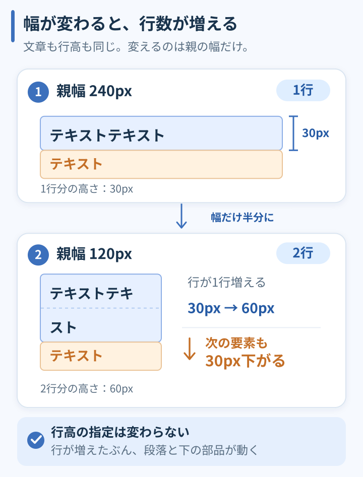

# 01_文字の行間と高さを確認する

カンプでは一行だった見出しや説明文が、ブラウザでは二行になり、その下の部品まで下がることがあります。こんなとき、下の部品の `margin-top` を減らして合わせても、別の幅ではまたずれるかもしれません。

原因を調べるには、まず文章そのものが何行になっているかを見ます。**一行に与えた高さが同じでも、行数が変われば、その下の要素の位置が変わる**からです。

## 幅を変えると、なぜ下の要素が動くのか

次の「文字の高さを確認する」という文章と、その直後にある「次の要素」で試します。CSSでは、文字サイズを16px、一行分の高さを文字サイズの1.5倍にしています。段落の既定のmarginは比較の邪魔にならないよう0にします。

```html
<div class="sample">
  <p class="sample__text">文字の高さを確認する</p>
  <p class="sample__next">次の要素</p>
</div>
```

```css
.sample {
  width: 240px;
}

.sample__text {
  font-size: 16px;
  line-height: 1.5;
}

.sample p {
  margin: 0;
}
```

まず親の `.sample` が240pxのときは、文章が一行に収まります。ここで **`.sample` の `width` だけを120pxに変更**してください。文章が折り返され、二行になります。HTMLや `font-size`、`line-height` は変えていません。



一行分の高さは次の計算で求められます。

```text
16px × 1.5 = 24px
```

したがって、この例で文章だけが行に置かれるなら、行数による高さの違いは次のとおりです。

```text
親幅240px：24px × 1行 = 24px
親幅120px：24px × 2行 = 48px
差：                         24px
```

**行高の指定は変わっていません。変わったのは、同じ文章を置くのに必要な行数です。** `height` を指定していない段落は、行が増えればそのぶん高くなります。そのため、直後にある「次の要素」の始まる位置も24px下がります。

行数を確かめるときは、HTMLに`<br>`を書いて改行したのか、表示幅に応じて自然に折り返したのかも区別します。`white-space: nowrap`で自然な折り返しを止めることはできますが、`<br>`による強制改行まで消えるわけではありません。

幅によって折り返す文章なら、固定の`height`や`<br>`を追加する前に、PC・SPだけでなくその間の幅でも確かめます。

ここでいう「一行24px」は、文字の黒い部分が上から下まで24pxあるという意味ではありません。ブラウザが文字を配置するときに使う行の高さです。文字の字形そのものの高さや見た目の上下位置とは区別します。行の箱の考え方から確認する場合は、導入の[インラインブロックとインラインボックスの違い](../../../01_導入/01_HTML・CSS/08_インラインと行の仕組み/02_インラインブロックとインラインボックスの違い.md)が前提になります。

## 行の高さと、段落の箱の高さは同じなのか

先ほどの48pxは、余白も枠線もない、文字だけの二行を考えた値です。次に、**親幅120px・二行の状態はそのまま**にして、`.sample__text` に上下のpaddingとborderを追加します。

```css
.sample__text {
  font-size: 16px;
  line-height: 1.5;
  padding-block: 10px;
  border-block: 2px solid #25384f;
}
```

追加したのは上下方向だけなので、文章の横幅と行数は変わりません。ただし、段落の箱全体は、テキスト二行の48pxだけではなくなります。


```text
行の部分    24px × 2行  = 48px
上下padding 10px × 2    = 20px
上下border   2px × 2    =  4px
--------------------------------
段落の箱全体              72px
```

つまり、**文章が何行あるかで決まる部分と、その外側に足される部分は別**です。`margin` はさらに箱の外側にあり、段落そのもののborder boxの高さには含まれません。次の要素までの距離を調べるなら、marginも別に確認します。

この「一行24pxとして数える」方法は、今回のように同じフォント・文字サイズの普通のテキストだけが並んでいる場合の基本です。行の中に大きな画像や異なる行高のインライン要素があると、行ボックスはその内容にも影響されるため、単純な `24px × 行数` にならないことがあります。その場合は[ベースラインと見た目のずれ](./04_ベースラインと見た目のずれ.md)で、行の中身を確認します。

## カンプの高さと比較するときは、何から見るか

カンプとブラウザで文章の下端が違っていたら、まずカンプのテキスト枠と、ブラウザで実際に文字を置ける領域の幅をそろえて比較してください。ブラウザの画面幅が同じでも、親要素の幅や左右のpaddingによって、文字を置ける幅は変わります。幅が違うと、行数の違いだけで高さが変わります。次に、文字サイズと行高の指定を確かめます。

デザインツールで文字サイズ18px、一行の高さ25pxと指定されているなら、CSSには `line-height: 25px` と書けます。倍率として管理したい場合は `25 ÷ 18 ≒ 1.389` なので、`line-height: 1.389` が候補です。端数を丸めた倍率では、pxで直接指定した場合とわずかに差が出ることがあります。

`line-height: 1.5` のような単位のない数値は、文字サイズを基準に使われ、継承した子要素でもその子の文字サイズを基準にできます。`px` や `%` とで継承結果がどう違うかは、次の[ line-heightの指定値と継承](./02_line-heightの指定値と継承.md)で比較します。

それでも見た目が合わなければ、カンプで測ったのが「テキストレイヤーの枠」なのか「実際に見える字形」なのか、ブラウザで測ったのが「文字の行」なのか「paddingやborderまで含んだ要素」なのかを確かめます。測る対象の違いは[カンプとブラウザで測る場所をそろえる](../07_ブラウザ挙動と表示のズレ/03_カンプとブラウザで測る場所をそろえる.md)で扱っています。

ブラウザのDevToolsで `.sample__text` を選び、Stylesで `font-size` と `line-height`、Box Modelで要素の寸法を確認できます。Consoleで次の式を実行すると、現在の段落の表示上の高さも測れます。

```js
document.querySelector('.sample__text').getBoundingClientRect().height
```

最初の作例なら親幅240pxで24px、120pxで48px、上下のpaddingとborderを追加した後なら72pxが目安です。この値は要素の箱の高さなので、複数行やpaddingがある状態で **「一行のline-heightそのもの」だと読み替えない**でください。

`line-height: normal` の場合はフォントなどに応じて行の高さが決まり、Computedに `normal` と表示されることもあります。文字サイズから特定の倍率を決めつけず、実際の描画と使用フォントを見ます。

文章の高さを直したいとき、最初に変えるべきなのは `height` や下の部品のmarginとは限りません。**文字を置ける幅を合わせる → 行数を見る → 一行分の高さを見る → 要素のpadding・border・marginを確認する。** この順なら、ずれが生まれた場所に戻って判断できます。
