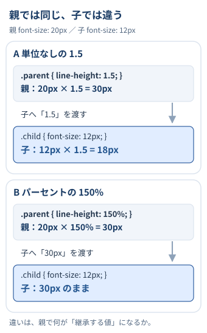
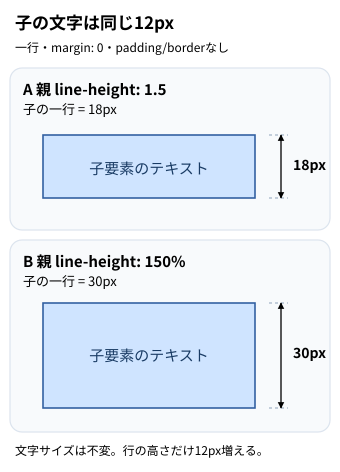

# 02_line-heightの指定値と継承

親要素に `line-height: 1.5` を指定したあと、子要素だけ文字サイズを小さくしたとします。すると、子の一行の高さも文字サイズに合わせて小さくなります。

ところが、親の指定を `line-height: 150%` に変えると、親では同じ高さだったのに、子の行が大きいままになることがあります。

**親ではどちらも1.5倍なのに、なぜ子で結果が変わるのでしょうか。** 違いは、親で計算されたあと、子に何が引き継がれるかにあります。

## 同じ親子で指定だけを変えてみる

まず、一行の文章を持つ子要素を用意します。

```html
<div class="parent">
  <p class="child">子要素のテキスト</p>
</div>
```

```css
.parent {
  font-size: 20px;
  line-height: 1.5;
}

.child {
  font-size: 12px;
  margin: 0;
}
```

親は20px、子は12pxの文字サイズです。子の `line-height` は指定していないので、親から継承します。`margin: 0` は、`p` の既定の余白を今回の比較から外すための指定です。

親では `20px × 1.5 = 30px` です。しかし、子へ渡るのは計算後の `30px` ではなく、**倍率そのものの `1.5`** です。したがって、子では `12px × 1.5 = 18px` 相当の行高になります。

次にHTMLと子の指定は変えず、親の一行だけを `150%` にします。

```css
.parent {
  font-size: 20px;
  line-height: 150%;
}
```

親では先ほどと同じ `20px × 150% = 30px` ですが、今度は親の段階で計算された**長さの `30px`** が子へ渡ります。子の文字サイズを12pxにしても、子の行高は30pxのままです。



図の二つの経路で、親の結果はどちらも30pxです。それでも子が18pxと30pxに分かれるのは、**子が受け取った値が `1.5` と `30px` で違う**ためです。

## 子の見た目では何が違うのか

子はどちらも `font-size: 12px` の一行の文章です。上の作例では、子の `p` にpadding・border・固定のheightがなく、通常のブロックとして一行を作るので、行高の差がそのまま要素の高さの差として現れます。



図の青い領域は、字形そのものではなく、**子の一行を配置するための高さ**を表しています。文字サイズは両方12pxのままです。`150%` の例では、文字が大きくなったのではなく、文字の行に使う高さが12px増えています。

この高さを、フォントの見た目の上下の空きや、画像を含む行の高さと同一視しないでください。行内に別の大きな要素がある場合は、行ボックス全体がこの単純な値どおりにならないことがあります。そうしたケースは[ベースラインと見た目のずれ](./04_ベースラインと見た目のずれ.md)で確認します。

## `1.5em` も同じなのか

親の指定を `line-height: 1.5em` にした場合も、**この親子関係では** `150%` と同じ結果になります。

```text
親の文字サイズ 20px
20px × 1.5 = 30px（1.5emの計算）
↓ 30pxという長さを継承
子の文字サイズ 12px／行高 30px
```

`em` は、その指定がある要素の文字サイズを基準に長さを求めます。親に書けば親の20pxで計算されます。もし同じ `line-height: 1.5em` を子自身に直接指定したなら、今度は子の12pxを基準に計算され、18pxになります。

つまり `1.5em` が常に30pxなのではありません。**どの要素に指定し、どの段階で長さに変わったか**が重要です。

ここまでの三つを整理すると、親の文字サイズが20pxのとき、単位なしの `1.5` は「倍率を継承」、`150%` と `1.5em` は「親で計算された長さを継承」です。`line-height: 30px` のように長さを直接書いた場合も、子へはその長さが引き継がれます。

## 自分の実装では、何を確認するか

子の文字だけ小さくしたのに行間が大きいときは、まず**子に `line-height` の指定があるか**を確認します。子自身に指定があれば、継承した値ではなく、その指定が使われます。

指定がなければ、DevToolsで親と子を順に選び、`font-size` と `line-height` を見比べます。親に `1.5` が指定されているのか、`150%` や `1.5em` が指定されているのかを確認してください。

先ほどのHTMLでブラウザのコンソールから確かめるなら、次のように子の計算済みスタイルと高さを取得できます。

```js
const child = document.querySelector('.child');
console.log(getComputedStyle(child).fontSize);
console.log(getComputedStyle(child).lineHeight);
console.log(child.getBoundingClientRect().height);
```

作例の条件では、親を `1.5` にすると子の行高・高さが18px相当、`150%` にすると30px相当になるはずです。ただし、`line-height: normal` はフォントなどの条件に依存するため、同じ計算を前提にできません。また、実際の要素の高さにpadding・border・複数行などが加われば、この二つの数値は一致しなくなります。

親子で文字サイズを変える本文では、通常は**単位なしの `line-height` を基本にする**と、各要素の文字サイズに合わせた行高を保ちやすくなります。反対に、親で決まった長さを子へ引き継ぎたい場合は、長さで指定する目的があるかを確かめます。

行の高さと行数そのものを確認したい場合は[文字の行間と高さを確認する](./01_文字の行間と高さを確認する.md)へ、行の中に画像やアイコンがあって高さが違う場合は[ベースラインと見た目のずれ](./04_ベースラインと見た目のずれ.md)へ進めます。

## 参考仕様

- [MDN：line-height](https://developer.mozilla.org/ja/docs/Web/CSS/Reference/Properties/line-height)
- [CSS Inline Layout Module Level 3：line-height](https://drafts.csswg.org/css-inline-3/#line-height-property)
- [CSS Cascading and Inheritance：Inheritance](https://www.w3.org/TR/css-cascade-5/#inheriting)
