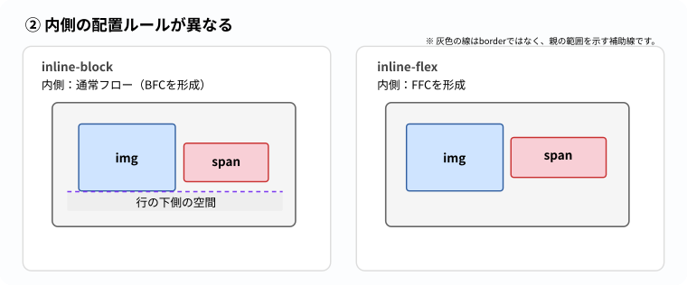

# 03_inline-blockとinline-flexを使い分ける

文章の途中に「詳しく見る」というリンクを置き、文字の横に矢印アイコンを添えたいとします。リンク全体は文章の流れに置きたい一方で、リンクの中では文字とアイコンをきれいに揃えたい。このとき候補になるのが `inline-block` と `inline-flex` です。

どちらも、周囲の文字と同じ行に置ける箱を作れます。違いは、**箱の中を通常の文字の流れで配置するか、Flexで直接の子を並べるか**にあります。同じ部品を使って、その境目を確かめます。

## 同じリンクで、内側の並び方を比べる

まず、文字と画像を一つの `a` 要素に入れます。画像は装飾用の矢印なので、`alt` は空にします。

```html
<p>
  続きはこちらから
  <a class="link" href="/detail/">
    
    <span>詳しく見る</span>
  </a>
  ご確認ください。
</p>
```

はじめはリンクを `inline-block` にします。

```css
.link {
  display: inline-block;
  padding: 10px 20px;
  border: 10px solid #555;
  text-decoration: none;
}

.link img {
  width: 20px;
  height: 20px;
}
```

リンク自体は、前後の文章と同じ行に置けます。その内側では、画像と `span` が通常のインラインの配置に参加します。画像の位置にはベースラインが関わり、HTML上の空白が画像と文字の間隔として現れることもあります。

次はHTMLを変えず、リンク側の `display` だけを `inline-flex` に変更します。変更した状態で `align-items` と `gap` も指定します。

```css
.link {
  display: inline-flex;
  align-items: center;
  gap: 10px;
  padding: 10px 20px;
  border: 10px solid #555;
  text-decoration: none;
}
```

今度は `img` と `span` がそれぞれ **Flexアイテム**になります。横書きで既定の `flex-direction: row` なら、子を横方向に並べ、`align-items: center` で縦方向の箱の中心を揃え、`gap: 10px` で間隔を作れます。

変更したのはリンクの**中身の配置方法**です。リンク全体が文章の途中に置かれる点は変わりません。



図②では、左側の `inline-block` は内部に通常の文字の行があり、右側の `inline-flex` では画像と文字を包む要素がFlexアイテムになっています。これは内側の仕組みを示す模式図で、実際の隙間の大きさはフォントや指定値によって変わります。

## 外側では、どちらも文章の一部として置かれる

リンクの中身をFlexで揃えられるとしても、リンク全体が文章の行から独立するわけではありません。


図①の「前の文字」「後の文字」は、リンクの外側にある文章です。その間に `inline-flex` の箱が一つ置かれています。親が通常のインラインの行を作っている場合、**リンク全体の縦位置は外側の行のルールに従い**、その箱の内部ではFlexのルールが使われます。

ここで、配置を二つに分けて考えます。

- **外側**：リンクの箱そのものを、周囲の文字とどう並べるか。
- **内側**：リンクの中にある画像と文字の箱を、どう並べるか。

そのため、リンクの中の画像と文字が中央に揃っていても、文章の中でリンク全体が上下へずれて見えることはあります。内側の整列を変える `align-items` と、行内でリンク全体の縦位置に関わる `vertical-align` は、同じ場所を操作していません。

```css
.link {
  vertical-align: middle;
}
```

この `vertical-align: middle` は、周囲の行に対するリンク全体の配置を変えます。ただし、Flexの `align-items: center` と同じ幾何学的な中央揃えではありません。行のベースラインやフォントに由来する基準も関わります。

## なぜ外側と内側でルールが違うのか

`display` は、要素が外側でどう扱われるかと、内側にどんな配置方法を作るかを合わせて決めます。

| 指定 | 外側の扱い | 内側の扱い |
| --- | --- | --- |
| `inline-block` | インラインレベルの箱 | 通常フロー。独立したBFCを形成 |
| `inline-flex` | インラインレベルの箱 | Flex整形コンテキスト（FFC）を形成 |
| `flex` | ブロックレベルの箱 | Flex整形コンテキスト（FFC）を形成 |

`inline-flex` は `inline flex`、`inline-block` は `inline flow-root` という外側・内側の組み合わせで理解できます。前者は直接の子をFlexアイテムとして配置し、後者は通常フローに従って配置します。

`inline-block` の中に文字やインライン画像があれば、それらのために行ボックスが作られます。一方、ブロックの子があれば通常フローで縦に並びます。つまり「`inline-block` の内側は必ずIFCだけ」という意味ではありません。

同様に、`inline-flex` の中のすべての文字がFlexアイテムになるわけでもありません。この例の `span` はFlexアイテムですが、**その `span` の中の文字は、引き続き文字として行に配置されます**。

なお、ここで「外側はインライン」と説明できるのは、親が通常の文章の行を作っている例だからです。親自身がFlexコンテナなら、その直接の子はFlexアイテムになり、外側の扱いは変わり得ます。表示の指定と、作られる箱の関係は[要素とCSSの箱の関係](../05_ボックスとdisplay/06_要素とCSSの箱の関係.md)で確認できます。

## `align-items: center` と `baseline` は何を揃えるか

内側をFlexにしても、ベースラインそのものが消えるわけではありません。

```css
.link {
  display: inline-flex;
  align-items: center;
}
```

`center` なら、横並びのFlexアイテムを縦方向の箱の中心で揃えます。これを `align-items: baseline` に変えると、各アイテムのベースラインを基準にした整列になります。必要なベースラインを持たないアイテムには、規則に従って基準線が合成される場合があります。


図④は**リンクの内側の整列**の比較です。画像の下に残る空間を考える際には、別記事[ベースラインと見た目のずれ](./04_ベースラインと見た目のずれ.md#image-gap)の図③で、部品の内側と外側のどちらに空間があるかを確認できます。番号は、この記事の図①・②・④と次の記事の図③を合わせた系列です。

## 文字だけなら、Flexにする必要はあるか

必ずしもありません。たとえば「国語」という短いラベルを、文字とpaddingを持つ一つの箱にしたいだけなら `inline-block` で十分です。

```html
<span class="subject">国語</span>
```

```css
.subject {
  display: inline-block;
  padding: 10px 20px;
  background-color: #c93030;
  color: #fff;
}
```

通常の非置換 `inline-block` で `width: auto` の場合、利用可能な幅と内容から箱の幅が決まります。通常のブロックと同じように、常に行いっぱいへ広がるわけではありません。ただし `auto` を単純に「文字幅と同じ」と読み替えるのも正確ではありません。

反対に、画像・文字・矢印など**複数の子の間隔や縦位置をまとめて管理したい場合**には `inline-flex` が便利です。`gap` や `align-items` を使う目的が生まれるからです。

`inline-block` でも別の指定を組み合わせれば同じ見た目にできることがあります。両者を「できる／できない」だけで分けるより、**どの箱の配置を調整したいか**で選びます。実際に押せる範囲は、`display` だけでは決まらず、リンク自身のpaddingなども関係します。詳しくは[CTAとナビリンクの操作範囲](../15_UI部品の実装判断/09_CTAとナビリンクの操作範囲を作る.md)で扱います。

## 疑似要素もpaddingの内側に入る

矢印を画像ではなく `::after` で付ける場合も、同じ考え方が使えます。

```html
<a class="link" href="/detail/">詳しく見る</a>
```

```css
.link {
  display: inline-flex;
  align-items: center;
  gap: 10px;
  padding-inline: 20px;
}

.link::after {
  content: ">";
}
```

生成した `::after` は、リンクの内容の後ろに置かれます。この例ではFlexコンテナ内で扱われるので、文字と疑似要素の間隔を `gap` で作れます。疑似要素はリンクの外側へ追加される別の兄弟要素ではないため、指定したpaddingの内側に収まります。


この図では、リンクの左右にpaddingがあり、その内側で文字と `::after` の間へ `gap` が入ります。

ただし、疑似要素にしかない重要な意味を持たせるのは避けます。単なる装飾か、独立した画像・情報として管理したいかは[装飾アイコンを疑似要素か実要素で作る](../15_UI部品の実装判断/13_装飾アイコンを疑似要素か実要素で作る.md)で判断します。

空の疑似要素を `inline-block` で行に置く場合と、`position: absolute` で配置する場合の基準の違いは、[疑似要素のdisplayと配置基準はどう違うのか？](../../../06_疑問/01_HTML・CSS/08_インラインと行の仕組み/疑似要素のdisplayと配置基準はどう違うのか.md)で確認できます。

## DevToolsで外側と内側を確かめる

最初の「詳しく見る」のHTMLをブラウザで開き、まずリンクを選んで `display` を `inline-block` と `inline-flex` で切り替えます。画像と文字の並びが変わる一方で、リンク全体は文章の間に残ることを確認します。

次に `inline-flex` のまま `align-items` を `center` と `baseline` で切り替え、内側の二つの箱の動きを見ます。その後、`vertical-align` を変えてリンク全体の位置を観察します。**中の箱を動かしたのか、外側の行の中でリンク全体を動かしたのか**を、一度に一つの変更で確かめます。

画像の下の空間が気になった場合は、次の[ベースラインと見た目のずれ](./04_ベースラインと見た目のずれ.md#image-gap)で、行ボックスが作る空間を調べます。`inline-block` 自身のベースラインがどの位置になるかの細かな条件は、[inline-blockのベースラインが決まる条件を比べる](../../../03_詳細/01_HTML・CSS/08_inline-blockのベースラインが決まる条件を比べる.md)へ分けます。

## 参考仕様

- [MDN：display](https://developer.mozilla.org/en-US/docs/Web/CSS/Reference/Properties/display)
- [MDN：Using the multi-keyword syntax with CSS display](https://developer.mozilla.org/en-US/docs/Web/CSS/Guides/Display/Multi-keyword_syntax)
- [MDN：Introduction to formatting contexts](https://developer.mozilla.org/en-US/docs/Web/CSS/Guides/Display/Formatting_contexts)
- [MDN：vertical-align](https://developer.mozilla.org/ja/docs/Web/CSS/Reference/Properties/vertical-align)
- [CSS Flexible Box Layout：Flex Container Baselines](https://www.w3.org/TR/css-flexbox-1/#flex-baselines)
