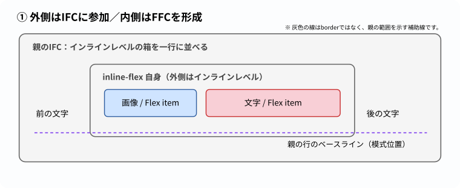
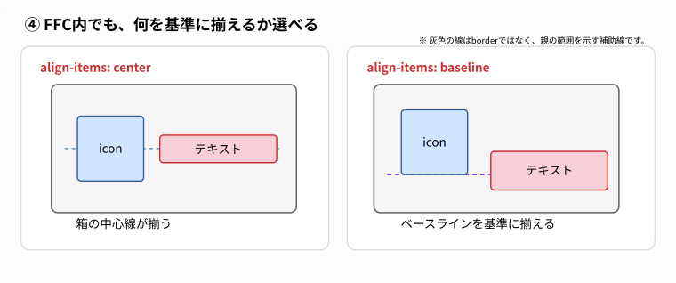

# 03_inline-blockとinline-flexを使い分ける

`inline-block`と `inline-flex`は、どちらも文章の流れに置ける箱を作れる。違いは、箱の中身をFlexで並べる必要があるかで判断する。

**`inline-flex`は外側でベースラインに従い、内側をFlexで揃えられるのはなぜ？**

> **この記事の疑問**：`inline-flex`はインライン要素のように文章の途中に並ぶのに、内側の画像と文字はベースラインに縛られず、`align-items: center`で揃えられる。なぜ外側と内側で配置ルールが違うのか。`inline-block`では何が異なるのか。

## 結論：外側と内側の配置ルールを分けて考える

`display: inline-flex`は、**外側ではインラインレベルのボックス**となり、親が形成するインライン整形コンテキスト（IFC）に参加する。一方、**内側ではFlex整形コンテキスト（FFC）を形成**する。

直接の子要素は**Flexアイテム**としてFFCの規則で配置され、`align-items: center`などで箱単位の整列ができる。通常のインライン要素のように、すべての子を共通のテキストのベースラインに載せる必要はない。

ただし、これは**ベースラインがなくなるという意味ではない**。`inline-flex`自身は外側の行でベースラインに基づいて配置され得るし、内部でも`align-items: baseline`を使えばベースライン整列を行える。文字にも引き続きベースラインがある。

**Wikiに使う一文**

> `inline-flex`は、外側ではインラインレベルのボックスとして親のIFCに参加し、内側ではFFCを形成する。直接の子はFlexアイテムとして配置されるため、内側の配置基準を通常のインラインのベースラインに限定せず、`align-items`などで整列できる。ただし、外側・内側ともベースラインそのものが消えるわけではない。



外側の位置合わせは残る。内側の直接の子はFFCで配置する。

図は模式図。ベースラインの位置は実際のフォントや子要素によって変わる。

## 「外側がIFC」という表現を正確にする

`inline-flex`自身が「IFCに変身する」のではない。**親のIFCに参加する、インラインレベルの箱**になるという意味である。

- **外側の表示型（outer display type）**：`inline`。周囲の文字・インライン要素と同じ行で配置される。
- **内側の表示型（inner display type）**：`flex`。直接の子をFlexアイテムとして配置する。

新しい2キーワード構文なら、次のように表せる。

```css
.badge {
  display: inline-flex; /* 従来の書き方 */
  /* display: inline flex; と同じ考え方 */
}
```

比較すると次のようになる。

| `display` | 外側での扱い | 内側の配置 |
|---|---|---|
| `inline` | インラインレベル | 通常のインラインの流れ |
| `inline-block` | インラインレベル | 通常フロー。独立したBFCを形成 |
| `flex` | ブロックレベル | FFC |
| `inline-flex` | インラインレベル | FFC |

`inline-block`は概念上、`inline flow-root`に相当する。`inline-flex`は`inline flex`に相当する。**外側が同じでも、内側の配置モデルは違う。**

> **前提の例外**：親がIFCを形成しているときに、`inline-flex`はその行へ参加する。親がFlexコンテナの場合、その子はFlexアイテムとなり、`display`の外側の型がブロック化される場合がある。「どこでも必ず親のIFCに参加する」わけではない。

## `inline-block`の内側は「ただのインライン」ではない

`inline-block`も外側と内側は分かれている。内側には独立した**BFC（Block Formatting Context）**が形成され、その中で通常フロー（ブロック配置・インライン配置）が行われる。

ここを単純に「`inline-block`の内側はIFC」とだけ書くと不正確になる。

- 内側の子がテキストやインライン画像なら、それらが**行ボックス（line box）**を形成して並ぶ。
- 内側の子がブロック要素なら、ブロックの通常フローに従って積み重なる。
- `inline-block`は、複数の直接の子をFlexアイテムとして扱うわけではない。

`inline-flex`では、直接の子要素はFlexアイテムになる。**Flexアイテムのさらに内側**には、必要に応じて独立した通常のテキスト配置（行ボックス）などが存在する。FFCがすべての子孫の文字組みを消すわけではない。


`inline-block`では、インラインのimgは行ボックスに参加。`inline-flex`では、直接の子はFlexアイテム。

※図は画像と文字の内部配置を模式的に比較。外側の行の隙間は別問題。

### 例：箱の境界は同じ、箱の中が違う

```html
<span class="sample block">
  
  <span>詳しく見る</span>
</span>

<span class="sample flex">
  
  <span>詳しく見る</span>
</span>
```

```css
.block {
  display: inline-block;
}

.flex {
  display: inline-flex;
  align-items: center;
  gap: 10px;
}
```

前者の直接の子は通常フローに従う。後者の直接の子はFlexアイテムとして配置される。

## displayは指定、boxは結果

`display`は、要素が外側と内側でどのようなレイアウトに参加するかを指定するプロパティである。boxは、その指定などをもとに表示用に作られる箱である。

```text
要素へdisplayを指定する
→ 表示と配置に使う箱が作られる
→ Layoutで箱の寸法と位置が決まる
```

`display`とboxを同じ言葉として扱わず、指定と結果として分ける。詳しい関係は[要素とCSSの箱の関係](../05_ボックスとdisplay/06_要素とCSSの箱の関係.md)で確認できる。

画像下に見える空間の仕組みと対処は、[ベースライン・ディセンダー・画像下の隙間](./04_ベースラインと見た目のずれ.md#image-gap)で、内側の行と外側の行を分けて確認する。

## `inline-flex`はベースラインを無視しているのか？

**違う。「内側の配置基準として、ベースライン以外も選べる」が正確。**

```css
.badge {
  display: inline-flex;
  align-items: center;
  gap: 10px;
}
```

横書きで`flex-direction: row`（既定）の場合、主軸は横方向、交差軸は縦方向になる。そのため、`align-items: center`は**Flexアイテムの箱を交差軸方向（縦方向）で中央に揃える**。

インラインのベースラインを利用して子同士を揃えるのとは異なる。

一方、

```css
.badge {
  display: inline-flex;
  align-items: baseline;
}
```

とすれば、FFCの中でも子アイテムのベースラインを使った整列ができる。ベースラインのないアイテムは必要に応じて基準線が合成される。



※配置の考え方を示す模式図。実際の文字の基準線や画像の位置は内容・フォント等に依存。

### `vertical-align`とは何が違う？

- `vertical-align`：**親の行ボックスの中**で、インラインレベル要素の縦位置を調整する。
- `align-items`：**Flexコンテナの中**で、Flexアイテムの交差軸方向の位置を調整する。

両者は対象が違う。`inline-flex`自身を外側の行で少し上下させたい場合は、`vertical-align`も関係する。内側の画像と文字を中央に揃えたいなら、`align-items: center`を使う。

> `vertical-align: middle`は、単純に2つの箱の幾何学的な中心を合わせる指定ではない。行のベースラインや親のx-heightを基準にした配置なので、Flexの中央揃えと結果が一致するとは限らない。

## それでも`inline-block`で対応できるのでは？

**対応できる場合は多い。ただし`inline-block`自身には、Flexのような子要素の一括配置機能がない。**

| やりたいこと | `inline-block` | `inline-flex` |
|---|---|---|
| 文字だけの小さなラベル | 十分 | 可能だが必須ではない |
| 外側を文章の途中に並べる | 可能 | 可能 |
| 内側の文字と画像を横並びにする | インラインの通常フローで可能 | Flexアイテムとして可能 |
| 内側の異なる高さの子を中央揃え | 子ごとに調整することがある | `align-items: center` |
| 子要素同士に一定の`gap`を指定 | `inline-block`だけでは不可 | 可能 |
| `justify-content: space-between` | `inline-block`だけでは不可 | 可能 |
| 子を`flex-grow`・`flex-shrink`で伸縮 | 不可 | 可能 |
| 子の並びを`order`で制御 | 不可 | 可能 |

別のCSSを組み合わせれば見た目を再現できる場合もある。「`inline-block`では絶対に不可能」という意味ではない。

### 教科ラベルなら`inline-block`で足りる

```html
<p class="subject">国語</p>
```

```css
.subject {
  display: inline-block;
  padding: 10px 20px;
  background: #c93030;
  color: #fff;
}
```

中が1つの文字列だけなので、複数の子をFlexで整列する必要はない。

### 文字＋アイコンなら`inline-flex`が便利

```html
<a class="link" href="#">
  <span>詳しく見る</span>
  
</a>
```

```css
.link {
  display: inline-flex;
  align-items: center;
  gap: 20px;
}

.link img {
  width: 20px;
  height: 20px;
}
```

2つの子アイテムをまとめて中央揃えでき、間隔も`gap`で指定できる。

### 文字だけの小さな箱ならinline-block

`inline-block`は、外側では行内の流れに参加し、内側では幅・高さ・paddingを持つ箱として扱える。

通常フローの非置換`inline-block`で`width: auto`のときは、通常ブロックのように利用可能幅へ一律に広がらず、内容に必要な幅と利用可能幅から収まる幅が決まる。そのため内容に沿った幅に見えやすいが、`auto`自体を「内容幅」という固定の意味では扱わない。

```html
<a class="button" href="#">詳細を見る</a>
```

```css
.button {
  display: inline-block;
  padding: 10px 20px;
  border: 10px solid #555;
  text-decoration: none;
}
```

文字一つとpaddingでボタン面積を作るなら、`inline-block`で足りる。中に並べる複数の子要素がない場合、Flexを使う理由はまだない。

### 文字とアイコンを並べるならinline-flex

`inline-flex`は、外側では行内の流れに参加し、内側では子要素をFlexの規則で並べる。

```html
<a class="button" href="#">
  <span>詳細を見る</span>
  <span aria-hidden="true">→</span>
</a>
```

```css
.button {
  display: inline-flex;
  align-items: center;
  justify-content: center;
  gap: 10px;
  padding: 10px 20px;
  border: 10px solid #555;
  text-decoration: none;
}
```

`gap`で子要素間の距離を作り、`align-items`で文字とアイコンの縦位置をそろえられる。

| 中身 | 選択の目安 |
| --- | --- |
| 文字だけ | `inline-block`で足りることが多い |
| 文字と矢印・アイコン | `inline-flex`で内部を並べやすい |
| 独立したCTA | 中身と整列方法に合わせて選ぶ |

ボタン面積はまずpaddingで作り、最低寸法が必要な場合に `min-width`や `min-height`を加える。固定した `width`や `height`は、文字変更や折り返しに弱くなるため要件を確認して使う。

### 疑似要素もpaddingの内側に入る

`::before`と `::after`は、元の要素の内容の前後に生成され、その要素の行内レイアウトやFlexなどの規則に従って配置される。この例では `.button`がFlexコンテナなので、文字と `::after`の間隔を `gap`で作れる。

```css
.button {
  display: inline-flex;
  align-items: center;
  gap: 10px;
  padding-inline: 20px;
}

.button::after {
  content: ">";
}
```

`::after`は元の要素の中に生成されるため、この例ではpaddingの内側へ配置される。「直前の文字のベースライン終端から描画される」とは考えない。

疑問：[疑似要素のdisplayと配置基準はどう違うのか？](../../../06_疑問/01_HTML・CSS/08_インラインと行の仕組み/疑似要素のdisplayと配置基準はどう違うのか.md)

```text
[左padding][文字][gap][::after][右padding]
```

単純な文字記号なら疑似要素で表せる。SVG画像を使う場合や、独立した意味・細かな寸法調整が必要な場合は実要素も検討する。具体的な判断は[CTAとナビリンクの操作範囲](../15_UI部品の実装判断/09_CTAとナビリンクの操作範囲を作る.md)と[装飾アイコンを疑似要素か実要素で作る](../15_UI部品の実装判断/13_装飾アイコンを疑似要素か実要素で作る.md)へ進む。

## 「箱を1段上に載せる」イメージは使える？

**比喩としては使える。** 外側の行に`inline-flex`という1つの箱があり、その中に別の配置ルールがある、と捉えると理解しやすい。

ただし、実際のCSSが2次元から3次元へ移動しているわけではない。独立した**整形コンテキストの境界**があるという意味である。

そして、完全に無関係な世界でもない。`inline-flex`自身の大きさやベースラインは、その中のFlexアイテムの寸法やベースラインから影響を受けることがある。

- **内側の子の並べ方**はFFCが決める。
- **その箱自身を外側でどこに置くか**は、親の配置ルールが決める。
- **箱のサイズ・基準線**には、内側の結果が反映されることがある。

「レイアウトのルールが分かれている」と「一切影響し合わない」は同じではない。

## DevToolsで実際に確認する

この記事のコード例と、[画像下の隙間のコード例](./04_ベースラインと見た目のずれ.md#image-gap)をHTMLファイルに記述してブラウザで開く。次の順番で確認する。

1. **インライン画像の隙間**：画像を囲む枠の下側を確認し、`img { display: block; }`を付け外しする。
2. **inline-blockとinline-flex**：画像と文字を同じHTMLに入れ、親だけ`display`を切り替える。
3. **中央揃えとベースライン揃え**：`align-items: center`と`baseline`を切り替える。
4. **外側の基準線**：文章中に置いた`inline-flex`の`vertical-align`を変更して、箱全体がどう動くかを見る。
5. **`line-height: 0`の副作用**：画像の隣に文字を入れ、行高や文字の重なりを確認する。

注意：DevToolsの`Computed`で表示される寸法は最終的な使用値であり、CSSにその寸法を明示的に書いたことを意味しない。

## よくある混同と正しい言い換え

| 言い方 | 正確な理解 |
|---|---|
| `inline-flex`の外側はIFC | 親がIFCを形成していれば、**そのIFCに参加する** |
| `inline-flex`はベースラインを無視する | **内側ではベースライン以外の整列方法も選べる** |
| `inline-flex`にするとベースラインが消える | **外側のベースラインは残る。内側でも利用できる** |
| `inline-block`の内側はIFCだけ | **独立したBFCがあり、インライン内容には行ボックスができる** |
| `inline-flex`の子の文字はベースラインを持たない | **Flexアイテムの内部では通常の文字組みが続く** |
| `inline-flex`なら下の余白が全部消える | **内側の画像由来の隙間と、外側の行の空間は別** |
| 文字ラベルには常に`inline-flex`がよい | **単独の文字なら`inline-block`で足りる** |

## このページのまとめ

**実装時に必要なこと**

1. `inline-flex`は**外側がinline、内側がflex**。
2. 直接の子はFlexアイテムになり、FFCの規則で並ぶ。
3. `align-items: center`は**箱の中央揃え**であり、ベースラインを消す指定ではない。
4. 画像下の隙間が**内側の行ボックス**で発生しているのか、**外側の行**で発生しているのかを区別する。
5. `inline-block`でも可能なことは多い。複数の子の整列・間隔・伸縮が必要なら`inline-flex`を選ぶ。

**必要になったときに調べること**

- [`inline-block`自身のベースラインの細かい決定規則](../../../03_詳細/01_HTML・CSS/08_inline-blockのベースラインが決まる条件を比べる.md)（通常は内部の最後の行ボックス、例外もある）。
- Flexコンテナのベースラインの選択・合成規則。
- フォントの詳細なメトリクスや行ボックスの算出。

## 参考仕様

- [MDN：Flex container](https://developer.mozilla.org/en-US/docs/Glossary/Flex_Container)
- [MDN：Using the multi-keyword syntax with CSS display](https://developer.mozilla.org/en-US/docs/Web/CSS/Guides/Display/Multi-keyword_syntax)
- [MDN：Introduction to formatting contexts](https://developer.mozilla.org/en-US/docs/Web/CSS/Guides/Display/Formatting_contexts)
- [MDN：vertical-align](https://developer.mozilla.org/ja/docs/Web/CSS/Reference/Properties/vertical-align)
- [CSS Flexible Box Layout：Flex Container Baselines](https://www.w3.org/TR/css-flexbox-1/#flex-baselines)
- [CSS 2：inline-blockのベースライン](https://drafts.csswg.org/css2/#propdef-vertical-align)
