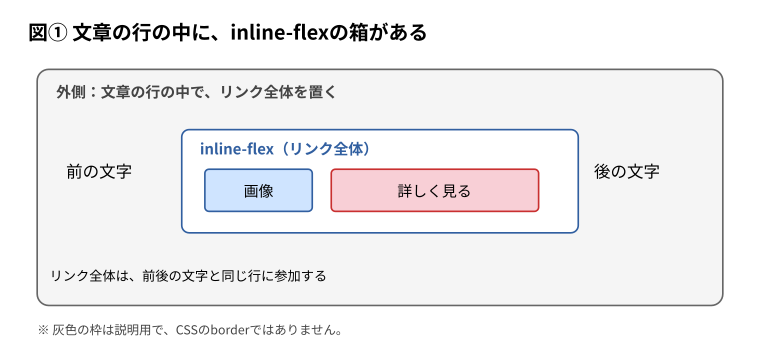
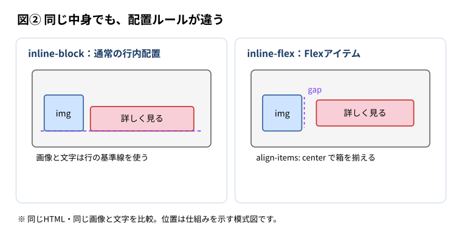
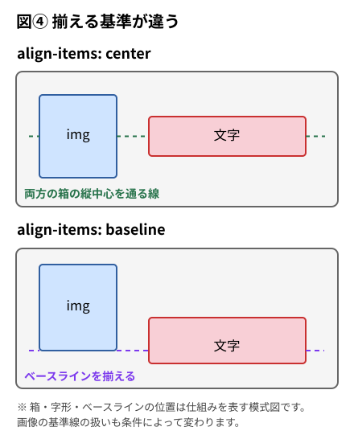
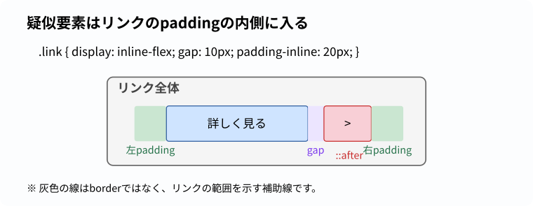

# 03_inline-blockとinline-flexを使い分ける

文章の途中に「詳しく見る」というリンクを置き、横に矢印アイコンを添える場面を考えます。リンク全体は前後の文章と一緒に並べたい。でも、リンクの中では画像と文字の高さや間隔も調整したい。このとき `inline-block` と `inline-flex` のどちらを選ぶとよいのでしょうか。

答えを出すには、**リンク全体をどこに置くか（外側）**と、**リンクの中の子要素をどう並べるか（内側）**を分ける必要があります。両方とも外側ではインラインレベルの箱になれますが、内側の並べ方が違います。

## まず、リンク全体は文章の中に置かれる

次のHTMLを使います。`arrow.svg` は装飾用の矢印画像とし、`alt` を空にしています。

```html
<p class="sentence">
  続きはこちらから
  <a class="link" href="/detail/">
    
    <span>詳しく見る</span>
  </a>
  ご確認ください。
</p>
```

```css
.sentence {
  font-size: 16px;
  line-height: 1.5;
}

.link {
  display: inline-block;
  padding: 10px 20px;
  text-decoration: none;
}

.link img {
  width: 20px;
  height: 20px;
}
```

`inline-block` にしたリンクは、文章から独立した大きな段落になるのではなく、**前後の文字と同じ行に置ける一つの箱**です。中身の画像と文字をまとめて扱えるので、リンク全体に `padding` も付けられます。



図①では、まず外側の文章の行に注目してください。「前の文字」と「後の文字」の間にリンク全体が一つの箱として入り、その箱の中には `img` と `span` があります。図は関係を示した模式図で、実際には行の幅が足りなければリンクが次の行へ移ることもあります。

ここでの **外側がインライン**という説明は、通常の文章の行にリンクが参加している条件での話です。親がFlexコンテナなら、その直接の子はFlexアイテムとして扱われるなど、別の配置規則が優先されます。

## リンクの中では何が変わるのか

`inline-block` のままでは、画像と `span` は通常の文字の行に配置されます。画像は既定でインラインの画像なので、文字と同じ行のベースラインが関係します。HTMLの改行や空白が、画像と文字の間の空白として現れる場合もあります。

**HTMLを変えずに**、まず `display` だけを切り替えます。

```css
.link {
  display: inline-flex;
  padding: 10px 20px;
  text-decoration: none;
}
```

今度はリンクの内側がFlexになり、直接の子である `img` と `span` がそれぞれ **Flexアイテム** になります。画像と文字を一つの行に並べていたときとは、配置を決めるルールそのものが変わりました。リンク全体は引き続き文章の中に置かれます。

そこで、Flexにしたリンクへ次の2つを追加します。

```css
.link {
  display: inline-flex;
  align-items: center;
  gap: 10px;
  padding: 10px 20px;
  text-decoration: none;
}
```

`align-items: center` は、横並びの子の**箱の縦方向の中心**を揃えます。`gap: 10px` は、直接の子の間隔を明示的に作ります。これらは `display` の切り替えとは別に追加する指定です。



図②のAでは、画像と `span` が通常の行内配置に参加しています。Bでは、画像と `span` が別々のFlexアイテムになり、`gap` と `align-items` で直接配置を調整できます。**画像と文字の間隔を確実に指定したい場合や、縦位置を箱単位で揃えたい場合**は、Bのほうが指定の目的が明確です。

ただし、`inline-block` でも文字や画像を並べられますし、ほかのCSSを組み合わせて似た見た目を作ることもできます。「画像があれば必ず `inline-flex`」ではなく、調整したい対象で選びます。

## 内側が揃っても、リンク全体は外側の行に従う

リンクを `inline-flex` にして `align-items: center` を指定すると、リンク内の画像と文字の箱を揃えられます。しかし、これでリンク全体が前後の文章の中央へ自動的に揃うわけではありません。

- `align-items` が揃えるのは、**リンクの中のFlexアイテム**です。
- `vertical-align` が関わるのは、**文章の行に置かれたリンク全体の縦位置**です。

たとえば、前後の文字に対するリンク全体の位置を調整したい場合は、次を試せます。

```css
.link {
  vertical-align: middle;
}
```

`middle` は親の行のベースラインとフォントのx-heightを使う整列であり、Flexの `center` と同じ意味の幾何学的な中央ではありません。リンク全体の位置が変わったのか、リンク内部の画像と文字の位置が変わったのかを分けて観察します。

一方、内側のFlexアイテム同士を文字の基準線で揃えたいときは、`align-items: baseline` を使う選択肢があります。



図④の上は箱の中心、下はベースラインを揃える模式図です。画像や文字が持つベースラインは条件によって決まるため、図の線の位置がどのフォントや画像でも同じになるわけではありません。このあたりで画像の下側に隙間が見える理由は、次の記事[ベースラインと見た目のずれ](./04_ベースラインと見た目のずれ.md#image-gap)の図③で、**部品の内側と外側のどちらに空間があるか**を確認するとつながります。

## どちらを選べばよいか

たとえば文章の途中に単純なラベルを置き、文字の周りに余白を付けたいだけなら、`inline-block` で十分です。

```html
<span class="subject">国語</span>
```

```css
.subject {
  display: inline-block;
  padding: 10px 20px;
  background-color: #c93030;
  color: #fff;
}
```

この場合は、内側の複数の子を並べる仕組みが必要ありません。一方、アイコン・文字・矢印などの**複数の子をまとめて揃えたり、間隔を管理したりしたい**なら、`inline-flex` が扱いやすくなります。

| 選ぶ場面 | まず試す指定 | 理由 |
| --- | --- | --- |
| 文字だけのラベルを箱として扱う | `inline-block` | 余分なFlexの配置規則がいらない |
| アイコンと文字の間隔を管理する | `inline-flex` | 直接の子へ `gap` を使える |
| 画像と文字の箱の縦位置を揃える | `inline-flex` | `align-items` を使える |
| 部品全体が前後の文字と上下にずれる | 外側の `vertical-align` を確認 | 内側の配置とは別の問題だから |

この比較は、通常の文章の中に置く部品を前提としています。ページ上で独立した幅いっぱいの行を作りたいなら、`display: flex` なども候補になります。`inline-block` の `width: auto` も常に「文字と同じ幅」になるわけではなく、利用できる幅の影響を受けます。外側と内側を組み合わせた `display` の考え方は、[要素とCSSの箱の関係](../05_ボックスとdisplay/06_要素とCSSの箱の関係.md)で詳しく扱います。

<a id="疑似要素もpaddingの内側に入る"></a>

## `::after` を使った矢印も内側に入る

画像の代わりにCSSの疑似要素で装飾矢印を作る場合もあります。これは最初の画像付きリンクとは別の作例です。

```html
<a class="link" href="/detail/">詳しく見る</a>
```

```css
.link {
  display: inline-flex;
  align-items: center;
  gap: 10px;
  padding-inline: 20px;
}

.link::after {
  content: "›";
}
```

`::after` はリンクの末尾に生成されます。この例ではリンクの中のFlexアイテムとして扱われるので、リンク内の文字と矢印の間に `gap` を使えます。矢印だけがリンクの外側へ追加される別の兄弟要素にはなりません。



装飾以外の意味まで疑似要素へ任せるべきかは、[装飾アイコンを疑似要素か実要素で作る](../15_UI部品の実装判断/13_装飾アイコンを疑似要素か実要素で作る.md)で判断します。疑似要素を通常の行に置く場合と `absolute` にする場合の違いは、[疑似要素のdisplayと配置基準](../../../06_疑問/01_HTML・CSS/08_インラインと行の仕組み/疑似要素のdisplayと配置基準はどう違うのか.md)で扱います。

## 自分の実装で確かめる

最初のHTMLをブラウザで開き、DevToolsで `.link` を選びます。`display: inline-block` と `display: inline-flex` を切り替え、**前後の文章に対するリンクの位置は同じ種類のまま、内側の並び方が変わる**ことを確認してください。

次に `inline-flex` の状態で `gap` を変更し、画像と `span` の間だけが変わるか確かめます。`align-items: center` と `baseline` を切り替えたら、画像と文字の縦位置を見ます。最後に `vertical-align: middle` を試し、今度はリンク全体が外側の行の中でどう動くか比べます。

**子の配置を直したいのか、文章の中で部品全体の位置を直したいのか。** この二つを見分けられれば、`inline-block` と `inline-flex` を使い分ける判断ができます。`inline-block` のベースラインがどこになるかという詳しい条件は、[inline-blockのベースラインが決まる条件](../../../03_詳細/01_HTML・CSS/08_inline-blockのベースラインが決まる条件を比べる.md)へ分けます。
