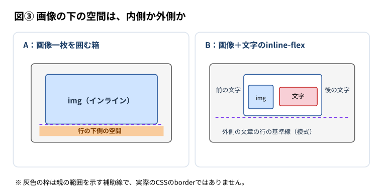
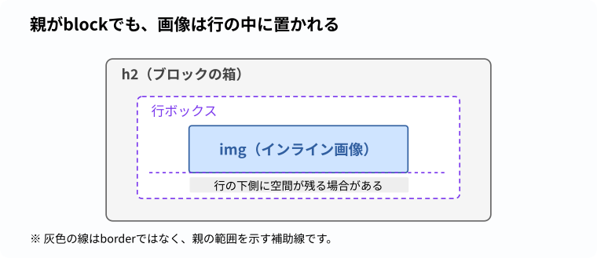

# 04_ベースラインと見た目のずれ

画像の下に数pxの空間が残ったり、文字とアイコンを中央に揃えたつもりでも上下にずれて見えたりすることがあります。こうしたときは、すぐにmarginを減らすよりも、**どの箱の内側に空間があるのか**を先に確かめます。

画像そのものの下に空間がある場合と、画像を含む部品全体が文章の行の中でずれている場合とでは、調べる場所が違うからです。

<a id="image-gap"></a>

## ベースライン・ディセンダー・画像下の隙間

### 画像にmarginがないのに、下が空くのはなぜか

まず、枠の中に画像を一枚だけ置きます。

```html
<div class="frame">
  
</div>
```

```css
.frame {
  border: 10px solid #666;
}
```

この状態では、`img` は既定でインラインレベルの置換要素として扱われます。画像がインラインの行に置かれると、既定の `vertical-align: baseline` により、画像の下端がその行の**ベースライン**に揃います。

ベースラインは、文字を行の中に配置するための基準線です。欧文の `g`・`p`・`y` などは、この線より下へ伸びる部分を持ちます。この部分を**ディセンダー**と呼びます。行の箱は、ベースラインより下側にもフォントに由来する空間を必要とすることがあります。

そのため、画像自体に下marginがなくても、**画像が入っている行ボックスの下側に空間が残る**場合があります。画像のピクセルに透明部分がある現象や、画像にmarginが付いた現象とは区別します。



図③のAは、画像を囲む箱の**内側**に、行ボックス由来の空間が残る例です。Bは、画像と文字を包んだ部品自体を、さらに外側の文章の行へ置いた例です。まずは枠線を目印に、気になる空間がどこにあるかを見分けます。図は位置関係を表す模式図で、空間の寸法は一律ではありません。

### 画像一枚なら、行の外へ出す

Aのように画像一枚を独立して表示するだけなら、まず画像をブロックに変えてみます。

```css
.frame img {
  display: block;
  max-width: 100%;
  height: auto;
}
```

画像は親の文字の行にインライン画像として参加しなくなるため、**その行ボックスが画像の下側に確保していた空間**を避けられます。

ここで `max-width: 100%` と `height: auto` は、画像が親の幅に収まり、縦横比を保つための指定です。下の隙間を解消する役割は `display: block` にあります。

ただし、親にpadding・margin・別の子要素があれば、それらによる余白まで消えるわけではありません。`display: block` を付け外しし、画像の下の距離が実際に変わるか確認します。

### 画像と文字を一つの部品にするなら、内側をFlexにする

Bのように画像と文字を横並びの部品にしたい場合は、部品の内側をFlexにできます。図に対応するよう、画像の後ろへ文字を一つ追加します。

```html
<p class="sentence">
  前の文字
  <span class="media">
    
    <span>説明用画像</span>
  </span>
  後の文字
</p>
```

```css
.media {
  display: inline-flex;
  align-items: center;
  gap: 10px;
}

.media img {
  width: 30px;
  height: auto;
}
```

この場合、`img` と内側の `span` はFlexアイテムとして配置されます。画像が通常のインライン画像としてテキストのベースラインに載るのではないため、**その仕組みで部品内に生じていた下側の空間**は避けられます。

しかし、`media` 自身は文章中の一つのインラインレベルの箱です。外側の `.sentence` が作る行には、別のベースラインと行ボックスがあります。部品の**内側**の空間がなくなっても、部品の**外側**の行に空間が残ることはあります。

部品の中の二つの箱を揃える指定が `align-items`、文章の行の中で部品全体の位置を変える指定が `vertical-align` です。この境界については、前の記事[inline-blockとinline-flexを使い分ける](./03_inline-blockとinline-flexを使い分ける.md)の図①・②・④でも比較しています。

### `line-height: 0` や `vertical-align` で対処してもよいか

画像だけを含む `inline-block` では、親の `line-height` を0にすると、行に必要な文字由来の高さを抑え、画像下の空間が目立たなくなる場合があります。

```css
.frame {
  display: inline-block;
  line-height: 0;
}
```

ただし、`line-height` は子孫へ継承されるため、後から文字を入れた際に行高不足や重なりにつながることがあります。`font-size: 0` も、子の文字まで小さくしてしまうため、画像下の隙間だけを直す指定としては扱いにくくなります。

インラインのまま置く理由がある場合は、画像への `vertical-align: bottom` などを試す方法もあります。ただし、これは行内での整列を変える指定で、行の箱そのものをなくすわけではありません。

**画像一枚なら、まず `img { display: block; }` を確認する。画像と文字を並べる目的があるなら、内部をFlexで管理する。** どちらも、部品の外側の行の高さとは分けて考えます。

### 見出しやリンクの中に画像がある場合

親がブロック要素でも、中の画像がインラインなら、親の中で行ボックスが作られます。

```html
<h2></h2>
```



図は箱の包含関係を示したものです。灰色の枠は説明用で、CSSの `border` を指定した状態ではありません。

この場合も画像だけなら `display: block` を試せます。ただし `h2` 自体のmarginやpaddingが距離を作っている可能性もあるので、画像下の空間がすべてベースライン由来だと決めつけません。

画像一枚を持つリンクを独立した矩形として扱うときは、リンクと画像をそれぞれブロックにできます。

```css
.link {
  display: block;
}

.link img {
  display: block;
  max-width: 100%;
  height: auto;
}
```

## どの箱を基準に揃えているか

ここまでの現象を説明する名前を整理します。すべてを最初から暗記するより、何の位置・寸法を調べているのかを区別できれば十分です。

| 名称 | 表すもの | このページでの確認先 |
| --- | --- | --- |
| inline box | 行内に流れる箱 | 周囲の文字との並び |
| line box | 一行の配置に使う箱 | 画像の下側に残る空間 |
| baseline | 行内の整列に使う基準線 | 画像の下端と文字の位置 |
| font metrics | フォントが持つ文字配置用の寸法情報 | 行の上側・下側の余地 |
| glyph | 画面に見える実際の字形 | 文字の見た目の上下位置 |
| replaced element box | `img` などの外部内容を表示する箱 | 画像そのものの寸法 |
| border box | content・padding・borderを含む箱 | 枠の内側か外側かの確認 |
| flex item | Flexコンテナが並べる対象 | 画像と文字の箱単位の整列 |

ブラウザで数pxの差を調べる場合は、まず対象要素と[ブラウザで実際に使われたフォント](../07_ブラウザ挙動と表示のズレ/04_ブラウザで実際に使われたフォントを確認する.md#指定フォントとレンダリングフォントを分ける)、`font-size`、`line-height`、padding、`vertical-align` を確認します。測る場所そのものが違っている場合は、[カンプとブラウザで測る場所をそろえる](../07_ブラウザ挙動と表示のズレ/03_カンプとブラウザで測る場所をそろえる.md)も参照してください。

短い定義が必要なときは[行ボックスとベースライン](../../../05_参照/行ボックスとベースライン.md)へ戻れます。

## 文字の数学的中央と見た目の中央は違うことがある

画像と文字を `align-items: center` で揃えても、文字が少し上や下に寄って見えることがあります。Flexが中央へ置くのは**子要素の箱**であり、目に見える字形だけの重心ではないためです。

フォントには、ベースラインやアセンダー・ディセンダーなどの寸法情報があります。大文字だけの文字列でも、フォントの下側の領域がなくなるわけではありません。箱としての中央と、文字の見た目の中央が一致しない場合があります。

この差を見たら、いきなり `transform` で補正する前に、フォントが意図したものか、行高・padding・Flexの整列が合っているかを確認します。それでも対象のフォントと部品に限定した調整が必要なら、次のような小さな補正を最後に検討します。

```css
.label {
  transform: translateY(2px);
}
```

これは共通の解決策ではありません。フォントや文字列が変われば、必要な調整も変わるためです。

なお、`inline-block` **自身のベースラインがどこになるか**は、内側の行や `overflow` によって変わる場合があります。詳しい条件は[inline-blockのベースラインが決まる条件を比べる](../../../03_詳細/01_HTML・CSS/08_inline-blockのベースラインが決まる条件を比べる.md)で扱います。

## 行内のずれを確認する順番

画像下の隙間や文字の縦位置が気になったら、最初に枠線で**問題が起きている位置**を見ます。次に、画像が行に参加しているのか、Flexアイテムになっているのかを確認し、変更を一つだけ加えます。

1. 隙間は画像を囲む箱の内側か、部品全体の外側か。
2. `line-height`、padding、marginのどれが距離を作っているか。
3. `img` がインライン画像か、ブロックか、Flexアイテムか。
4. 行の中なら `vertical-align`、Flexの中なら `align-items` のどちらを確認するか。
5. 箱の位置は合っていて、字形だけがずれて見えていないか。

この順なら、行の空間を消したかったのに部品全体を動かしてしまう、という修正を避けやすくなります。画像や動画が置換要素としてどう寸法を持つかは[置換要素](../../../05_参照/置換要素（img・input・video）.md)で確認できます。
