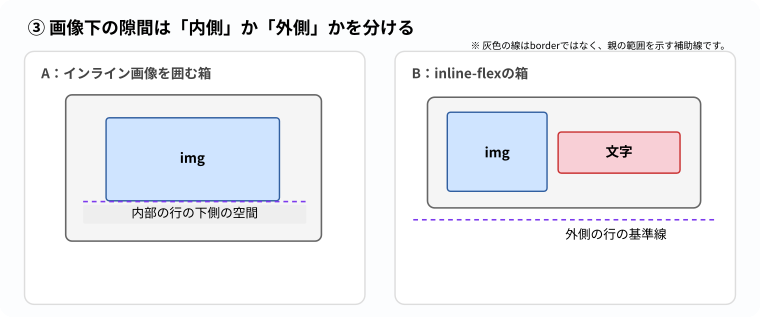

# 04_ベースラインと見た目のずれ

文字、画像、`inline-block`などが同じ行に並ぶときは、箱の中央ではなくベースラインを基準にそろう場合がある。画像の下の隙間や、文字が数学的な中央からずれて見える理由を分けて確認する。

<a id="image-gap"></a>

## ベースライン・ディセンダー・画像下の隙間

### ベースラインとは

文字を配置するときの基準となる線。欧文フォントの`g`・`p`・`y`などは、一般に文字の一部がこの線より下へ伸びる。その部分を**ディセンダー**という。

インライン整形コンテキストでは、文字・インライン画像などを同じ行に並べるとき、このベースラインやフォントの寸法を使って行ボックスの高さ・位置が決まる。

### `img`の下に見える空間はなぜできるか

`img`は初期状態でインラインレベルの置換要素として振る舞う。通常の`vertical-align: baseline`では、画像の**下端がテキストのベースラインに揃う**。

一方、行ボックスにはベースラインより下側にも、フォントに由来する空間が必要となることがある。そのため、画像と親の下端の間に、`margin`や`padding`を指定していないのに隙間が見えることがある。

これは「画像が勝手に下マージンを持つ」現象ではなく、**画像が参加しているインラインの行ボックスが作る空間**である。

```html
<div class="frame">
  
</div>
```

```css
.frame {
  border: 10px solid;
}

/* imgは初期状態ではインラインの配置に参加する */
```

### 解決策①：画像だけなら`display: block`

```css
.frame img {
  display: block;
  max-width: 100%;
  height: auto;
}
```

インライン画像として行に参加させなくなるので、**画像由来の行ボックス下側の隙間を避けられる**。画像だけを入れる部品には素直な方法。

### 解決策②：`inline-flex`にして、直接の子をFlexアイテムにする

```css
.frame {
  display: inline-flex;
  align-items: center;
}
```

直接の子の`img`はFlexアイテムになるので、親の**内側**で「テキストの行のベースラインに画像を置く」方式を採らない。したがって、その仕組みによる内側の隙間は生じない。

ただし、**`inline-flex`自身がさらに外側のIFCに参加していれば、外側の行には別のベースライン・行ボックスがある**。内側の隙間が消えることと、要素の外側に空間が一切できなくなることは別問題。



Aでは`img { display: block; }`が有効。`line-height: 0`は文字に副作用あり。

Bでは内側の隙間は避けられる。外側の行の高さは別に計算される。

### `line-height: 0`で消せるなら、それでよいのでは？

```css
.frame {
  display: inline-block;
  line-height: 0;
}
```

画像だけを含むケースでは、テキスト行の高さの寄与を抑え、隙間が目立たなくなる場合がある。しかし`line-height`は子へ継承されるため、**後から文字が入ると、行の高さ不足・重なり・はみ出し**につながり得る。

`font-size: 0`も文字まで小さくしてしまい、子側で文字サイズを戻す必要が生じる。`vertical-align: bottom`などによる回避も可能なケースはあるが、行の外側まで自動的に消える保証ではない。

したがって、**画像だけなら`img { display: block; }`を優先する**。文字と画像を並べる複合部品ならFlexを使う理由が出てくる。

### 画像リンクの下に隙間ができる場合

見出し自体がblockでも、中の画像がinlineなら行の中に置かれる。たとえば次の構造では、`h2`の高さを`img`の高さだけで決めつけられない。

```html
<h2></h2>
```

```text
h2（block）
└─ line box
   └─ img（inline）
```

`vertical-align: bottom`は画像の行内での位置を変えるが、行の箱そのものをなくす指定ではない。画像だけを独立した箱として扱うなら`display: block`で行内の配置から外せる。ただし、見出しのpaddingやmarginなども高さ・周囲の距離に関わるため、親子の高さの差をすべてベースライン由来と決めない。

画像一枚を持つリンクを独立した矩形として扱うなら、リンクと画像をblockにする方法が分かりやすい。

```css
.link {
  display: block;
}

.link > img {
  display: block;
}
```

`display: flex`でも隙間が消える場合はあるが、画像一枚だけなら内部をFlexにする目的がない。行内に残したい場合は `vertical-align`を調整する選択肢もある。

## どの箱を基準に揃えているか

| 名称 | 何を表すか | 主に確認する場面 |
| --- | --- | --- |
| inline box | 行内に流れる箱 | 行内での並び |
| inline-block box | 行内に置ける矩形の箱 | 行内の小さなUI |
| font metrics | ascent・descentなど、フォントが持つ文字配置用の寸法情報 | 行の高さやベースライン周辺の確認 |
| glyph | 実際に描かれる個々の字形 | 文字の見え方 |
| line box | 一行全体の箱 | `line-height`と行内配置 |
| replaced element box | `img`など外部の内容を持つ箱 | 画像や動画の配置 |
| border box | content・padding・borderを含む箱 | 要素の外寸 |
| flex item | Flexコンテナの配置対象 | `align-items`など |

すべての名前を暗記する必要はない。まず「どの要素の箱か」「行の中か、Flexの中か」「見えている字形か、要素の外寸か」を区別する。

> [!NOTE]
> 普段の実装では、箱やフォントに関する内部の名称をすべて覚える必要はない。まず対象要素、[実際に使われたフォント](../07_ブラウザ挙動と表示のズレ/04_ブラウザで実際に使われたフォントを確認する.md#指定フォントとレンダリングフォントを分ける)、`font-size`、`line-height`、`padding`、`vertical-align`などを確認する。それでも文字の位置や数pxの差を説明できないときは、line box、ベースライン、font metrics、見えている字形の違いが関係している可能性を思い出す。これは必ずしもCSS設計の誤りを意味せず、残る原因候補の一つとして扱う。

短い定義へ戻る場合は[行ボックスとベースライン](../../../05_参照/行ボックスとベースライン.md)を使う。

## 文字の数学的中央と見た目の中央は違うことがある

フォントには、ベースライン、ascender、descenderなどのメトリクスがある。大文字だけの文字列でも、フォントの下側領域がなくなるわけではない。そのため、箱の寸法として中央でも、字形だけを見ると上下へずれて感じる場合がある。

まず `line-height`、padding、Flexなどの整列を確認する。それでも視覚上の補正が必要で、対象フォントや文字列が固定されている場合は、最後に小さく調整する。

```css
.label {
  transform: translateY(2px);
}
```

この調整を共通ルールにせず、フォントと対象部品を確認したうえで限定する。

`inline-block`自身の基準線が、内側の文字や`overflow`によって変わる条件は、[inline-blockのベースラインが決まる条件を比べる](../../../03_詳細/01_HTML・CSS/08_inline-blockのベースラインが決まる条件を比べる.md)で確認できる。

## 行内のずれを確認する順番

1. `line-height`。
2. `vertical-align`。
3. `img`などの置換要素か。
4. `inline`、`inline-block`、`inline-flex`のどれか。
5. 行内の一部か、独立したUI部品か。
6. 要素の箱と、見えている字形のどちらを比較しているか。

画像や動画が置換要素としてどう寸法を持つかは[置換要素](../../../05_参照/置換要素（img・input・video）.md)で確認できる。
