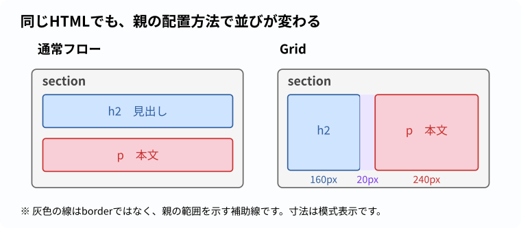

# 02_通常フローを基準にする

FlexやGridをまだ指定していないのに、見出しの下へ本文が並ぶのはなぜでしょうか。CSSで特別な配置を指定しなくても、ブラウザには要素を並べる基本のルールがあります。これが**通常フロー**です。

レイアウトを変更するときは、まず通常フローでどう並んでいるかを見て、その後に**同じHTMLの親へ指定を一つ加える**と、何が変わったのかを追いやすくなります。

## まず指定を追加しない状態を見る

次のHTMLをブラウザで開きます。

```html
<section class="section">
  <h2>見出し</h2>
  <p>幅に合わせて折り返す本文です。</p>
</section>
```

`section` の中に `h2` と `p` があり、どちらも通常はブロックレベルの箱を作るため、**見出しの後に段落が縦へ並びます**。段落の文字は、その中で横に並び、使える幅を超えると折り返します。

ここではまだ `display: grid` も `display: flex` も書いていません。縦に並ぶことも、本文が折り返すことも、通常フローで起きている配置です。

`h2` や `p` にはブラウザ標準のmarginがありますが、ここでは余白の大きさより、**二つの箱が縦に並んでいること**に注目します。

## 同じHTMLにGridを追加するとどう変わるか

ここからも、最初の `.section` をそのまま使います。今度は `.section` に次の指定を追加してください。

```css
.section {
  display: grid;
  grid-template-columns: 160px 240px;
  gap: 20px;
}
```

`display: grid` を指定した `.section` がGridコンテナになり、その直下の `h2` と `p` はGridアイテムとして配置されます。ここでは比較しやすいよう、列幅を160pxと240px、列間のgapを20pxに指定しました。**見出しは1列目、本文は2列目**に入り、同じ行の別々の列へ並びます。

DevToolsで `.section` の `display: grid` を一度無効にしてください。`grid-template-columns` と `gap` が書かれたままでも、Gridコンテナでなくなれば、見出しと段落は通常フローに戻り、縦へ並びます。再び有効にすると、同じHTMLが横の二列へ並びます。



図は、要素の配置を見比べるための模式図です。灰色の線は実際のborderではありません。

この比較から分かるのは、**子のHTMLを書き換えなくても、親が作る配置ルールを変えると、直下の子の並びが変わる**ということです。親の幅が固定列の合計とgapより狭くなれば、この実験用のGridは収まりません。ここではまず並びが変わる仕組みを見て、幅に合わせて列を調整する判断は[FlexとGridで直下の子を並べる](./03_FlexとGridで直下の子を並べる.md)で扱います。

## 高さを指定しなくても、内容によって箱は伸びる

通常フローで見出しと本文が縦へ並ぶとき、`height` を指定しなければ、それらの内容や余白などをもとに `.section` の高さが決まります。本文を長くして折り返しが増えれば、段落が高くなり、その下に続く内容も押し下げられます。

このときの高さは、`height: 300px` のようにCSSに書いた固定値とは限りません。**`height: auto` の結果として、内容に必要な高さが生まれている**場合があります。

反対に、親へ固定の高さを指定して内容がその高さを超えた場合、親の指定した高さが自動で大きくなるわけではありません。

```css
.section {
  height: 100px;
}
```

この指定を試すときは、本文を十分長くしてみます。初期値の `overflow: visible` なら、子の内容が親の箱の外へはみ出して見えることがあります。親に高さを付けたからといって、中身が収まるとは限りません。

「最低でも100pxほしいが、文章が増えたら伸びてよい」という要件なら、固定の `height` ではなく `min-height` が候補になります。

```css
.section {
  min-height: 100px;
}
```

どちらがよいかは、カンプの高さをただ写すのではなく、**文章が増えたときにどう振る舞ってほしいか**で決めます。なお、これらの高さの比較は先ほどのGridの指定を外し、通常フローの状態で試すと、変化の理由を追いやすくなります。

## 通常フローの中にいない箱もある

配置を調べるときは、対象が通常フローに参加しているかも確認します。たとえば `position: absolute` を指定した要素は、通常フローから外れて配置されます。周囲の要素は、その箱が通常フロー内で占める高さを前提として並びません。

また、floatは通常のブロック配置から外れ、文章がその周囲へ回り込む場合があります。どちらも単に「上に重ねる／横へ並べる」という見た目だけで理解すると、周囲の要素との関係を見失います。

画像に文字を重ねる実装は[画像の上に文字や部品を重ねる](../../11_メディアの表示枠と重ね配置/05_画像の上に文字や部品を重ねる.md)、floatの回り込みは[floatで文章を図版に回り込ませる](../../../../03_詳細/01_HTML・CSS/06_floatで文章を図版に回り込ませる.md)で確認できます。

## 配置を変える前に確認すること

配置が思ったとおりにならないときは、まず親と直下の子を選び、現在の `display` を調べます。通常フローでの並びを確かめたうえでFlexやGridを有効にすれば、**どの指定が子の並びを変えたのか**を区別できます。

さらに、画面幅や文章量を変えて、折り返し・高さ・はみ出しを確認します。子を横へ並べたいのか、子の中身を並べたいのか迷う場合は、次の[FlexとGridで直下の子を並べる](./03_FlexとGridで直下の子を並べる.md)と[親子のレイアウト文脈を区別する](./04_親子のレイアウト文脈を区別する.md)で、その指定を置く親を確認します。

blockとinlineで箱の広がり方が異なる理由は、[blockとinlineの広がり方](../../05_ボックスとdisplay/05_blockとinlineの広がり方.md)へ戻れます。

## 仕様確認先

- [CSS 2.2：Normal Flow](https://www.w3.org/TR/CSS22/visuren.html#normal-flow)
- [CSS Display Module Level 3](https://www.w3.org/TR/css-display-3/)
