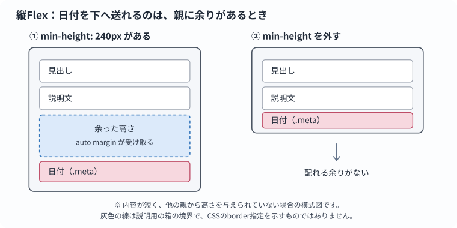

# 02_Flexで子の位置を揃える

Flexで横並びにした要素を中央に揃えたい、あるいはカードの中の日付だけを下へ送りたいとき、指定するプロパティは同じとは限りません。**子をどの方向へ動かしたいか**と、**その方向に余った空間があるか**を分けると判断しやすくなります。

## 主軸と交差軸を先に確認する

Flexには、子を並べる**主軸**と、それに直交する**交差軸**があります。横書きの通常の例では、次のようになります。

| `flex-direction` | 主軸 | 交差軸 |
| --- | --- | --- |
| `row` | 横方向 | 縦方向 |
| `column` | 縦方向 | 横方向 |

たとえば、見出しとリンクを左右へ離して置く場合を考えます。

```html
<div class="row">
  <h2>講師紹介</h2>
  <a href="/teachers/">一覧を見る</a>
</div>
```

```css
.row {
  display: flex;
  justify-content: space-between;
  align-items: center;
}
```

既定の `flex-direction: row` では、主軸は横方向です。`justify-content: space-between` は主軸方向の余りを子の間へ配り、`align-items: center` は縦方向で子の箱を揃えます。

もし `flex-direction: column` に変えると、主軸と交差軸が入れ替わります。`justify-content` は縦方向、`align-items` は横方向に作用するようになります。「左右なら `justify-content`、上下なら `align-items`」と固定して覚えると、縦Flexになったときに判断が逆になります。

`align-self` は、コンテナ全体ではなく一つのFlexアイテムだけの交差軸方向の揃え方を変えるときに使います。

## `display: flex` だけで子の高さが揃うのはなぜか

横方向のFlexでは、子に高さを指定していないのに、並んだ箱の高さが揃うことがあります。これは、交差軸方向の既定の整列が通常は `stretch` 相当として働くためです。

たとえば二つのカードを横並びにしたとき、片方の文章が長ければ、その行の交差軸方向の大きさに合わせて短い方のFlexアイテムも伸びる場合があります。ただし、子の交差軸サイズが `auto` で、min/maxサイズなどの制約がないことが前提です。

箱が伸びたことと、画像そのものの縦横比が変わったことは別です。画像の収め方を確認する場合は[決めた表示領域に画像を合わせる](../../12_レスポンシブ画像設計/03_決めた表示領域に画像を合わせる.md)へ進みます。

## 日付だけを下へ送りたいときは、余りのある親を探す

次は、カードの中に見出し・説明文・日付を縦に並べる例です。本文の長さが変わっても、余りがあるときには日付を下側へ置きたいとします。

```html
<article class="card">
  <h3>講師紹介</h3>
  <p>各講師の特徴を紹介します。</p>
  <p class="meta">2026.11.20</p>
</article>
```

```css
.card {
  min-height: 240px;
  display: flex;
  flex-direction: column;
}

.meta {
  margin-block-start: auto;
}
```

ここでは `.card` 自身を縦方向のFlexコンテナにしています。見出し・説明文・日付は、その**直接の子であるFlexアイテム**です。

カードには `min-height: 240px` があるため、内容の合計が240pxに満たなければ縦方向に余りができます。`.meta` の `margin-block-start: auto` がその余りを受け取り、日付の上に空間を作ることで、日付はカードの下端側へ移動します。



左の図は、カードに最低高があり、内容より高さが余っている場合です。右の図は `min-height` を外し、**他の親から高さを与えられていない**ため、カードが内容に近い高さになった場合です。右側では配れる余りがほぼなく、`margin-block-start: auto` を指定しても日付は下へ離れません。

ブラウザでも `.card` の `min-height` を外してみてください。日付がすぐ上の文章へ近づくなら、元の下寄せは、カードの余りを使っていたと確認できます。

反対に、`min-height` を外しても日付が下に残る場合は、カードの高さを別の指定や外側のレイアウトから受け取っていないかを確認します。**auto marginは、「下へ移動する」という直接の命令ではなく、余った空間をmarginが受け取る仕組み**だからです。

また、本文そのものが長くなって余りを使い切れば、日付の上に入る空間は小さくなります。ここでは固定のカード高ではなく最低高にしているので、内容が増えた場合は必要に応じてカードを伸ばせます。

## `justify-content` と auto margin をどう使い分けるか

同じ縦Flexでも、複数の子全体を分散したい場合と、一つの子だけを末尾へ送りたい場合では考え方が異なります。

| 動かしたい対象 | 主に見る指定 |
| --- | --- |
| Flexアイテム全体の主軸方向の配置 | `justify-content` |
| Flexアイテム全体の交差軸方向の配置 | `align-items` |
| 一つのアイテムだけの交差軸方向の整列 | `align-self` |
| 一つのアイテムへ主軸方向の余りを受け渡す | `margin-*-start: auto` など |
| 箱の中の文字やインライン内容 | `text-align` |

このカードでは見出しと説明文を自然に続け、その後の**日付だけ**を下へ送りたいので、`.meta` のauto marginが適しています。`justify-content: space-between` に変更すると、見出しと説明文の間にも余りが配られ、意図したまとまりが崩れる場合があります。

なお、通常の横書きで `flex-direction: column` の例だから、`margin-block-start: auto` が主軸方向の開始側marginになっています。書字方向やFlexの方向が変わる場合は、どのmarginが主軸方向に当たるか確認します。

同じ行の複数カードで日付の高さまで揃える場合は、カード自身が外側のGridやFlexから同じ高さを受け取ることと、**カード内部で余りを日付へ渡すこと**を別々に考えます。この応用は[カードの可変本文と下寄せ要素を両立する](../../15_UI部品の実装判断/07_カードの可変本文と下寄せ要素を両立する.md)で扱います。

文字の中央と要素の箱の中央を区別したい場合は、[文字と要素の箱を中央に寄せる](../../08_インラインと行の仕組み/06_文字と要素の箱を中央に寄せる.md)へ戻れます。

## 確認する順番

Flexで子が思った位置へ動かない場合、まず `flex-direction` から主軸・交差軸を決めます。続いて、動かしたいのが子全体なのか一つの子なのかを確認し、**その方向に配れる余りがあるか**を見ます。

今回のカードなら、`.meta` だけではなく `.card` の高さも確認してください。必要な高さがどこで生まれているかが分かれば、位置指定が効く条件も説明できるようになります。

## 仕様確認先

- [CSS Flexible Box Layout Module Level 1：Alignment](https://www.w3.org/TR/css-flexbox-1/#alignment)
- [CSS Box Alignment Module Level 3](https://www.w3.org/TR/css-align-3/)
- [MDN：Aligning items in a flex container](https://developer.mozilla.org/en-US/docs/Web/CSS/Guides/Flexible_box_layout/Aligning_items)
