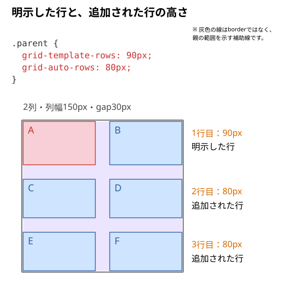
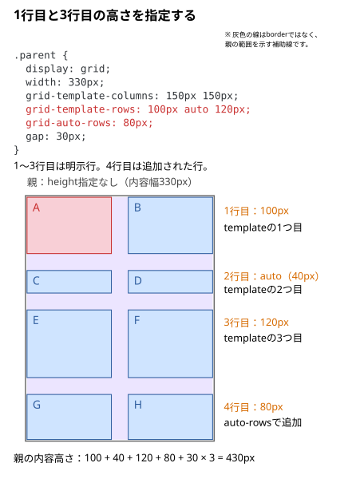

# 行の高さはどう決まる？

Gridでは、親に高さを指定していなくても、子を並べるための行が作られます。2列のGridに6個の子を入れれば、1行に2個ずつ入り、全部を置くために3行が必要になります。

では、その3行は**何pxになるのでしょうか**。最初に行の高さを一つも指定しない状態を見てから、1行目だけを指定する場合と、あとから必要になった行を指定する場合を比べます。

## 何も行高を指定していないとき

A〜Fの6個を、同じ親に入れます。

```html
<div class="parent">
  <div class="child">A</div>
  <div class="child">B</div>
  <div class="child">C</div>
  <div class="child">D</div>
  <div class="child">E</div>
  <div class="child">F</div>
</div>
```

親には2列と列の間隔だけを指定します。`width: 330px` は、150pxの列が2本と30pxのgapを収めるための、この実験用の幅です。

```css
.parent {
  display: grid;
  width: 330px;
  grid-template-columns: 150px 150px;
  gap: 30px;
}

.child {
  line-height: 40px;
  background: #cfe4ff;
}

.child:first-child {
  background: #f8cfd6;
}
```

A・Bが1行目、C・Dが2行目、E・Fが3行目に入ります。今回はどの子も文字が1行で、行高は40pxです。子にpaddingやborderもなく、行を高くする別の内容がなければ、**内容に合わせた3行はそれぞれ40px**になります。

親の `height` は指定していません。上下の行間は30pxずつなので、この条件では親の内容高さは次のようになります。

```text
40px × 3行 + 30px × 2か所 = 180px
```

ここで区別したいのは、**行が何本必要か**、**各行の高さはいくつか**、**行とgapの合計で親がどれだけ高くなるか**の三つです。行の高さを明示しなくても、必要な行が作られ、内容をもとに高さが決まります。

なお、これは親に高さの制約がなく、上の内容だけを置いた場合の結果です。親に余分な高さが与えられると、`auto` の行が `align-content: stretch` で伸びるなど、別の条件も関わります。

## 1行目だけを90pxにしたら、残りはどうなるか

次に、同じHTMLへ行の指定を加えます。

```css
.parent {
  display: grid;
  width: 330px;
  grid-template-columns: 150px 150px;
  grid-template-rows: 90px;
  grid-auto-rows: 80px;
  gap: 30px;
}
```

`grid-template-rows: 90px` が定義しているのは**1行目だけ**です。2列に6個の子を置くには3行必要なので、2・3行目は足りない分として自動で追加されます。その追加行の高さを `grid-auto-rows: 80px` が決めます。



この図では、1行目は90px、2行目と3行目は80pxです。行の間に30pxのgapが二つあるので、親の内容高さは次のとおりです。

```text
90px + 80px + 80px + 30px × 2 = 310px
```

`grid-template-rows` と `grid-auto-rows` は、同じ行を取り合って優先順位を競っているわけではありません。**前者は指定して用意した行、後者は必要になって追加された行**を担当しています。Gridの列や行を帯状に見た領域を**トラック**と呼び、ここでは行トラックの高さを指定しています。

## 1行目と3行目の高さを指定する

では、1行目は100px、3行目は120pxにして、その間の2行目だけ内容に合わせたい場合はどうでしょうか。

```css
.parent {
  display: grid;
  width: 330px;
  grid-template-columns: 150px 150px;
  grid-template-rows: 100px auto 120px;
  grid-auto-rows: 80px;
  gap: 30px;
}
```

`grid-template-rows` へ書いた三つの値が、そのまま1〜3行目に対応します。`auto` と書いた2行目も**明示して用意した行**です。`auto` という単語があるから追加行になるのではありません。

この違いを確認するため、先ほどのA〜Fの末尾、親の閉じタグの直前にG・Hを追加します。

```html
<div class="child">G</div>
<div class="child">H</div>
```

2列で8個になったため、今度は4行必要です。1行目が100px、2行目は短い内容に合わせて40px、3行目が120pxになります。**4行目だけが追加行**なので、`grid-auto-rows: 80px` が適用されます。



```text
100px + 40px + 120px + 80px + 30px × 3 = 430px
```

ここでも、親の高さを直接430pxと指定したわけではありません。今回の条件では、必要な行とgapの高さを合計した結果、親の内容高さが430pxになります。

## 内容に合わせる行と固定した行を比べる

ここからはG・Hを外して、再びA〜Fの6個へ戻します。そして、Fだけを3行の文章に変えます。

```html
<div class="parent">
  <div class="child">A</div>
  <div class="child">B</div>
  <div class="child">C</div>
  <div class="child">D</div>
  <div class="child">E</div>
  <div class="child">F<br>続き<br>続き</div>
</div>
```

親の行指定をいったん外し、最初と同じ2列・gapだけの状態にします。子の `line-height: 40px` などはそのままです。

```css
.parent {
  display: grid;
  width: 330px;
  grid-template-columns: 150px 150px;
  gap: 30px;
}
```

この状態では明示行がないため、作られる行はすべて `grid-auto-rows` の対象です。省略時の初期値は `auto`。まずこれを基準に、**同じFの内容のまま、行高の指定だけを変更**します。

### A｜文章に合わせて行を伸ばす（`auto`）

```css
.parent {
  grid-auto-rows: auto;
}
```

短い内容の1・2行目は40px、3行目はFの3行分に合わせて120pxになります。同じ3行目にあるEも、Fと**同じ行トラック**に置かれます。Eの文字が3行になったわけではありませんが、行そのものは120pxです。

つまり、`auto` は行ごとの内容に必要な大きさをもとに決まり、すべての行が同じ高さになるとは限りません。ただし、親の高さに余りがある場合などには `auto` 行が伸びることもあるため、「常に文字の高さと完全一致する」という意味でもありません。

### B｜常に80pxに固定する（`80px`）

```css
.parent {
  grid-auto-rows: 80px;
}
```

今度はすべての行トラックが80pxです。Fは3行のままなので、必要な120pxに対して行が40px足りません。行を固定しても文字そのものの行高は縮まず、**内容が行の外へはみ出し、隣の行と重なって見える**場合があります。



**行の高さを固定することと、中身を収めることは別**です。内容を隠してよいのか、折り返すべきか、カードを伸ばすべきかは実装要件から決めます。

### C｜最低80pxにして、必要なら伸ばす（`minmax()`）

```css
.parent {
  grid-auto-rows: minmax(80px, auto);
}
```

各行に80pxの下限を設け、内容がそれより大きければ、必要な高さまで伸ばします。今回の短い1・2行目は80pxで、Fを含む3行目は120pxになります。



`minmax(80px, auto)` が変えるのは**行トラックの寸法**です。子のフォントサイズや行数を変える指定ではありません。最低高を揃えつつ、内容が増えたら伸ばしたいカード一覧などで使えます。

## `1fr` を行の高さに使うと？

行でも `fr` を使うことができます。

```css
.parent {
  grid-auto-rows: 1fr;
}
```

ただし、列の `fr` と同じ感覚で「画面の高さを均等に割る」と考えるのは正確ではありません。親に `height: 420px` のような確定した高さがあれば、行は制約を考慮しながら利用可能な高さを配分します。

一方、今回のように親の高さが `auto` で内容から決まる場合は、内容に必要な大きさを基準に `fr` の行高が計算され、複数の `1fr` 行が同じ高さになることもあります。最小サイズの制約もあるため、常に自由な高さまで縮められるわけではありません。

## 行の高さと、行の中の子の位置は別

行が90pxでも、子の箱をその行の上側に置くことはできます。`align-items` や `align-self` は、行トラックそのものではなく、**行の中で子をどう配置するか**を調整する指定です。

行高を決めたあとに子だけを上下へ動かしたいなら、[子要素の上下左右の揃え方](./09_子要素を上下左右に揃えるには.md)で比較してください。

## DevToolsで確かめる

Gridオーバーレイを表示し、まずA〜Fの6個で1行目90px、追加行が80pxになることを見ます。次に `grid-auto-rows` を無効にして、追加行だけが内容に合わせた高さへ戻るかを確認します。

G・Hを増やした例では2行目の `auto` と4行目の追加行を見分け、最後にFを3行にした例で `auto`・固定80px・`minmax(80px, auto)` を切り替えます。確認するのは、**Gridの行の境界**と、**その中の文字が収まっているか**の両方です。

この二つを分けて見れば、「行を高くしたつもりが中身だけ変わっていた」「行を固定したのに文字がはみ出す」といった現象の理由を追いやすくなります。

仕様確認先：[MDN：grid-auto-rows](https://developer.mozilla.org/en-US/docs/Web/CSS/Reference/Properties/grid-auto-rows)、[CSS Grid Layout Module Level 2](https://www.w3.org/TR/css-grid-2/#fr-unit)。
