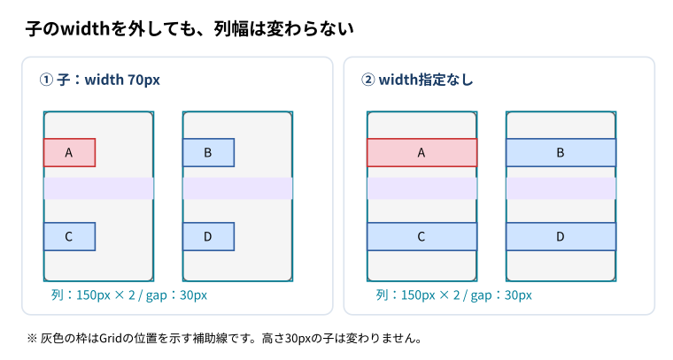
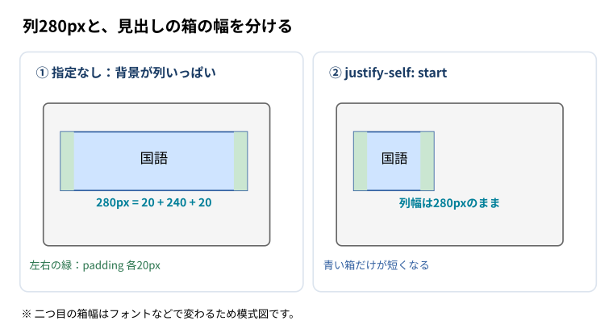
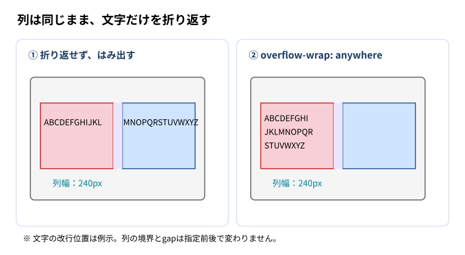

# 列幅と子要素のサイズの違い

列を150pxにしたのに、子の箱は70pxしかない。反対に、短い文字しか入っていない見出しの背景が、列幅いっぱいに伸びることもある。**Gridの列と、そこに入る子の箱、さらに中身の幅は、何が決めているのだろう？**

列は親が作る配置用の枠であり、子要素そのものではない。まず列と子を比べ、次に子の箱と文字を分けて見ていく。

## 列を保ち、子の幅だけを変える

2列・2行のGridにA〜Dを置く。列はそれぞれ150px、子の幅だけ70pxとする。

```html
<div class="parent">
  <div class="child">A</div>
  <div class="child">B</div>
  <div class="child">C</div>
  <div class="child">D</div>
</div>
```

```css
.parent {
  display: grid;
  width: 330px;
  grid-template-columns: 150px 150px;
  grid-template-rows: 90px 90px;
  gap: 30px;
}

.child {
  width: 70px;
  height: 30px;
  line-height: 30px;
  background: #cfe4ff;
}
```



`width: 70px`を外すと、通常の`div`のGridアイテムは既定の横方向の引き伸ばしによって、列の幅150pxまで広がる。**変わるのは子の幅であり、親の列幅ではない。** 高さ30pxは指定したままなので変わらない。

行と列の交わる領域を**セル**と呼ぶ。セルの大きさと、そこへ置く子の箱の大きさは別である。子の`height`も外した場合や、固有の縦横比を持つ画像の場合は、同じように広がるとは限らない。

## 文字だけの見出しが列幅まで広がるのはなぜか

今度は、Gridの中に「国語」という短い見出しを置く。**文字は短いのに、背景が列幅いっぱいになる**ことを確認する。

```html
<div class="parent">
  <p class="child">国語</p>
</div>
```

```css
.parent {
  display: grid;
  grid-template-columns: 280px;
}

.child {
  margin: 0;
  padding-inline: 20px;
  background: #333;
  color: #fff;
}
```

列は280px。子の`p`には`width`を指定していないが、通常のGridアイテムは、横方向に空きがあると既定の配置規則で**列の幅まで伸びる**。`width: 100%`が自動で追加されているわけではない。

ここで伸びているのは、文字の形でも左右のpaddingでもない。子の**content領域**である。



この例ではborderもmarginもないため、背景の箱の幅は280px。そのうち左右のpaddingは各20pxなので、content領域の幅は次のようになる。

`280 - 20 - 20 = 240px`

ただし、「国語」の文字自体が240pxの幅を持つわけではない。**文字の右側に余って見える場所も、content領域に含まれる。** ボックスモデルの各領域は[ボックスモデルの4領域](../../05_ボックスとdisplay/03_ボックスモデルの4領域.md)で確認できる。

### 背景を文字幅に合わせたいとき

列幅280pxは保ち、見出しの箱だけを短くしたいなら、次を加える。

```css
.child {
  justify-self: start;
}
```

これで子の横方向の引き伸ばしが止まり、短い文字と左右paddingに合う幅になる。**列幅は280pxのまま、子の背景だけが短くなる。** 文字幅はフォントによって変わるため、修正後の子の幅を280pxのような固定値とは考えない。

背景を列いっぱいにしたい場合は、逆にこの指定は必要ない。`inline-flex`など別の`display`を追加しなくても、通常のGridアイテムとして扱えばよい。

### DevToolsで、列と子のどちらが広いか確かめる

1. 親のGridオーバーレイで、**280pxの列の境界**を見る。
2. 子のBox Modelで、**背景の箱・content・左右20pxのpadding**を見る。
3. `justify-self: start`を付け外しし、列は変わらず子の箱だけが短くなるか確認する。

DevToolsの斜線模様を見ても、それだけでは`gap`、padding、余った空間のどれなのかは確定できない。Gridの列境界と、子のBox Modelの寸法を優先して照合する。子にFlexの表示指定がある場合は、Flexのオーバーレイが内部の空間を示していることもある。表示方法はDevToolsの設定やバージョンによって変わる。

**ここまでで、列が正常なのに背景の箱だけが広い疑問には答えられる。** 反対に、列の境界自体が親より外へ出ているなら、次は最小幅を調べる。列と子は収まっていて文字だけがはみ出す場合は、後半の[文字を折り返す例](#列が収まっても文字は別に折り返す)へ進めばよい。

## 列と子の最小幅を分ける

Gridアイテムの中身が大きいと、子の最小幅が列の計算に影響する場合がある。列の幅を決めることと、列の中に子や文字を収めることは、ここでも別の問題になる。

| 調整したい対象 | 主な指定 |
| --- | --- |
| 親が作る列の下限 | `grid-template-columns`の`minmax()` |
| 子の箱の最小幅 | 子の`min-width` |
| 子の中の長い文字・画像 | `overflow-wrap`、画像自身の寸法など |

例えば、自然幅340pxの画像が子の中にあり、画像の幅に制限がないとする。子の`min-width`の初期値は`auto`で、条件によって内容から決まる最小幅が使われる。さらに親の列を単独の`1fr`で指定すると、その列の最小値にも`auto`が含まれる。

このような場合、**子が必要とする最小幅が、列の最低限の幅にも影響する**ことがある。列の境界自体が広がる理由は[1frなのに列が広がるのはなぜ](./04_1frなのに列が広がるのはなぜ.md)で、同じHTMLを用いて確認できる。

### 親の列の下限と、子の最小幅は別

`minmax(0, 1fr)`は**親が作る列**の下限を0にする指定。`min-width: 0`は**子の箱**の自動最小幅の制約を外す指定であり、変更する対象が違う。

元の列指定を保ったまま、子の最小幅だけが原因か調べたい場合は、子へ次を加えて比較する。

```css
.child {
  min-width: 0;
}
```

この指定をしたからといって、長い文字や画像が自動的に縮むわけではない。**列 → 子の箱 → 中身**のどこがはみ出しているかを、順に確認する。自動最小幅が必ず画像の自然幅と同じになるわけではなく、`overflow`などの条件にも影響される。必要なときは[内容由来のサイズと自動最小サイズ](../../../../05_参照/内容由来のサイズと自動最小サイズ.md)で詳しく確認する。

## 列が収まっても文字は別に折り返す

第04記事では、列を`minmax(0, 1fr)`へ変えても、改行できない長い文字そのものは外へはみ出した。列が収まっているなら、今度は**文字の表示**だけを変える。

[第04記事の長い文字のHTML](./04_1frなのに列が広がるのはなぜ.md)を使い、列幅はそのままで次を加える。

```css
.token {
  overflow-wrap: anywhere;
}
```



これは文字が改行できる位置を増やす指定であり、**列を広げたり、文字を縮小したりする指定ではない**。改行位置と行数は、フォントや表示幅によって変わる。`white-space: nowrap`のように一行を保つ必要がある場合は、折り返しではなく省略やスクロールなどを別に判断する。

## 画像なら画像自身の寸法を調整する

子の中に画像を置く場合、画像を自然幅より大きくせず、子の内容幅以内に収める例は次のとおり。

```css
.child img {
  display: block;
  max-width: 100%;
  height: auto;
}
```

この指定は画像の表示寸法を制御するもので、親Gridの列幅を決める指定ではない。`width: 100%`との違いは[画像を自然比率で表示する](../../12_レスポンシブ画像設計/02_画像全体を自然比率で表示する.md#widthとmax-widthを使い分ける)で確認できる。

## DevToolsで確認する順番

- **列が広い**：親のGridオーバーレイで列の境界を見る。
- **子の背景が広い／狭い**：子のBox Modelで寸法と`justify-self`を見る。
- **文字や画像だけがはみ出す**：その中身の折り返しやサイズ指定を見る。

一度に複数のCSSを変えない。どの箱を変えたいのか決めてから、その対象の指定を一つずつ試す。入れ子の関係を見失った場合は[親子のレイアウト文脈](../02_配置の基本/04_親子のレイアウト文脈を区別する.md)へ戻れる。

## このページのまとめ

列の幅、Gridアイテムの箱の幅、中身の表示幅は別々に決まる。**背景の幅だけを戻したいなら子の揃え方、列そのものが広がるなら列と子の最小幅、文字だけがはみ出すなら折り返し**を確認する。

## 仕様・確認先

- [CSS Grid Layout Module Level 2：Grid Item Sizing](https://www.w3.org/TR/css-grid-2/#grid-item-sizing)
- [CSS Grid Layout Module Level 2：Automatic Minimum Size](https://www.w3.org/TR/css-grid-2/#min-size-auto)
- [MDN：Grid内での整列](https://developer.mozilla.org/ja/docs/Web/CSS/Guides/Grid_layout/Box_alignment)
- [Chrome DevTools：Flexboxの検査](https://developer.chrome.com/docs/devtools/css/flexbox)
