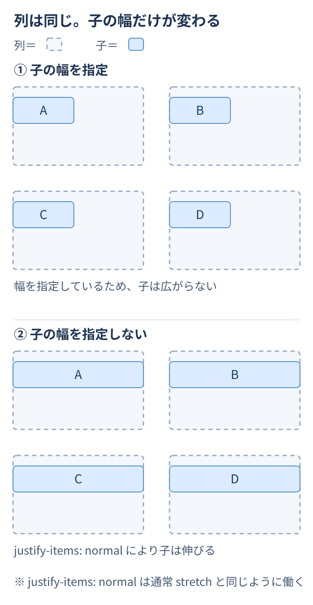
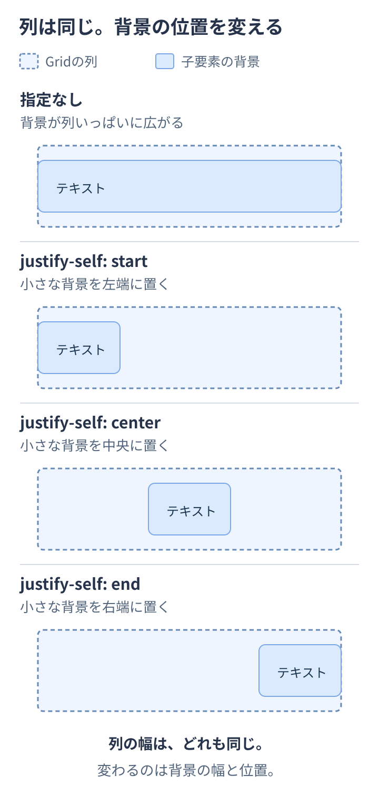
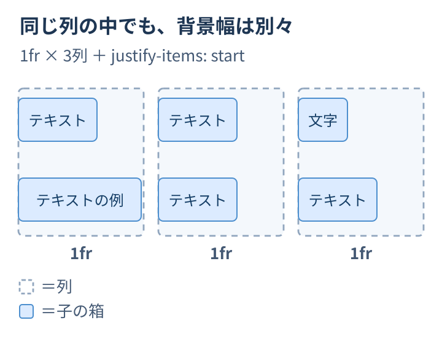
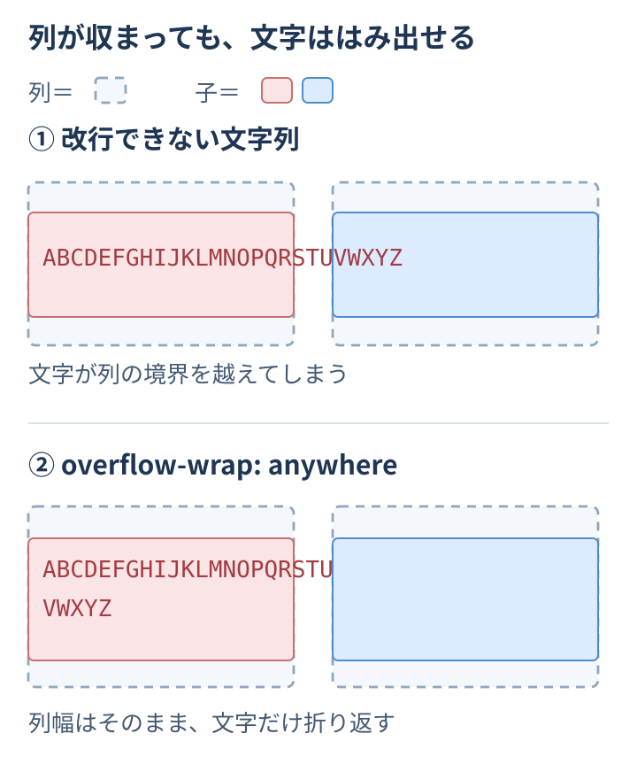

# 列幅と子要素のサイズの違い

Gridで列を等幅に並べたのに、短い見出しの背景が列いっぱいに伸びてしまうことがあります。背景を文字の長さに合わせたいとき、列幅まで変える必要があるのでしょうか。

この疑問を考えるには、**列が作る領域と、その中に置かれる子要素の箱を分けて見る**ことが大切です。さらに、箱の中にある文字や画像も別のものとして考えると、どこを調整すればよいかが見えてきます。

## 列を保ち、子の幅だけを変える

まず、A〜Dの子要素をGridで並べてみます。点線の枠が子を置くための領域、青い部分が実際の子要素の箱です。

```html
<div class="parent">
  <div class="child">A</div>
  <div class="child">B</div>
  <div class="child">C</div>
  <div class="child">D</div>
</div>
```

親が列を作り、子には幅を指定した状態から始めます。ここでは配置の違いを見るため、幅の数値そのものは気にしなくて構いません。

```css
.parent {
  display: grid;
  width: 330px;
  grid-template-columns: repeat(2, 150px); /* 同じ幅の列を2つ作る */
  gap: 30px;
}

.child {
  width: 70px;          /* 子要素の箱の幅を指定する */
  background: #dcebff;  /* 子要素の背景色（薄い青） */
}
```

この子の`width`指定だけを外すと、何が変わるでしょうか。



上段では青い箱が点線の途中で終わっています。下段では、点線の位置はそのままなのに、青い箱だけが右端まで伸びています。

通常の`div`で`width`が`auto`なら、Gridの`justify-items: normal`は通常`stretch`のように働き、子の箱を横方向に広げます。一方、子に幅を明示していると、その幅が使われます。

**親の列幅は変わっていません。変わったのは、列の中にある子の箱の幅です。** なお、画像など固有のサイズや縦横比を持つ要素は、同じ伸び方になるとは限りません。

## 見出しの背景が、文字より広くなるのはなぜか

次は、Gridの一つの列に「テキスト」と書かれた`p`要素を置き、背景色を付けた場合です。

```html
<div class="subjects">
  <p class="subject">テキスト</p>
</div>
```

```css
.subjects {
  display: grid;
}

.subject {
  margin: 0;           /* p要素に標準で付く外側の余白をなくす */
  padding: 0.6em 1em;  /* 子要素の余白を広くする */
  background: #dceafe; /* 見出しの箱の背景色（薄い青） */
}
```

文字は短くても、先ほどの`div`と同じように子の箱が列いっぱいに広がれば、背景色もその幅まで付きます。文字の右側に見える空間が、すべて`padding`というわけではありません。**文字が使っていない部分も、広がった`content`領域に含まれます。**

背景だけを文字に合う幅にしたいなら、列の指定を変えるのではなく、子へ次の指定を加えます。

```css
.subject {
  justify-self: start; /* 子要素の箱を列の左端に揃える */
}
```

幅が`auto`のこの例では、子の横方向の引き伸ばしが止まり、文字と左右の`padding`が収まる幅になります。さらに`center`や`end`へ変えると、その小さくなった箱を列の中央や右端に置けます。



図では、どの段でも点線の列幅は同じです。指定なしでは背景が列いっぱいに広がり、`start`・`center`・`end`では背景ごと左・中央・右へ配置されています。

ここで動いているのは**文字だけではなく、背景を持つ子要素の箱**です。箱の中で文字を中央揃えにする`text-align: center`とは、動かす対象が異なります。

## 等幅の列でも、子の背景はそれぞれ違う幅にできる

見出しが複数ある場合も、考え方は同じです。今度は内容が収まるだけの幅がある状態で等幅の3列を作り、それぞれの子の背景を文字の長さに合わせてみます。

```html
<div class="labels">
  <div class="label">テキスト</div>
  <div class="label">テキスト</div>
  <div class="label">文字</div>
  <div class="label">テキストの例</div>
  <div class="label">テキスト</div>
  <div class="label">テキスト</div>
</div>
```

```css
.labels {
  display: grid;
  grid-template-columns: repeat(3, 1fr); /* 同じ幅の列を3つ作る */
  gap: 1em;
  justify-items: start; /* すべての子要素の箱を各列の左端に揃える */
}

.label {
  padding: 0.6em;      /* 文字と背景の端との間に余白を作る */
  background: #dcebff; /* 子要素の背景色（薄い青） */
}
```

一つの子に使った`justify-self: start`に対し、**`justify-items: start`は親から各子へ共通の揃え方を指定する**ものです。個別の子に`justify-self`を指定すれば、その子には個別の指定が使われます。



図の左列では、上の「テキスト」より、下の「テキストの例」の背景が長くなっています。それでも両方の左端は同じ位置です。中央列では文字量が同じなので、背景の幅も揃っています。

**列の幅を揃えることと、その中の背景を揃えることは別々に選べます。**

ここでは`1fr`で列を分け、`justify-items`で子の箱を整えました。反対に、列そのものを内容に合わせて詰めるなら、`max-content`など列幅の指定を検討します。その場合は列幅が変わるので、後ろの列の開始位置も変わります。

<a id="列が収まっても文字は別に折り返す"></a>

## 列が収まっても、中の文字ははみ出すことがある

ここまでは、列と子の箱の幅を見てきました。しかし、**子の箱が列に収まっていても、中の文字まで収まるとは限りません。**

例えば、途中に空白のない長い英字は、通常の折り返し位置がなく、箱の外へ続いてしまうことがあります。

次の例では、列幅を内容に押し広げられないよう、先に`minmax(0, 1fr)`で列を作っています。

```html
<div class="words">
  <div class="token">ABCDEFGHIJKLMNOPQRSTUVWXYZ</div>
  <div class="neighbor"></div>
</div>
```

```css
.words {
  display: grid;
  width: 320px;
  grid-template-columns: repeat(2, minmax(0, 1fr)); /* 列の最小値を0にして、等幅の列を2つ作る */
  gap: 1em;
}

.token {
  padding: 0.6em;      /* 文字と背景の端との間に余白を作る */
  background: #fbe4e5; /* 長い英字を入れた子要素の背景色（薄い赤） */
}
```

この状態で、文字の折り返し方だけを変えます。

```css
.token {
  overflow-wrap: anywhere; /* 長い英字も必要に応じて途中で折り返せるようにする */
}
```



上段では、文字が赤い箱を越えて隣の列まで伸びています。下段では、同じ箱の中で次の行に移っています。**列も子の箱も横幅は同じで、変わったのは文字の折り返し方です。**

`overflow-wrap: anywhere`は、通常は折り返せない長い文字列にも、必要に応じて改行できる位置を作ります。文字を小さくする指定ではありません。実際の改行位置や行数は、文字やフォント、表示幅によって変わります。

<a id="列と子の最小幅を分ける"></a>

## 列の境界まで広がっているなら、最小幅を見る

先ほどは、列と子の箱を収めたうえで文字だけがはみ出していました。一方、**列の境界そのものが想定より広がる**場合もあります。

通常の`1fr`には、内容に由来する自動的な最小幅が関わります。折り返せない文字列などが入ると、列がそれより小さくなれない場合があります。

ここで確認するのは、列と子のどちらの最小幅が制約になっているかです。

- `minmax(0, 1fr)`：親が作る**列の最小値**を`0`にする
- `min-width: 0`：**子自身の自動最小幅**による制約を外し、より小さくなれるようにする

どちらも、中身の文字を自動で折り返す指定ではありません。列や子の箱が収まったあとも文字だけが出ているなら、前の例のように折り返しを確認します。

`1fr`と最小幅の詳しい計算は、[1frなのに列が広がるのはなぜ](./04_1frなのに列が広がるのはなぜ.md)で扱います。

## 画像がはみ出している場合は

箱の中身が文字ではなく画像なら、画像自身の表示幅を確認します。元画像が大きくても、親の内容幅を超えて表示しないための基本形は次のとおりです。

```css
.child img {
  display: block;   /* 画像の下にできるインライン要素特有の隙間を避ける */
  max-width: 100%;  /* 画像が親の内容幅を超えて広がらないようにする */
  height: auto;    /* 画像の縦横比を保って高さを自動調整する */
}
```

これは画像の表示幅を制御する指定であり、Gridの列幅を直接変える指定ではありません。画像の自然な幅と`width: 100%`との違いは、[画像全体を自然比率で表示する](../../12_レスポンシブ画像設計/02_画像全体を自然比率で表示する.md#widthとmax-widthを使い分ける)につながります。

## DevToolsでどこを見るか

見た目だけでは原因を判断しづらいときは、まずGridオーバーレイで**列の境界**を確認します。列が想定より広がっていれば、列幅の指定と子の最小幅を調べます。

列は想定どおりなのに背景だけが広ければ、子要素を選択して**箱の幅**を確認します。`width`や`justify-self`、親の`justify-items`が手がかりになります。

列も箱も収まっているのに文字や画像が外へ出ていれば、今度は**箱の中身**の表示方法を見ます。

## まとめ

列は子を配置する領域、子要素はその中に置く箱、文字や画像はさらにその箱の中にあります。

短い見出しの背景を文字に合わせたいなら、まず子の揃え方を確認します。列自体が広がっているなら列と子の最小幅を、箱から文字だけがはみ出しているなら折り返しを確認します。

**列・子の箱・中身のどれが変わっているのか。** そこを区別すれば、調整すべきCSSを選びやすくなります。

## 仕様・確認先

- [W3C CSS Grid Layout Level 2 — Grid Item Sizing](https://www.w3.org/TR/css-grid-2/#grid-item-sizing)
- [W3C CSS Grid Layout Level 2 — Automatic Minimum Size](https://www.w3.org/TR/css-grid-2/#min-size-auto)
- [W3C CSS Text Level 3 — Overflow Wrapping](https://www.w3.org/TR/css-text-3/#overflow-wrap-property)
- [Chrome DevToolsでCSS Gridを確認する](https://developer.chrome.com/docs/devtools/css/grid/)

<!-- GPT作成案：添付SVG4枚に対応。画像参照はWikiの07_画像へ調整。 -->
