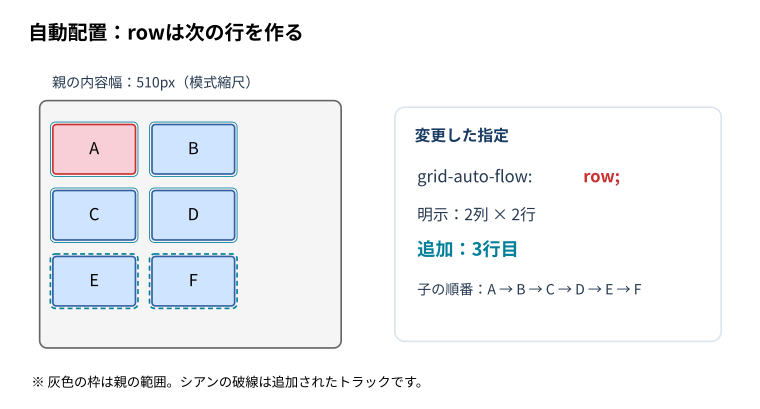
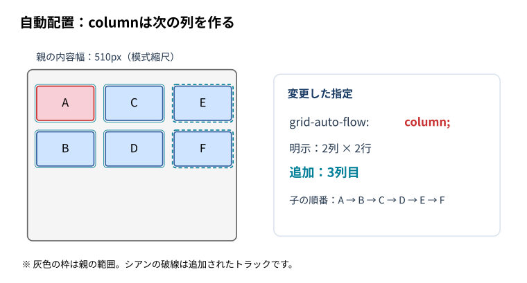
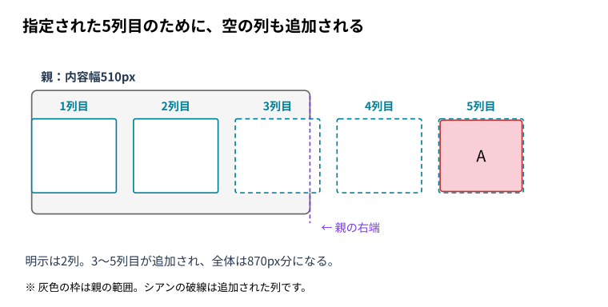

# 11_Gridが想定どおりに並ばない原因

3列にしたつもりが1列になる。列幅が揃わない。子が予想外の位置へ置かれる。**Gridが崩れたとき、どのCSSが原因なのかを、どうやって絞り込めばよいのでしょうか。**

最初にDevToolsで親のGridオーバーレイを表示し、**親の列・行の枠が想定と違うのか、それとも枠は正しくて子や中身が違うのか**を見ます。見た目だけで複数の指定を一度に直さないことが重要です。

## 見えている症状から、調べる対象を選ぶ

| 起きていること | まず見る場所 | 調べる記事 |
| --- | --- | --- |
| Gridにしたのに1列のまま | 親の`display`と列指定 | [列を作る](./02_子要素を2列・3列に並べるには.md) |
| 列数が想定より少ない | 親幅・最低列幅・`gap` | [自動列数](./05_列数を自動変更するには.md) |
| 片方の列が広い／親からはみ出す | 列の最小幅、子と中身 | [1frの下限](./04_1frなのに列が広がるのはなぜ.md)、[列と子の違い](./10_列幅と子要素のサイズの違い.md) |
| 子の置かれる順番・位置が違う | `grid-column`・`grid-row`・`grid-auto-flow` | [子の配置](./08_子要素を指定位置に配置するには.md) |
| 高さや上下位置が合わない | 行高と子の整列 | [行の高さ](./07_行の高さはどう決まる.md)、[整列](./09_子要素を上下左右に揃えるには.md) |
| 余白が意図と違う | `gap`・padding・margin | [余白の分担](../02_配置の基本/06_gapとmarginとpaddingを使い分ける.md) |

## 例① Gridにしたのに1列のまま

```html
<div class="parent">
  <div class="child">A</div>
  <div class="child">B</div>
  <div class="child">C</div>
</div>
```

```css
.parent {
  display: grid;
  gap: 30px;
}
```

この指定だけでは、3列にはなりません。今回の通常の自動配置では、基本的に1列になります。3列を作りたいなら、親へ列数を指定します。

```css
.parent {
  grid-template-columns: repeat(3, minmax(0, 1fr));
}
```

それでも変わらなければ、Stylesで列指定が有効かを確かめ、A・B・Cが**本当にGridコンテナの直下の子か**を見ます。間にラッパーがあれば、Gridが直接配置するのはそのラッパーです。

なお`repeat(3, …)`は列数を3で固定します。親が狭くても自動で2列にはなりません。列数を幅から決める方法は[auto-fit](./05_列数を自動変更するには.md)で扱います。

## 例② 列・子・文字のどれがはみ出しているか

`1fr 1fr`を指定したのに片方の列が広がるときは、まず**列トラックの境界そのもの**を見ます。次の指定は、第04記事の[長い文字の例](./04_1frなのに列が広がるのはなぜ.md)で使うものです。

```css
.parent {
  display: grid;
  grid-template-columns: 1fr 1fr;
  gap: 30px;
}
```

長くて途中で改行できない文字があると、内容由来の最小幅によって列が大きくなる場合があります。まず親の**列指定だけ**を次へ変更します。

```css
.parent {
  grid-template-columns: repeat(2, minmax(0, 1fr));
}
```

列の境界が親へ収まったら、そこで列の問題は一度切り分けられます。まだ子の箱が外へ出ているのか、文字だけが出ているのかを改めて見てください。

**元の列指定を保って子の最小幅を調べたい場合**は、親の指定を元へ戻してから、子だけを変更します。

```css
.child {
  min-width: 0;
}
```

**列と子は収まっているのに、長い文字だけがはみ出す場合**は、文字を含む要素の折り返しを変更します。

```css
.token {
  overflow-wrap: anywhere;
}
```

**画像だけがはみ出す場合**は、画像自身の表示幅を調整します。

```css
.child img {
  max-width: 100%;
  height: auto;
}
```

これらを一度に追加するのではなく、観測した場所に応じて**一つだけ試す**のが目的です。列は`minmax()`、子の箱は`min-width`、文字は`overflow-wrap`、画像は画像の寸法指定という違いは[第10記事](./10_列幅と子要素のサイズの違い.md)へ分けてあります。

## 例③ 途中に空きが残るのはなぜか

子の一部が複数列を使うと、残った場所に次の子が入れない場合があります。例えば3列のGridで、AとBを各2列分に指定したとします。

```css
.parent {
  display: grid;
  grid-template-columns: repeat(3, minmax(0, 1fr));
  gap: 30px;
}

.child:nth-child(1),
.child:nth-child(2) {
  grid-column: span 2;
}
```

Aが2列分を占めると1列だけ残ります。Bも2列分必要なため、1行目の空きには入らず次の行へ進みます。これは列が壊れたのではなく、**必要な列数が空きに収まらない**結果です。

`grid-auto-flow: dense`なら空きを埋める場合がありますが、画面上の並びとHTMLの順が異なる可能性があります。まずその指定が必要なのかを判断し、安易に追加しないでください。

## 明示した行・列と、自動で追加される行・列

今度は子を6個用意して、最初に2列・2行だけを明示したGridを考えます。

```html
<div class="parent">
  <div class="child">A</div>
  <div class="child">B</div>
  <div class="child">C</div>
  <div class="child">D</div>
  <div class="child">E</div>
  <div class="child">F</div>
</div>
```

```css
.parent {
  display: grid;
  width: 510px;
  grid-template-columns: 150px 150px;
  grid-template-rows: 90px 90px;
  grid-auto-columns: 150px;
  grid-auto-rows: 90px;
  grid-auto-flow: row;
  gap: 30px;
}

.child {
  line-height: 40px;
  background: #cfe4ff;
}
```

指定した2行・2列を**明示的Grid**、足りなくなって追加される行・列を**暗黙的Grid**と呼びます。`grid-auto-rows`・`grid-auto-columns`は追加された行・列の**大きさ**を決める指定で、これだけで行や列を新規作成するわけではありません。

### 横方向へ並べる：`grid-auto-flow: row`

通常は行方向へ子が並び、E・Fを置くために3行目が追加されます。



### 縦方向へ並べる：`grid-auto-flow: column`

親の他の指定とHTMLはそのままで、次の値だけを変えます。

```css
.parent {
  grid-auto-flow: column;
}
```



この例ではE・Fを置くために3列目が追加されます。HTMLのA〜Fの順番は変わらず、**行から使うか、列から使うか**が変わりました。

### 子が一つでも、範囲外を指定すると列が増える

次はAだけにし、明示していない5列目を指定します。

```html
<div class="parent">
  <div class="target">A</div>
</div>
```

```css
.parent {
  display: grid;
  width: 510px;
  grid-template-columns: 150px 150px;
  grid-auto-columns: 150px;
  gap: 30px;
}

.target {
  grid-column: 5 / 6;
}
```



`5 / 6`は5番と6番の列線の間です。3〜5列目が必要になるため、子が入らない3・4列目も追加されます。全5列と四つのgapを合わせると、`150 × 5 + 30 × 4 = 870px`となり、親の510pxを超えます。

自動追加された列がいつまでも残るのではありません。Aの配置指定を無効にし、必要な列が減った後のGridオーバーレイも確認してみてください。

## DevToolsで切り分ける順番

1. 親を選び、Stylesで`display: grid`と列指定が有効か見る。
2. Gridオーバーレイを表示し、列・行の**境界**が想定どおりか確認する。
3. 親の幅と`gap`から、列数や列幅が成立しているか確認する。
4. 子が違う場所なら、`grid-column`・`grid-row`・`order`を一つずつ確認する。
5. 親の列が正しければ、子のBox Model、次に中の文字・画像を確認する。
6. 最後に、`gap`・padding・marginなど、**実際に広い場所**を見分ける。

CSSは**一度に一つだけ変更し、どの境界が動いたか**を確かめます。指定を戻しながら比較すれば、別の原因を同時に増やさずに調べられます。

## 仕様・確認先

- [Chrome for Developers：Gridレイアウトの検証](https://developer.chrome.com/docs/devtools/css/grid/)
- [MDN：グリッドの自動配置](https://developer.mozilla.org/ja/docs/Web/CSS/Guides/Grid_layout/Auto-placement)
- [MDN：grid-auto-flow](https://developer.mozilla.org/en-US/docs/Web/CSS/Reference/Properties/grid-auto-flow)
- [MDN：grid-template-columns](https://developer.mozilla.org/en-US/docs/Web/CSS/Reference/Properties/grid-template-columns)
