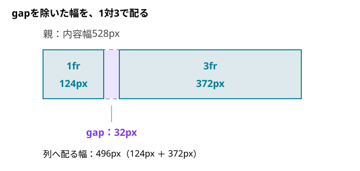

# 07_Gridの枠と子要素の大きさを理解する

Gridは、**親が行と列の枠を作り、その中へ直下の子を配置する仕組み**。カード一覧や、サイドとメインを持つページで使う。

まず「何列作るか」「列へ幅をどう配るか」「子がその枠をどう使うか」を分けて考える。列が小さくなっても、子の中の画像や長い文字列まで必ず収まるわけではない。

## 最初に理解する6つ

| 順番 | 理解するもの | 答えたい疑問 |
| --- | --- | --- |
| ① | Gridコンテナとアイテム | 誰が配置を決めるのか |
| ② | 列・行・トラック・セル | 親はどんな枠を作るのか |
| ③ | `fr`と`minmax()` | 列の幅はどう決まるのか |
| ④ | `repeat()`と`auto-fit` | 列数はどう決まるのか |
| ⑤ | `gap` | 列と行の間隔をどう確保するのか |
| ⑥ | アイテムの配置とサイズ | 枠と子の大きさはどう違うのか |

## 親が枠を作り、直下の子が入る

親へ`display: grid`を書くと、その親が**Gridコンテナ**になる。以下の通常フローにある直下の子は、**Gridアイテム**として配置される。

```html
<div class="parent">
  <div class="child">A</div>
  <div class="child">B</div>
  <div class="child">C</div>
  <div class="child">D</div>
</div>
```

```text
parent  ← 行・列・gapを指定する
├─ child A  ← Gridアイテム
├─ child B
├─ child C
└─ child D
```

たとえば、親に2列・2行を作る。枠と子の違いが見えるよう、この例では子の幅と高さを枠より小さく指定する。

```css
.parent {
  display: grid;
  width: 540px;
  grid-template-columns: repeat(2, minmax(0, 1fr));
  grid-template-rows: repeat(2, 108px);
  gap: 28px;
}

.child {
  width: 164px;
  height: 48px;
  background: #cfe4ff;
}
```



図は親と列の幅を固定したまま、子の`width`だけを外して164pxから256pxへ広げ、再指定して戻す。子の高さ48pxは変えない。各段階は説明を一度消して次の説明を表示し、2.5秒以上待ってから3秒で幅を変える。動きを減らす設定では164pxの静止表示になる。

薄いシアンの縦帯がcolumn 1（列1）、薄いオレンジの横帯がrow 1（行1）。交わる枠が1セルで、薄紫のすき間がgapになる。列の見出しと寸法線はシアン、行はオレンジ、gapは紫で区別する。gapと混同しないよう、子Cには紅紫を使う。灰色の破線は親の外周、細い実線はセルの境界、色付きの箱は子要素を示す。gapはセル間の空いた帯として見える。図の線と子の色は識別用であり、CSSの`border`を表していない。

| 用語 | 図で見る場所 |
| --- | --- |
| 列（column） | 縦に続く枠。左右に2列ある |
| 行（row） | 横に続く枠。上下に2行ある |
| トラック（track） | 1列または1行の帯状の領域 |
| セル（cell） | 1列と1行が交わる一つの枠 |
| グリッド線（grid line） | 行・列の境界。子の外枠とは別のもの |

列幅は`(540 - 28) ÷ 2 = 256px`。子の幅は164pxなので、**列幅と子の幅は一致していない**。

この例では`grid-template-rows`で行の高さも指定した。一覧では、行の高さを指定せず内容に任せることも多い。列を指定して子を順番に入れると、必要な行は自動で追加される。

## gapは枠と枠の間に入る

`gap: 28px`は、行間と列間の両方へ28pxの溝を作る。2列なら列間は1か所、3列なら2か所ある。親の外周には余白を作らない。

列へ配れる幅は、親の内容幅から列間の`gap`などを引いた幅になる。外周にも余白が必要なら、[gap・margin・paddingの指定先](./12_gapとmarginとpaddingを使い分ける.md)を分けて考える。

## 列の作り方を4パターンで読む

以下は親の`grid-template-columns`へ書く指定。列数を保つのか、列数も自動で変えるのかを先に選ぶ。

### A：列数を固定し、同じ重みで幅を配る

```css
.parent {
  display: grid;
  grid-template-columns: repeat(3, 1fr);
  gap: 32px;
}
```

`repeat(3, 1fr)`は`1fr 1fr 1fr`と同じ。`repeat()`は指定を繰り返す関数であり、それ自体が列を伸縮させるわけではない。

この指定は**3列を保つ**。親が狭くなっても、自動で2列へ変わることはない。ただし、単独の`1fr`には内容に基づく最小幅が関わるため、内容によって均等にならなかったり、親からあふれたりする。内容の制約を外して列を縮めたい場合は、Cの指定を使う。

固定したいのが「列数」ではなく「列幅」なら、`repeat(2, 160px)`のように長さを書く。これは160pxの列を二つ作り、親が広がっても列幅を変えない。

### B：列ごとに配分の重みを変える

```css
.parent {
  display: grid;
  grid-template-columns: 1fr 3fr;
  gap: 32px;
}
```

`fr`は、利用可能な空間を分ける重み。内容の最小幅に妨げられない例では、`1fr 3fr`はgapを除いた幅を1対3で分ける。

親の内容幅が528pxなら、列へ配る幅は`528 - 32 = 496px`。これを4口へ分けるので、左は124px、右は372pxになる。親全体をそのまま1対3へ分けるわけではない。



シアンの帯と数値が列、紫がgapを示す。この図は短い内容が各列へ収まり、内容の最小幅が配分を妨げない条件。内容に押される場合の確認は[縮まない原因](./08_Gridが内容に押されて縮まない原因を確認する.md)で扱う。

### C：minmaxで列の下限を指定する

#### minmaxの下限とfrの配分を分けて読む

```css
.parent {
  display: grid;
  grid-template-columns: repeat(3, minmax(0, 1fr));
  gap: 32px;
}
```

`minmax(最小値, 最大値)`は、各トラックのサイズの範囲を指定する。`minmax(0, 1fr)`では、二つの値の担当が異なる。

| 値 | 担当 |
| --- | --- |
| `0` | 列を0pxまで縮めてよいという下限 |
| `1fr` | 固定列やgapなどを除いた残り幅を受け取る重み |

`0`を書くだけで列幅が0pxに決まるわけではない。[列幅が本当に0になる条件](./08_Gridが内容に押されて縮まない原因を確認する.md#列幅が本当に0になる条件)は、親の幅と、ほかの列・gapが使う幅によって変わる。

この指定で外すのは、列の内容に基づく自動の最小幅。子やその中身を何でも収める指定ではない。列からはみ出す文字や画像があれば、子の最小幅・折り返し・画像のサイズを別に確認する。

#### 親が狭くなると、同じ重みの列が一緒に縮む

次の比較では、子を空にし、padding・border・固定幅を指定しない。親の内容幅だけを変え、列の配分を見る。gapはこの比較では26pxとする。

```html
<div class="parent">
  <div></div>
  <div></div>
  <div></div>
</div>
```

```css
.parent {
  display: grid;
  width: 580px;
  grid-template-columns: repeat(3, minmax(0, 1fr));
  gap: 26px;
}
```

gapは列の間に2か所ある。親の内容幅が580pxなら、各列は`(580 - 26 × 2) ÷ 3 = 176px`。`width`だけを370pxへ変えると、各列は`(370 - 26 × 2) ÷ 3 = 106px`になる。



図は「幅を縮める」「幅を戻す」の説明を表示してから、親の外枠・灰色の塗り・シアンの3列が一緒に伸縮する。外枠の点線は各辺の起点と間隔を保ち、枠の幅だけが変わる。下の静止比較では親幅370pxの範囲を示す。点線と列のシアンの外枠は補助表示で、CSSの`border`ではない。

実装ではDevToolsで`.parent`の`width`を580pxと370pxへ切り替え、Grid表示や計算済みの`grid-template-columns`で各列が176pxと106pxになるかを見る。

### D：auto-fitで入る列数を自動変更する

列数を親の幅に合わせて変えるなら、繰り返し回数へ`auto-fit`を書く。次の例は、最初のHTMLと同じ4個の子を使う。子の幅・高さと、親の固定幅・行高さの指定は外し、親が使える幅に合わせて配置する。

```css
.parent {
  display: grid;
  grid-template-columns: repeat(auto-fit, minmax(184px, 1fr));
  gap: 26px;
}
```

- `184px`：1列が確保する最低幅。
- `auto-fit`：最低幅とgapが収まる列数を求め、配置後に空になった列は折りたたむ。
- `1fr`：残った列で、余った幅を同じ重みで受け取る。



図は親の幅だけを変え、列数と子の配置が変わる様子を示す。シアンの枠と列数がcolumn（列）、別の色の箱が子A〜Dを表す。各段階は説明を一度消して次の説明を表示し、2.5秒以上待ってから3秒で幅を変え、外枠も幅・行数に追従する。点線の間隔と起点は保つ。高さは配置を見やすくするための模式表示で、CSSで固定した高さを表していない。

| 親の内容幅 | 列数 | 各列の幅 |
| --- | --- | --- |
| 652px | 3列 | `(652 - 26 × 2) ÷ 3 = 200px` |
| 438px | 2列 | `(438 - 26) ÷ 2 = 206px` |
| 208px | 1列 | 208px |

3列に必要な最低幅は`184 × 3 + 26 × 2 = 604px`。2列なら`184 × 2 + 26 = 394px`。親幅がこの境界を下回ると、列数が一つ減る。動きの途中でも子は消えず、次の行へ配置される。

最低幅だけでなくgapも列数に関わる。子が少なく空の列ができる幅では、`auto-fit`はその空列を折りたたみ、残った列が空間を使う。また、親が184pxより狭くても最低幅は184pxなので、1列が親からはみ出す場合がある。

`repeat(3, ...)`は列数を保ち、`repeat(auto-fit, ...)`は入る列数を変える。この違いを、親幅を変えて確認する。図の動きは比較を追うためのものであり、このCSSだけで自動的に幅がアニメーションするわけではない。

## 列幅・子の幅・中身の表示を分ける

最初の2列の例では、列は256px、子は164pxだった。子から`width`と`height`を外すと、この例の通常の`div`は既定のストレッチによってセルを埋める。行の高さも内容に任せたいなら、親の`grid-template-rows`も外す。

| 決めたいこと | 指定・確認する対象 |
| --- | --- |
| 列の幅 | 親の`grid-template-columns` |
| 子の大きさ・枠内の位置 | 子自身の寸法と、親・子の揃え方 |
| 子の中の画像や文字の表示 | 画像の寸法、文字の折り返しなど、子の内部 |

幅・高さを指定した子や、画像のように固有の寸法・比率を持つ要素は、常にセルいっぱいになるとは限らない。子の中にある孫も、親のGridへ直接並ぶわけではない。入れ子の担当は[親子のレイアウト文脈](./04_親子のレイアウト文脈を区別する.md)で確認する。

初めは「子を通常の順番で1セルずつ配置する」と考えればよい。特定の子を別の列へ置いたり、複数列にまたがせたりしたいときは、[子の配置指定](./09_Gridで特定の子を列へ配置する.md)へ進む。

## 固定列と可変列を組み合わせる

サイドの幅を保ち、メインへ残り幅を配るなら、同じ親へ固定値と可変値を書く。

```css
.layout {
  display: grid;
  grid-template-columns: 192px minmax(0, 1fr);
  gap: 26px;
}
```

一覧全体の列幅は親へ置き、部品自身が持つべき寸法は子へ置く。「一覧の規則か、部品の規則か」で指定先を分ける。

固定列とgapだけで親幅を超えると、可変列を0まで縮めても全体は収まらない。列の指定を変えるか、[配置が成立する幅でレイアウトを切り替える](./11_配置が成立する幅でブレークポイントを決める.md)。

## このページのまとめ

- 親が行と列を作り、通常フローにある直下の子がGridアイテムとして配置される。
- トラックは1行・1列の帯、セルは行と列が交わる枠。枠と子の寸法は別に考える。
- `gap`を除いた空間を`fr`の重みで配る。内容の最小幅が配分に関わることもある。
- `minmax(0, 1fr)`は列の下限を0にする。子の中身が収まるかは別に確認する。
- `repeat(3, ...)`は列数を保ち、`auto-fit`は最低幅とgapが入る列数へ変える。

考える順序は「親の利用可能な幅 → 列数 → 列幅 → 子の配置と寸法 → 中身の表示」。これは理解のための大まかな順序であり、ブラウザ内部の厳密な計算順序ではない。

## 仕様確認先

- [CSS Grid Layout Module Level 2: Grid Layout Model](https://www.w3.org/TR/css-grid-2/#grid-model)
- [CSS Grid Layout Module Level 2: Grid Item Sizing](https://www.w3.org/TR/css-grid-2/#grid-item-sizing)
- [CSS Grid Layout Module Level 2: Track Sizing](https://www.w3.org/TR/css-grid-2/#track-sizing)
- [CSS Grid Layout Module Level 2: Flexible Lengths](https://www.w3.org/TR/css-grid-2/#fr-unit)
- [CSS Grid Layout Module Level 2: Repeat-to-fill](https://www.w3.org/TR/css-grid-2/#auto-repeat)
