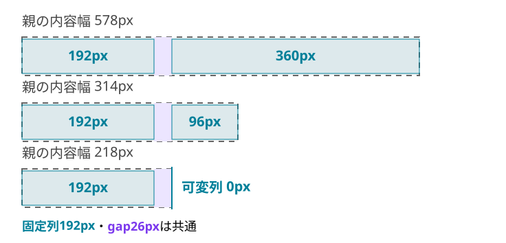

# 08_Gridが内容に押されて縮まない原因を確認する

`1fr`は親幅へ必ず収まる固定値ではない。Gridトラックの最小値や、Gridアイテムの内容由来の最小サイズによって、列が期待した幅まで縮まない場合がある。

## まずトラックとアイテムを分ける

```css
.layout {
  display: grid;
  grid-template-columns: 192px minmax(0, 1fr);
  gap: 26px;
}

.main {
  min-width: 0;
}
```

| 指定 | 変更する対象 | 役割 |
| --- | --- | --- |
| `minmax(0, 1fr)` | Gridトラック | トラックの最小値を`auto`ではなく0にする |
| `min-width: 0` | Gridアイテム | 要素側の自動最小幅を0まで許可する |

似た指定に見えても、変更する対象が違う。片方だけで解決しない場合は、DevToolsのGrid表示とBox Modelで両方を確認する。

## 列幅が本当に0になる条件

`minmax(0, 1fr)`の列は、配分される幅がなくなれば本当に0pxになる。`0`は「必ず0pxにする」という命令ではなく、0pxまで縮めることを許す下限である。`fr`の配分は[固定列と可変列を作る記事](./07_Gridの枠と子要素の大きさを理解する.md#minmaxの下限とfrの配分を分けて読む)で扱う。

先ほどの`.layout`に、固定列へ入る空の子と、可変列へ入る空の`.main`を一つずつ置く。親子ともpadding・border・子の固定幅を加えず、`.layout`の内容幅だけを変える。

```html
<div class="layout">
  <div></div>
  <div class="main"></div>
</div>
```



| 親の内容幅 | 固定列とgapを除いた可変列の幅 |
| --- | --- |
| 578px | `578 - 192 - 26 = 360px` |
| 314px | `314 - 192 - 26 = 96px` |
| 218px | `218 - 192 - 26 = 0px` |

親の内容幅が218pxになると、固定列192pxとgap26pxだけで使い切るため、可変列の幅は0pxになる。さらに親を狭めても可変列は負の幅にならず、固定列とgapが親からあふれる。

実装で確かめるときは、DevToolsで`.layout`の`width`を578px、314px、218pxへ切り替え、Grid表示や計算済みの`grid-template-columns`で右列が360px、96px、0pxになるかを見る。

図の灰色の点線は親の範囲、シアンの外枠と0pxのシアンの線は列の位置を示す補助表示で、CSSのborderではない。0pxになった列の中身を消したり、内容を自動的に折り返したりする指定ではないため、実際の内容を入れたときの表示方法は次で確認する。

## 内容側の縮まない条件を確認する

トラックとアイテムの最小幅を調整しても、中身の表示方法は別に決める。

- 長い単語：`overflow-wrap`などの折り返し条件
- 一行表示：`white-space: nowrap`と省略方法
- 固有幅を持つ画像：画像自身の`max-width`や表示枠
- 固定幅の子：その固定幅を維持する必要があるか
- overflow：はみ出しを表示、切り取り、スクロールのどれにするか

`minmax(0, 1fr)`と`min-width: 0`は、内容を自動的に折り返したり省略したりする指定ではない。

## 確認順

1. 親の利用可能幅、列定義、`gap`を確認する。
2. はみ出しているGridトラックをOverlayで確認する。
3. 対象アイテムの`min-width`と実寸を見る。
4. 長い文字、画像、固定幅、`white-space`のどれが最小幅を要求しているか調べる。
5. 内容を折り返すのか、縮めるのか、スクロールさせるのか決める。

一つの箱の実寸を追う場合は[箱の大きさが予想と違うときの確認順](../05_ボックスとdisplay/12_箱の大きさが予想と違うときの確認順.md)も使う。

## このページのまとめ

- Gridが縮まないときは、トラックの最小値とアイテムの最小幅を別々に確認する。
- `minmax(0, 1fr)`の列は、配分される幅がなくなれば実際に0pxになる。固定列やgapまで消えるわけではない。
- 列幅の調整と、中身の折り返し・省略・overflowの扱いは分けて決める。

## 仕様確認先

- [CSS Grid Layout Module Level 2: Automatic Minimum Size](https://www.w3.org/TR/css-grid-2/#min-size-auto)
- [CSS Grid Layout Module Level 2: Track Sizing Algorithm](https://www.w3.org/TR/css-grid-2/#algo-track-sizing)
