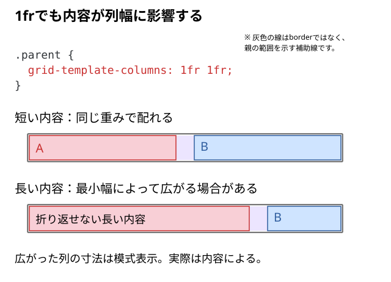
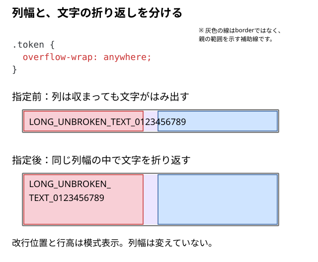
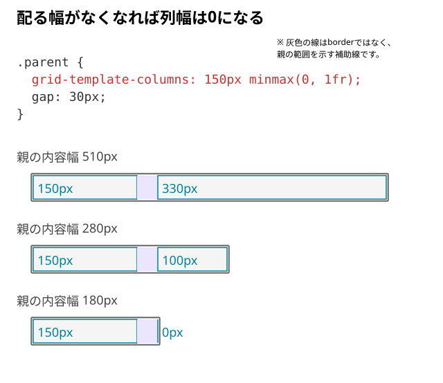

# 1frなのに列が広がるのはなぜ？

2列を同じ幅にするため `grid-template-columns: 1fr 1fr` を書いたのに、片方だけが大きくなることがある。なぜ `1fr` 同士なのに等幅にならないのだろう？

## 結論：`1fr` には、内容を考慮する自動的な最小幅がある

`1fr` を単独で指定した列は、**最小幅が無条件に0になるわけではない**。仕組み上は `minmax(auto, 1fr)` に相当し、列の中身が必要とする最小幅を下回れない場合がある。

長くて途中で改行できない文字列などが入ると、その**内容の最小幅に押されて列が広がる**。結果として `1fr 1fr` でも左右が同じ幅にならず、内容が非常に長ければ親の幅を超えることもある。※ 自動最小幅は常に内容幅と同じになるわけではなく、子の `min-width` や `overflow`、トラックの条件などにも左右される。

> 図は仕組みの模式表示。長い内容がある場合の正確な列幅は、文字・フォント・CSSによって変わる。

## 同じHTMLで「列」と「中身」を分けて確認する

配置指定は2個の子を直接包む親 `.parent` に書く。

```html
<div class="parent">
  <div class="child">
    <span class="token">ABCDEFGHIJKLMNOPQRSTUVWXYZABCDEFGHIJKLMNOPQRSTUVWXYZABCDEFGHIJKLMNOPQRSTUVWXYZ</span>
  </div>
  <div class="child">B</div>
</div>
```

```css
.parent {
  display: grid;
  width: 510px;
  grid-template-columns: 1fr 1fr;
  gap: 30px;
}

.child {
  line-height: 40px;
  background: #cfe4ff;
}

.child:first-child {
  background: #f8cfd6;
}

.token {
  font-family: monospace;
}
```

この例の長い英字は、空白やハイフンなどの通常の改行位置がない**一続きの文字列**。折り返せないことで最小幅が大きくなりやすい。図の比較は、親幅510pxを確保できる環境を前提としている。

### A｜短い内容なら `1fr 1fr` で等幅になる

中身を短いテキストに変えると、次のように考えられる。

- 親の幅：510px
- 列間：30px
- 列に配分できる幅：480px
- **左240px、右240px**（内容が最小幅を押し広げない場合）

これは第03記事で扱った `fr` の配分と同じ。

### B｜長い内容では、`auto` の最小幅に押される

```css
.parent {
  grid-template-columns: 1fr 1fr;
}
```

`1fr` は単独では、おおむね次のように考えられる。

```css
.parent {
  grid-template-columns: minmax(auto, 1fr) minmax(auto, 1fr);
}
```

- 長い文字列の**途中に改行可能な位置がない**と、左列の内容由来の最小幅が大きくなりやすい。
- 左列がその幅より縮めず、**左240px／右240pxにならない**ことがある。
- 長すぎれば、列の合計幅と `gap` が親の510pxを超えることもある。

ここで起こるのは、まず**列トラックの幅が内容に影響される**という問題。



## minmaxの下限とfrの配分を分けて読む

```css
.parent {
  grid-template-columns: repeat(2, minmax(0, 1fr));
}
```

`minmax(0, 1fr)` は、**列トラックの下限を0にしたうえで、余った幅を `fr` で配分する**指定。図の条件なら、内容が非常に長くても、列トラックはそれぞれ240pxを基本として配分できる。

ただし、これは**中の長い文字列を自動で折り返したり縮小したりする指定ではない**。列が240pxになっても、文字そのものが右隣の列や親の外へはみ出す可能性がある。

`repeat(2, minmax(0, 1fr))` は `minmax(0, 1fr) minmax(0, 1fr)` と同じ意味。



## 中身も収めたいなら、中身の扱いを別に決める

長い一続きの文字を折り返してよいなら、次を追加する。

```css
.token {
  overflow-wrap: anywhere;
}
```



これで通常の改行位置がない文字列にも改行可能な位置が追加される。図の例では、列幅を保ちながらテキストを列の中へ収められる。

画像なら、文字の折り返しではなく、画像自体の大きさを制御する。

```css
.child img {
  max-width: 100%;
  height: auto;
  display: block;
}
```

**列の幅を決める処理**と、**中身を列に収める処理**は別。

## `min-width: 0` とはどう違う？

同じ現象に対して、Gridアイテム側の自動最小幅を抑える方法もある。

```css
.parent {
  display: grid;
  grid-template-columns: 1fr 1fr;
  gap: 30px;
}

.child {
  min-width: 0;
}
```

- `minmax(0, 1fr)` は**親が定義する列トラックの最小幅**を0にする。
- `min-width: 0` は**その子要素（Gridアイテム）の最小幅**を0にする。

この例ではどちらも「内容に押されて列が広がる」ことを抑えられるが、**変更している対象が違う**。どちらの方法でも、長い文字列自体のはみ出し対策は別途必要。

## 列幅が本当に0になる条件

固定列とgapで幅を使い切ると、可変列へ配る幅はなくなる。空の子を二つ使い、内容由来の制約をなくして比べる。

```html
<div class="parent">
  <div></div>
  <div></div>
</div>
```

```css
.parent {
  display: grid;
  width: 510px;
  grid-template-columns: 150px minmax(0, 1fr);
  gap: 30px;
}
```



図の高さは模式表示。比較するのは列幅だけ。

| 親の内容幅 | 可変列に残る幅 |
| --- | --- |
| 510px | `510 - 150 - 30 = 330px` |
| 280px | `280 - 150 - 30 = 100px` |
| 180px | `180 - 150 - 30 = 0px` |

親をさらに狭めても、可変列は負の幅にはならない。固定列とgapが親からあふれるため、必要なら[配置が成立する幅で切り替える](../11_配置が成立する幅でブレークポイントを決める.md)。

## 実装時の判断

| 困っている現象 | 確認するもの | 対処の候補 |
| --- | --- | --- |
| `1fr 1fr` が等幅にならない | 子の最小幅、改行できない内容 | `repeat(2, minmax(0, 1fr))` |
| Gridの子が縮まず親を押し広げる | Gridアイテムの `min-width` | 子へ `min-width: 0` |
| 列は正常なのに文字だけはみ出す | 文字の改行可能位置 | `overflow-wrap: anywhere` |
| 列は正常なのに画像だけはみ出す | 画像の自然幅とCSS | `max-width: 100%; height: auto;` |
| 幅を確保できないのに2列が必要 | 設計上、2列を保てる最小幅 | 第05記事の列数自動切替を検討 |

ここでの目的は、すべてのGridに `minmax(0, 1fr)` を機械的に付けることではない。**「どの最小幅が効いているか」を切り分けてから指定を選ぶ**。

## DevToolsで確かめる

1. 上記HTMLを開き、`.parent` を選んで Grid のオーバーレイを表示する。
2. `grid-template-columns: 1fr 1fr` の状態で、**長い文字が入った列の境界**を見る。必要ならブラウザのComputedから計算後の列幅を確認する。
3. `grid-template-columns: repeat(2, minmax(0, 1fr))` に変更する。**列の境界は親の幅に収まる**が、文字はまだはみ出す可能性がある。
4. `.token { overflow-wrap: anywhere; }` を追加して、**文字が列の中で改行する**ことを確認する。
5. `minmax()` を元の `1fr 1fr` に戻し、文字の折り返し指定も外してから、代わりに `.child { min-width: 0; }` を追加する。**列の最小幅と子の最小幅をそれぞれ変えた結果**を比べる。

### よくある取り違え

- **「`1fr 1fr` は必ず半分ずつ」→ 違う。** `1fr` には `auto` の最小幅が関係する。
- **「`minmax(0, 1fr)` は子の文字を小さくする」→ 違う。** 制御するのは列トラックの下限。
- **「列が親に収まれば中身も収まる」→ 違う。** 文字・画像のサイズや改行は別に確認する。
- **「`min-width: 0` と `minmax(0, 1fr)` は同じCSS」→ 違う。** 前者は子の最小幅、後者は列トラックの最小幅。

## 仕様・確認先

- [MDN：grid-template-columns](https://developer.mozilla.org/en-US/docs/Web/CSS/Reference/Properties/grid-template-columns)
- [MDN：minmax()](https://developer.mozilla.org/en-US/docs/Web/CSS/Reference/Values/minmax)
- [W3C：CSS Grid Layout — Automatic Minimum Size of Grid Items](https://www.w3.org/TR/css-grid-2/#min-size-auto)
