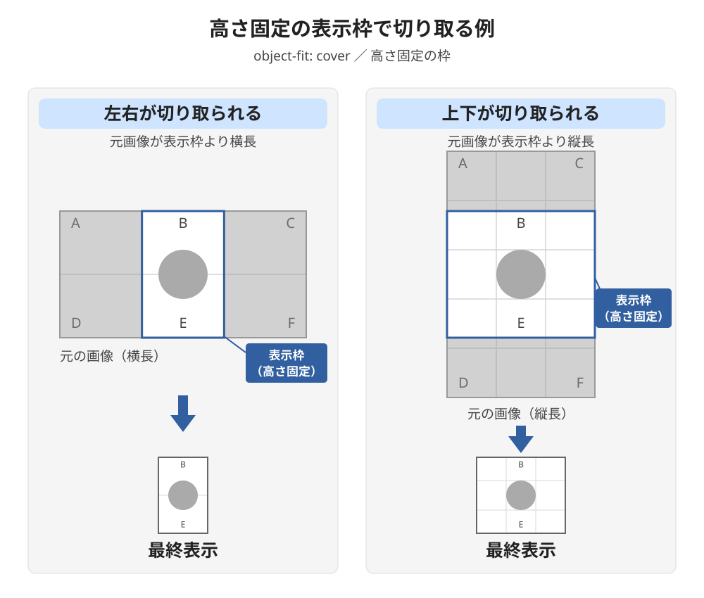

# 05_高さで表示領域を作る

表示領域の縦横比より、高さそのものを優先する場合は`height`を指定する。幅が変わっても、同じ条件の中では指定した高さを保つ。

MVやヒーローなどで一定の占有高さが必要な場合に使う。幅に合わせて高さも連続して変えたいなら[比率で表示領域を作る](./04_比率で表示領域を作る.md)方法を選ぶ。

## 高さを直接指定する

次の例では`img`自身を表示領域にする。SPでは450px、PCでは600pxの高さを指定する。

```html

```

```css
.image {
  display: block;
  width: 100%;
  height: 450px;
  object-fit: cover;
}

@media (min-width: 800px) {
  .image {
    height: 600px;
  }
}
```

SP側で表示幅が400pxから600pxに変わっても、高さの指定値は450pxのままである。`object-fit: cover`は画像を表示領域へ収める別の判断であり、[全体を残すか埋めるか](./03_決めた表示領域に画像を合わせる.md)によって変える。

親を表示枠にして画像や文字を重ねる場合は、親に高さを指定する形もある。親の表示枠と`img`側の指定を分ける理由は[表示枠・画像要素・画像内容の役割を分ける](../11_メディアの表示枠と重ね配置/02_表示枠・画像要素・画像内容の役割を分ける.md)で扱う。

## 比率で作る場合との違い

```text
比率で作る → 幅が変わると、高さも比率に従って変わる
高さを指定する → 幅が変わっても、その条件では高さを保つ
```

### 画面幅を変えて、周囲の配置と収まりを見る

画像のレスポンシブ設計では、実際に画面幅を変えて、画像の高さが周囲の配置にどう影響するかを確認する。SP・PCの基準カンプに合う指定を試し、中間幅でも表示を見る。

`aspect-ratio`で表示領域の高さを幅に比例させると、通常フローで画像の下に続く要素の位置も変わる。画像だけを見ず、重ねた文字やCTAとの位置関係、次のセクションが見える位置、1画面での収まり、全体のバランスまで確認する。

**高さの変化によって配置のずれが大きくなり、意図した収まりや全体のバランスが崩れる場合は、高さ固定を基本にする。** SP・PCでそれぞれ高さを決め、中間幅でも収まりを確認する。必要なら、途中で高さを切り替えたり、上限・下限を設けたりして調整する。

幅に比例して高さが変わっても、意図した構図や配置を保てる場合は、[比率で表示領域を作る](./04_比率で表示領域を作る.md)方法を使う。判断基準は、**高さの変化と、それが周囲へ与える影響が、デザインとして許容できる範囲に収まるか**である。理屈は、実際に試して起きた変化の原因を理解し、調整するために使う。

### カンプの切り抜きから高さ固定を実装案にする

中間幅での挙動が指定されていないときは、カンプの寸法・切り抜き方・周囲の配置を材料に、実装案を選ぶ。元画像の上下や左右がマスクで切られ、SP・PCでそれぞれ表示高さが与えられている場合は、**カンプの高さを保つ`height`と、画像で枠を埋める`object-fit: cover`を第一案として試せる。** 元画像自身の比率より、各画面で確保したい表示領域を優先していると読むためである。これはカンプから立てる実装仮説とし、実際に幅を変えて構図と周囲の収まりを確認する。



図は、横長と縦長の元画像を使った二つの模式例で、青い表示枠の高さをそろえている。左は元画像が表示枠より横長なので左右が切れ、右は元画像が表示枠より縦長なので上下が切れる。どちらもA・C・D・Fの部分が枠の外へ隠れ、B・丸・Eが残る。下段は残る内容を縮小して示している。枠線と格子は説明用の補助線であり、実際のCSSのborderではない。

#### 元画像全体の比例表示と、枠内の切り抜きを分ける

元画像自身の比率のまま全体を比例表示するだけなら、A〜Fも残るため、図の切り抜き方にはならない。この表示は[画像全体を自然比率で表示する](./02_画像全体を自然比率で表示する.md)方法で扱う。

切り抜き後の構図をそのまま比例表示したい場合は、切り抜き済み画像を書き出し、その画像に`height: auto`を指定する方法もある。一方、元画像を残して表示領域を埋める場合は、[決めた表示領域に画像を合わせる](./03_決めた表示領域に画像を合わせる.md)方法を使う。`object-fit: cover`で枠を埋め、必要なら`object-position`で見せる位置を調整する。

Figmaで元画像とマスクを残す構造には、見せる範囲を後から調整できる利点がある。[マスクは元の画像を変更・削除しない編集方法](https://help.figma.com/hc/en-us/articles/360040450253-Masks)なので、その存在だけを高さ固定の確定根拠にはしない。

#### 基準幅で同じに見えても、幅変更後の挙動は違う

カンプと同じ比率の表示領域を`aspect-ratio`で作り、`cover`で埋めれば、**基準幅では同じ切り抜きを再現できる。** ただし、高さ固定とは幅変更後の挙動が異なる。

ここでは同じ画像を`object-position: center`で中央に合わせ、表示枠に高さの上限・下限などを加えない場合を比べる。

| 表示領域の作り方 | 幅を広げたとき |
| --- | --- |
| 比率を固定する | 幅と高さが同じ倍率で増え、見える画像の範囲も同じ割合を保つ |
| 高さを固定する | 高さを保って幅だけが増え、枠の縦横比と切り抜かれる量が変わる |

比率固定では、同じ形の枠が拡大・縮小する。高さ固定では、枠そのものが横に広がったり狭まったりする。図と同じ切り抜き方向を保っている間は、幅の変更を次のように読める。

- **図の左：** 高さを固定して幅を広げると、左右の切り抜き量が減り、隠れていた部分がより見えるようになる。幅を狭めると、左右の切り抜き量が増える。
- **図の右：** 高さを固定して幅を広げると、画像も幅に合わせて拡大され、上下の切り抜き量が増える。幅を狭めると切り抜き量が減り、上下がより見えるようになる。

枠の比率が元画像と同じになった時点で、この例では比率差による切り抜きがなくなる。そこを越えて幅を変えると、切り抜かれる方向が変わる。

### 表示意図と未指定部分の扱いを事前に共有する

**重要な挙動が未指定なら、理屈を突き詰めても設計意図は確定できない。** SP・PCの静止カンプだけでは、中間幅で高さや切り抜き範囲をどう変えるかが残ることがある。そのため、実装前に確認事項を共有し、現場で同じ判断ができるようにしておくことを重視する。

カンプを作る側と読む側の判断の前提がずれる理由は、[カンプ設計とCSS設計で仕事の認識がずれる理由](../../07_設計/CSS設計/06_カンプ設計とCSS設計で仕事の認識がずれる理由.md)で扱う。

画像については、次の内容をデザイン側・実装側で共有する。

- 表示領域の高さを固定するか、幅に比例させるか。高さに上限・下限が必要か。
- 必ず見せたい部分と、切れてよい部分。
- 中間幅での挙動と、表示方針を切り替える条件。
- 指定がない部分を誰が判断し、誰が表示結果を確認するか。

カンプを作成する段階で、これらをどの注記・レイヤー構造・共有仕様で伝えるかも合意しておく。決めた内容をカンプや共有仕様に残し、現場ルールに沿って表示意図を読み取れるようにする。指定済みの内容と、実装側で判断する部分を区別する。

未指定部分は、周辺レイアウトとの整合性を基準に実装案を作成し、中間幅を含む表示確認で調整する。経験は、実装案を選び、崩れやすい場所を見つけるために使う。表示結果を担当者と確認して合意した内容は、その現場で次に使える判断基準として残す。

事前共有では、例えば次のように伝える。

> 表示高さ、画像の見せる範囲、中間幅での挙動に指定がある場合は、事前に共有をお願いします。指定がない部分は、周辺レイアウトとの整合性を基準に実装案を作成し、中間幅を含む表示確認で調整します。判断・確認の担当も事前に共有します。

## `height`と`min-height`

親の表示枠に文字などの内容が入り、内容量によって高さを増やす必要がある場合は、固定の`height`ではなく`min-height`を使うことがある。

```css
.frame {
  min-height: 450px;
}
```

```text
height     → 高さを指定値にする
min-height → 最低限の高さを確保し、内容に応じてさらに伸び得る
```

どちらも高さを基準にする点は同じだが、`min-height`だけの親に置いた画像の`height: 100%`が、親の最終的な高さへ必ず広がるわけではない。画像も伸びる枠全体を覆う必要がある場合は、重ね配置など別の方法を含めて確認する。

## 確認すること

1. `height`なら指定した高さ、`min-height`なら最低限の高さが意図どおり保たれるか確認する。
2. SP・PCだけでなく中間幅でも、文字・CTA・次のセクションとの位置関係、1画面での収まり、全体のバランスを確認する。
3. 画像を親の枠に合わせる場合は、画像要素の箱も意図した高さになっているか確認する。
4. `cover`を使う場合は、幅が変わっても必要な部分が見えるか確認する。
5. 表示意図と未指定部分の判断・確認担当を共有し、実装案について合意できているか確認する。

## このページのまとめ

- 幅を変えて試し、高さの変化による配置のずれや収まりの崩れが大きい場合は、高さ固定を基本にする。
- 幅に比例して高さが変わっても意図した構図・配置を保てる場合は、比率で表示領域を作る。
- カンプの寸法・切り抜き方・周囲の配置を材料に、高さ固定＋`cover`を第一案として試せる。元画像全体の比例表示と、枠内の切り抜きを分ける。
- 比率固定では見える範囲の割合を保ち、高さ固定では幅の変化によって切り抜き量が変わる。基準幅だけでなく、幅変更後の挙動を確認する。
- 重要な表示意図と未指定部分の判断・確認担当を事前に共有し、合意内容をカンプや共有仕様から読み取れるようにする。
- 内容量に応じて親の表示枠を伸ばす必要がある場合は、`min-height`を検討する。
