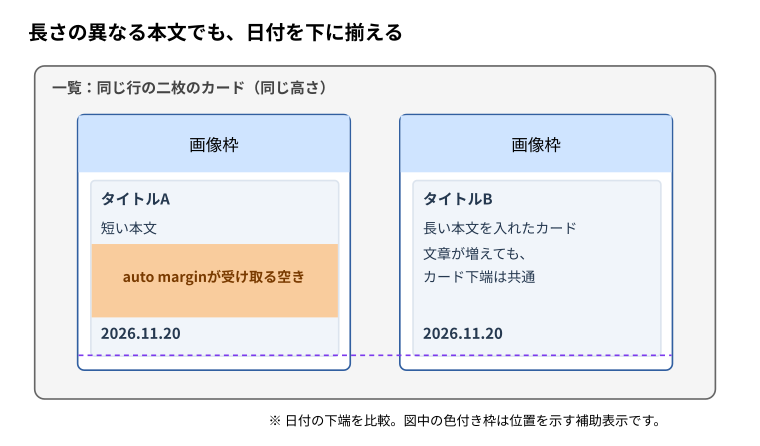

# 07_カードの可変本文と下寄せ要素を両立する

カード一覧で文章の量が違うと、短いカードの日付だけが上に見えることがあります。**本文を固定の高さにせず、同じ行のカードの日付を下へ揃えるには、どこに空きを作ればよいのでしょうか。**

先に確認したいのは、日付に`margin-top: auto`を指定したかどうかではなく、**日付を入れている箱に、受け取れる余りの高さがあるか**です。

## 同じ行のカードを、まず同じ高さにする

第15章06の[カード一覧とカード内部の責務](./06_カード一覧とカード内部の責務を分ける.md)では、一覧親がGridで二つのカードを並べています。同じGrid行に置かれた通常のカードは、その行の高さに合わせて伸びます。行の高さは、長い内容を持つカードに合わせて大きくなる場合があります。

ただし、カードの間に`li`やリンクなど別の箱があれば、伸びているのがどの要素かを先に調べます。**一覧側で高さを揃えること**と、**カード内部の日付を下へ寄せること**は別の仕事です。

## 画像枠の下にある本文箱へ、余りを渡す

画像枠の下にタイトル・本文・日付を入れる構造で試します。`media`は配置関係を確認するための仮の画像枠です。

```html
<div class="list">
  <article class="card">
    <div class="media">画像枠</div>
    <div class="body">
      <h3 class="title">記事A</h3>
      <p class="text">短い説明文です。</p>
      <p class="date">2026.11.20</p>
    </div>
  </article>
  <article class="card">
    <div class="media">画像枠</div>
    <div class="body">
      <h3 class="title">記事B</h3>
      <p class="text">こちらは説明文が長く、何行かに折り返します。カードの高さが変わる場合を確認します。</p>
      <p class="date">2026.11.20</p>
    </div>
  </article>
</div>
```

```css
.list {
  display: grid;
  grid-template-columns: repeat(2, minmax(0, 1fr));
  gap: 20px;
}

.card {
  display: flex;
  flex-direction: column;
}

.media {
  height: 80px;
  background: #cfe4ff;
}

.body {
  display: flex;
  flex: 1;
  flex-direction: column;
}

.title {
  margin: 0;
}

.text {
  margin: 0;
}

.date {
  margin: 0;
  margin-top: auto;
}
```

`.card`を縦Flexにすると、画像枠と`.body`が縦に並びます。`.body`の`flex: 1`は、**画像枠の下に残った高さを本文箱へ渡す**指定です。

次に`.body`も縦Flexにします。その直接の子である日付へ`margin-top: auto`を指定すると、日付の上側のmarginが**本文箱の余り**を受け取ります。短い文章のカードでは日付の上に空きが生まれ、日付が本文箱の末尾へ寄ります。



図では二枚のカードの高さと画像枠の高さを揃えています。左の色付きの空間が、日付の上にできた余りです。**その空間がなければ、`margin-top: auto`は日付をさらに下へ動かせません。**

## うまく揃わない場合は、どの箱の高さが違うかを見る

例えばカードの外枠が同じ高さでも、途中の`.body`が伸びていなければ、日付を入れている箱には余りがありません。まずGridの行の高さ、次に`.card`の高さ、最後に`.body`の高さをDevToolsで順に比べます。

また、画像枠の高さがカードごとに異なる場合や、日付が複数行になる場合は、末尾の位置が思ったように揃わない可能性があります。今回の図は**同じ高さの画像枠・一行の日付**を前提とした比較です。

文字量を増やし、画面幅を狭くして、本文が複数行になっても日付が下へ残るか確認してください。固定した本文の`height`で揃える必要はありません。

単独の縦Flex内でauto marginが余りを受け取る仕組みは、[Flexで子の位置を揃える](../09_レイアウト/03_Flex/02_Flexで子の位置を揃える.md)でも確認できます。

## このページのまとめ

同じ行のカードの高さを揃えてから、**カード → 本文箱 → 日付**の順に余りを受け渡します。日付だけに`auto margin`を付けても、その親に余りがなければ下へ寄りません。本文は固定高にせず、内容が増えたときに伸びられる状態を保ちます。
