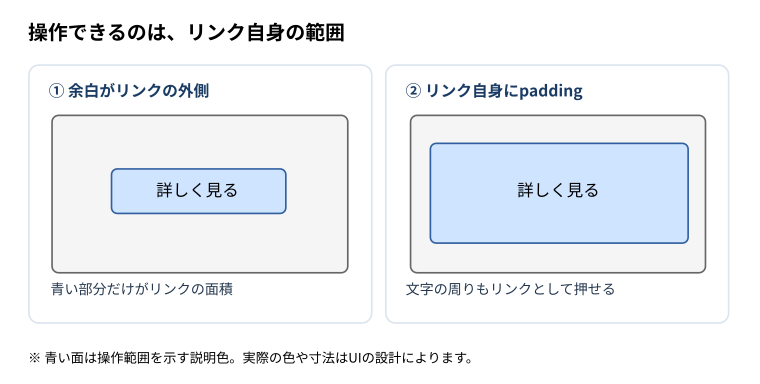

# 09_CTAとナビリンクの操作範囲を作る

ナビの文字の周りに余白があるのに、**文字の近くでしか押せない**ことがあります。CTAやナビの操作範囲を広げたいときは、外側の余白ではなく、**リンク自身の箱に広さを持たせる**ことを先に確認します。

## クリックできる面積は、どの要素のものか

次のHTMLでは`a`要素そのものがリンクです。

```html
<a class="link" href="/guide/">詳しく見る</a>
```

リンク自身へ`padding`を指定すると、文字の周囲まで同じリンクの面積になります。外側の要素へpaddingやmarginを足しただけでは、その空間がリンクの操作範囲になるとは限りません。



この図では青い範囲がリンクの操作対象です。色は説明用で、実際のリンクに青い背景を指定する必要はありません。

## CTAとして使う場合

文章中に置ける、小さなCTAの例です。リンク自身を`inline-flex`にし、paddingと最低高さを設定します。

```html
<a class="cta" href="/apply/">申し込む</a>
```

```css
.cta {
  display: inline-flex;
  align-items: center;
  justify-content: center;
  min-height: 48px;
  padding-inline: 20px;
}
```

`inline-flex`によってリンク全体を周囲の文章と同じ行に置きながら、文字の位置をリンクの箱の中で揃えられます。ここでは子が一つの文字列だけなので、複数の子のための`gap`は必要ありません。**押せる面積を持つのはリンク自身**です。

## ナビの各リンクに操作面積を持たせる場合

ナビ全体へpaddingを付けるのではなく、**各`a`要素**にクラスを付ける例です。

```html
<nav aria-label="主要メニュー">
  <a class="nav" href="/about/">会社案内</a>
  <a class="nav" href="/contact/">お問い合わせ</a>
</nav>
```

```css
.nav {
  display: flex;
  align-items: center;
  justify-content: center;
  min-height: 48px;
  padding-inline: 30px;
}
```

各リンクは、この例ではブロックレベルのFlexコンテナとして配置されます。横幅が必要なら利用可能な領域へ広がり、左右のpaddingもその**リンク面の内側**に入ります。リンクを横並びにする場合は、リンクを包む`nav`などの親側で一覧の配置を考えます。

CTAとナビの指定が違うのは、部品を文章中で並べるか、リンク面を行の幅へ広げるかという**外側の扱い**も異なるためです。Flexの名前だけでクリック範囲が決まるわけではありません。

## 確認すること

DevToolsで`a`を選び、ハイライトされる箱とBox Modelのpaddingを見ます。**文字の周囲のどこまでが`a`自身か**を調べ、実際に余白の部分を押してリンクが反応するか確かめます。

文字が増える場合は、初めから固定の`width`で詰め込むより、paddingと必要な最低高さを優先します。すべてのリンクの横幅を揃える必要がある場合にだけ、追加の幅指定を検討します。

ここでの`48px`はあくまで例の設計値です。WCAG 2.2のTarget Size (Minimum)は原則24×24 CSS pxを基準とし、間隔などの例外があります。寸法の数値一つだけで適合を判断せず、隣の操作対象との間隔や案件の要件を確かめます。リンクかボタンかの意味は[リンクとボタンを使い分ける](../04_HTMLの意味と構造/10_リンクとボタンを使い分ける.md)で確認します。

## 仕様・基準

- [WCAG 2.2：Target Size (Minimum)](https://www.w3.org/WAI/WCAG22/Understanding/target-size-minimum)
