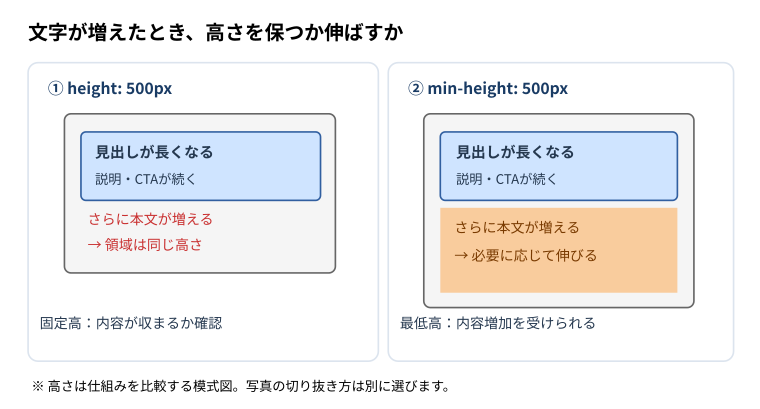

# 11_MVの表示領域を作る

MV（メインビジュアル）は、写真だけでなく、見出しやCTAを含めて高さが成立する必要があります。**PCでちょうどよい高さでも、SPで見出しが折り返したとき、文字やボタンが収まるでしょうか。**

最初に画面幅を狭め、文字が増えたときにも押す場所や文字の読みやすさを保てるか確かめます。その結果から、MVの高さを何で決めるか選びます。

## 高さを何で決めるか、文字を増やして比べる

`height`は指定した高さそのものを作るので、内容量が増えても**その高さを自動で増やす指定ではありません**。

```css
.mv {
  height: 500px;
}
```

その高さに収めること自体がデザイン要件なら候補になります。ただし、画面幅が狭くなったり文章が増えたりしたとき、内容がはみ出さないか確認が必要です。

一方、**最低でも500pxは見せたいが、文字が増えたら伸びてよい**なら、次を候補にします。

```css
.mv {
  min-height: 500px;
}
```

`min-height`は下限であり、内容がその下限を超えれば高さを増やせます。ここでは見出しとCTAを通常のフロー内に置くことを前提にしています。



画像だけの表示枠のように、**幅が変わるにつれて高さも同じ比率で変わってよい**場合は`aspect-ratio`も候補です。これは文字量に合わせて高さを増やすための指定ではありません。画像枠自体の比率や固定高を選ぶ詳細は[レスポンシブ画像設計](../12_レスポンシブ画像設計/01_レスポンシブ画像設計の選び方.md)で扱います。

## 写真と、文字の安全領域を分ける

MVの高さを決めた後で、写真をどのように表示するかを調整します。写真の一部が切れてよいなら、画像の枠と`object-fit: cover`などを検討できます。顔・商品・文字入り素材など、**切ってはいけない部分**がある場合は、表示位置の調整やSP/PCで使う画像の切り替えも選択肢です。

同時に、見出しとCTAの周囲の余白を確かめます。写真を背景に回しても、文字を絶対配置などで通常フローから外すと、**文字が増えてもMVの親の高さには寄与しない**ことがあります。高さが内容に追従してほしい場合は、文字の配置方法にも注意します。

画像の上に文字を重ねる配置そのものは[画像の上に文字や部品を重ねる](../11_メディアの表示枠と重ね配置/05_画像の上に文字や部品を重ねる.md)で確認できます。

## DevToolsで確かめる

1. PC幅で見出し、CTA、写真が収まるか見る。
2. SP幅へ狭め、見出しの行数が増えたときの高さを確認する。
3. `height`と`min-height`の違いを、一つずつ切り替えて観察する。
4. 必要な高さと写真の切り抜き方を別々に確認する。

## このページのまとめ

MVの高さは、写真の形だけでは決めません。**高さを固定する要件なら`height`、最低高を保ちつつ内容の増加を許すなら`min-height`、幅に応じて比率で変化させたいなら`aspect-ratio`**を候補にし、実際の文字量で成立するか確認します。
