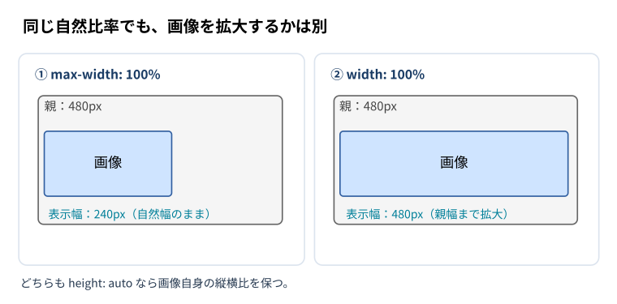

# 02_画像を自然比率か表示枠へ収めるか選ぶ

ロゴと人物写真では、同じ`img`を使っていても、守りたいものが違います。**画像全体を切らずに見せたいのか、カードなどの決まった形の枠を揃えたいのか**を先に決めます。

| 画像の用途 | 優先すること | 方法 |
| --- | --- | --- |
| ロゴ・文字入り画像 | 端が切れず、文字もすべて見える | 画像自身の比率を保つ |
| 一覧の写真・サムネイル | 表示枠の形を揃え、一部の切り抜きを許容 | 枠の比率＋`object-fit: cover` |
| 商品など、全体が必要な素材 | 枠内に余白ができても全体を見せる | 比率を保つ、または`object-fit: contain` |

## 画像全体を見せるなら、画像自身の比率を保つ

画像が縦に伸びたり横に潰れたりせず、全体を表示したい場合は`height: auto`を使います。あとは**画像をどこまで横に広げたいか**を選びます。

```css
.image {
  display: block;
  max-width: 100%;
  height: auto;
}
```

この指定なら、別の幅指定がない自然幅240pxの画像を、内容幅480pxの親に入れても、画像は240pxのままです。親より画像が大きければ、親の幅まで縮められます。

反対に、カードの横幅いっぱいへ広げたいなら次のようにします。

```css
.image {
  display: block;
  width: 100%;
  height: auto;
}
```



どちらも`height: auto`で画像自身の縦横比を保っています。違うのは**自然幅より大きくしてよいか**です。幅の計算を詳しく比べる場合は[画像全体を自然比率で表示する](../14_レスポンシブ画像設計/02_画像全体を自然比率で表示する.md#widthとmax-widthを使い分ける)で確認できます。

## 決めた形の表示枠へ収める

人物写真などを同じ形のカード枠へ入れたい場合は、画像自身ではなく**外側の枠**に比率を持たせる方法があります。

```html
<div class="frame">
  
</div>
```

```css
.frame {
  aspect-ratio: 3 / 2;
  overflow: hidden;
}

.frame img {
  display: block;
  width: 100%;
  height: 100%;
  object-fit: cover;
}
```

枠を`3 / 2`の形にし、画像の`cover`でその枠を埋めます。**枠と画像の比率が違えば、画像の一部が切れる**方法です。全体を残す必要があるなら`contain`や自然比率での表示を検討します。

## 判断するときに確かめること

1. ロゴの端、文字、人物の顔など、絶対に切りたくない部分があるか。
2. 画像全体が必要か、見せる枠の形が必要か。
3. 画像を自然幅より拡大してよいか。
4. SP/PCで構図を変える必要があるか。

`img`へ`width: 100%`と`height: 100%`を指定しただけでは、切り抜きの方針を決めたことにはなりません。また画像自身の比率を守るだけなら、CSSの`aspect-ratio`を重ねる必要は基本的にありません。

そもそもHTMLの`img`とCSSの背景画像のどちらが適切か迷う場合は[imgとbackground-imageを選ぶ](../12_画像と背景/02_imgとbackground-imageを選ぶ.md)、枠に写真を収める操作は[決めた表示領域に画像を合わせる](../14_レスポンシブ画像設計/03_決めた表示領域に画像を合わせる.md)で確認できます。装飾用の形だけなら[background-imageとmask-image](../12_画像と背景/05_background-imageとmask-imageを区別する.md)で別に判断します。

## このページのまとめ

画像全体を守るなら、画像自身の縦横比を保つ。表示枠を揃えるなら、枠の比率と画像の切り抜き方を決める。さらに**親幅まで拡大するのか、自然幅を上限にするのか**は別の判断です。
