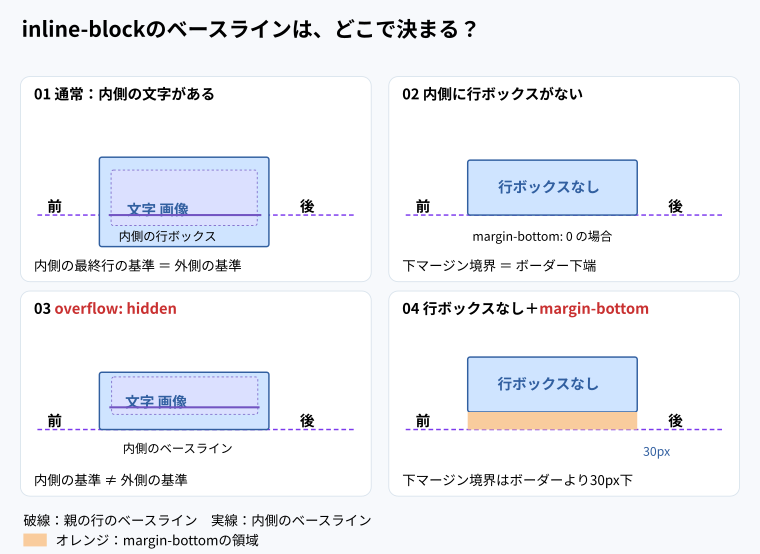

# 08_inline-blockのベースラインが決まる条件を比べる

[inline-blockとinline-flexの使い分け](../../02_基礎/01_HTML・CSS/08_インラインと行の仕組み/03_inline-blockとinline-flexを使い分ける.md)で外側と内側の配置を分けた後、「inline-block自身は、行のどこを基準に並ぶのか」を確認する。画像下の空間の対処は、[ベースラインと見た目のずれ](../../02_基礎/01_HTML・CSS/08_インラインと行の仕組み/04_ベースラインと見た目のずれ.md)へ戻る。

通常は内側の最後の行ボックスのベースラインを利用するが、内側に通常フローの行ボックスがないか、`overflow`の計算値が`visible`以外の場合、下側マージン境界が使われる。



外側は親のIFCに参加する。内側の行ボックスを使う場合と、下マージン境界を使う場合を比較。図は模式図で、青はinline-blockの箱、薄紫は内側の行ボックス、紫の実線は内側のベースライン、紫の破線は親の行のベースライン、オレンジはmargin-bottomの領域を表す。

## 01 通常：内側の文字がある

最後の行ボックスのベースラインを外側でも使う。

```css
.label {
  display: inline-block;
  overflow: visible;
}
```

内側の最終行の基準 ＝ 外側の基準。図では「文字 画像」を含む行ボックスのベースラインを、外側でも使う。

## 02 内側に行ボックスがない

参照できる行ボックスがないので下マージン境界を使う。

```css
.label {
  display: inline-block;
  width: 200px;
  height: 100px;
}
```

図は中身が空の箱で、`margin-bottom: 0`の場合。下マージン境界 ＝ ボーダー下端。

## 03 overflow: hidden

文字はあっても、外側には下マージン境界を使う。

```css
.label {
  display: inline-block;
  overflow: hidden;
}
```

内側の基準 ≠ 外側の基準。図では文字のベースラインが箱の下端より上にあるが、外側で使われるのは下マージン境界になる。

## 04 行ボックスなし＋margin-bottom

行ボックスがない例。基準はボーダーでなくマージンの下端。

```css
.label {
  display: inline-block;
  width: 200px;
  height: 100px;
  margin-bottom: 30px;
}
```

下マージン境界はボーダーより30px下。内側に行ボックスがない条件は02と同じで、`margin-bottom`を加えると、その下端が外側の基準になる。

## このページのまとめ

- 通常は、内側の最後の通常フローの行ボックスのベースラインを使う。
- その行ボックスがない場合、または`overflow`が`visible`以外の場合は、下側マージン境界を使う。
- 下側マージン境界を使う場合、`margin-bottom`があるとボーダー下端より下が基準になる。

## 参考仕様

- [CSS 2.2：inline-blockのベースライン](https://www.w3.org/TR/CSS22/visudet.html#propdef-vertical-align)
