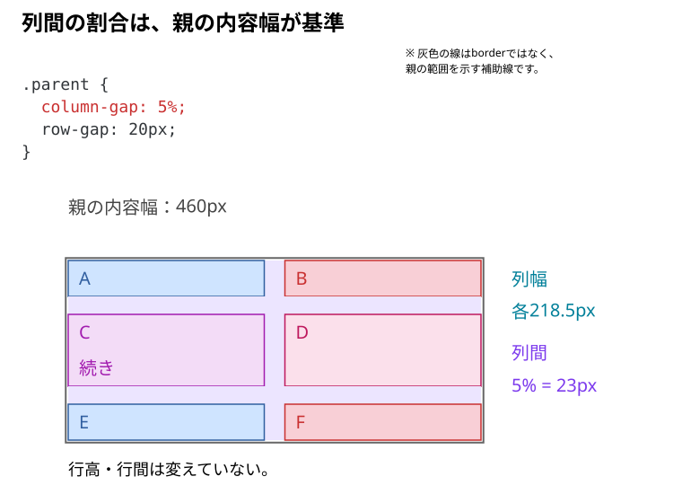
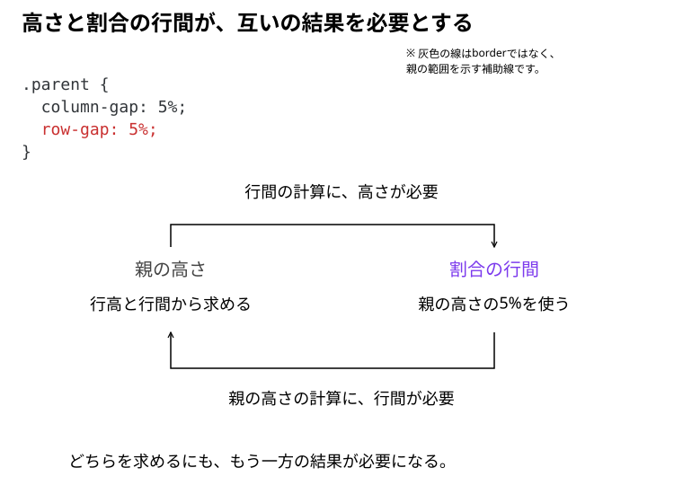
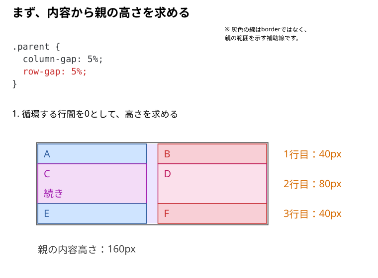
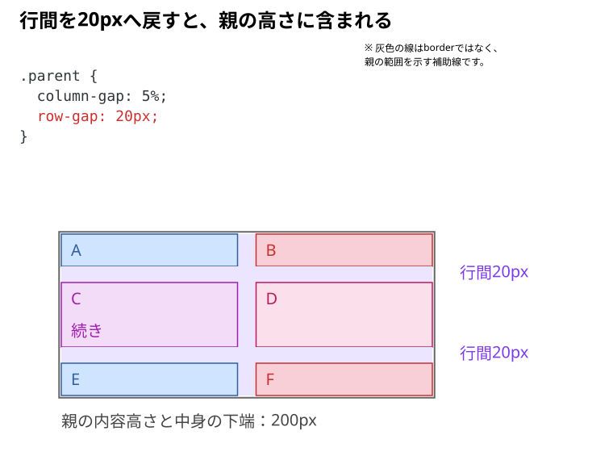

# Gridで割合gapの基準はどう決まる？

[親・行・列・中身の関係](../../../../01_導入/01_HTML・CSS/09_レイアウト/02_Gridの親と行列と中身の関係.md)では、親の幅から列を捉え、中身に必要な行高と行間から親の高さへつないだ。

同じ例で`gap`を割合へ変えると、**割合の基準になる親のサイズが、何から決まるか**が重要になる。横書きのGridでは、列間の割合は親の内容幅、行間の割合は親の内容高さを基準にする。

## 同じ例の列間だけを割合へ変える

親の内容幅460px、子A〜F、Cだけ2行の文章という条件を引き継ぐ。行高は40px・80px・40px、行間はまだ20pxのまま。

まず列間だけを、20pxから5%へ変える。

```css
.parent {
  display: grid;
  grid-template-columns: 1fr 1fr;
  column-gap: 5%;
  row-gap: 20px;
}
```

今回は、親の内容幅460pxを外側の使える幅から決められる。その5%は23px。列間を確保してから、残りの幅を2列へ等分できる。



図の子の文章は、この列幅でも折り返しが変わらない短い内容にしている。列間を変える比較で、行高まで同時に変わらないようにするため。

## 行間を割合にすると、基準の高さが必要になる

次に、列間は5%を保ち、行間だけを20pxから5%へ変える。

```css
.parent {
  display: grid;
  grid-template-columns: 1fr 1fr;
  column-gap: 5%;
  row-gap: 5%;
}
```

親の高さは引き続き`auto`で、外側から固定されていない。この例では、親の高さを求めるには行高と行間が必要になる。

ところが、行間の5%を求めるには、その親の内容高さが必要になる。



このように、お互いを決めるために相手の結果を必要とする関係を**循環依存**と呼ぶ。ここが、外側から幅を決められた先ほどの列間との違い。

循環依存は、`row-gap`だから発生するのではなく、gapの割合を計算する基準サイズ自体が、そのgapに依存しているときに発生する。

## まず、親の内容由来の高さを求める

Gridでは、このように循環する割合gapは、**内容から親のサイズを求める段階では0として扱う**。

この例の行高は40px・80px・40px。循環する行間を0として、親の内容高さは160pxになる。



図はサイズ計算の段階を取り出した説明で、ブラウザが一度この画面を表示してから描き直す、という意味ではない。

## 次に、その高さを基準に行間を配置する

内容を配置する段階では、決まった親の内容高さ160pxを基準にする。その5%は8px。

3行の間に8pxの行間が2か所入る。行高の合計160pxに行間16pxが加わり、中身は親の上端から176pxの位置まで達する。



**割合の行間を配置した後、その分を親の高さへ足し戻す計算にはならない。** 親は160pxのままで、中身の下端との間に16pxの差が生まれる。後ろの行ほど、その手前にある行間の分だけ下へずれる。

この図の動きは、親の高さを保ったまま行間が加わる関係を見せるもの。実際のブラウザの描画過程を録画したものではない。

## 内容に合わせて親を伸ばしたいとき

この例で、行間も含めて親の高さを内容に合わせたいなら、行間を20pxへ戻せばよい。列間の5%はそのまま使える。

```css
.parent {
  display: grid;
  grid-template-columns: 1fr 1fr;
  column-gap: 5%;
  row-gap: 20px;
}
```

20pxの行間は親の高さを知らなくても求められる。3行の高さと2か所の行間を合わせた200pxが、親の内容高さに含まれる。



`px`だけが選択肢というわけではない。例えば`rem`も、この例では親の高さを基準にせずに求められる。必要な余白の設計に合わせて単位を選ぶ。

一方、最初から親の内容高さが確定していれば、割合の行間をその高さから求められる。ただし、固定した高さに行と行間が収まるかは別に確認する。`height: auto`という表記だけで一律には判断せず、**その状況で基準の高さが何から決まるか**を見る。

## このページのまとめ

- 横書きGridの割合gapは、列間なら親の内容幅、行間なら親の内容高さが基準。
- 内容から親の高さが決まり、その高さへ割合の行間が依存すると、循環が生じる。
- Gridの循環する割合gapは、内容由来のサイズを求める段階では0、内容の配置時は親の内容領域を基準に解決される。
- この例では、基準の高さに依存しない行間へ変えると、行間を含めて親の高さを求められる。

## 仕様・確認先

- [CSS Gaps：割合gapの基準と循環時の扱い](https://www.w3.org/TR/css-gaps-1/#gap-percent)
- [CSS Grid：Gridコンテナの内容由来のサイズ](https://www.w3.org/TR/css-grid-1/#intrinsic-sizes)
