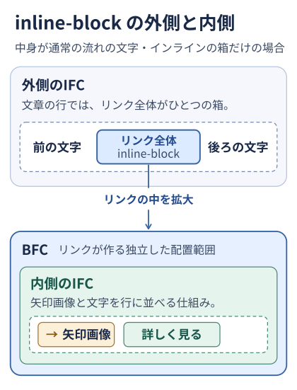
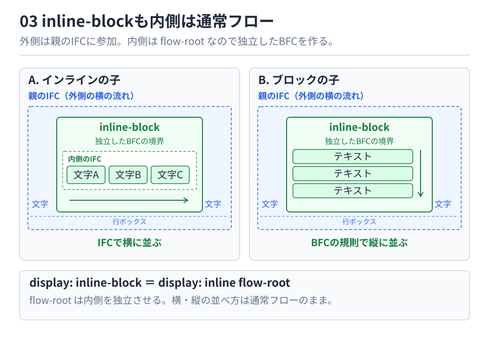

# inline-blockの中にIFCとBFCが両方できるのはなぜか

元の記事：[inline-blockとinline-flexを使い分ける](../../../02_基礎/01_HTML・CSS/08_インラインと行の仕組み/03_inline-blockとinline-flexを使い分ける.md#リンクの中では何が変わるのか)

文章の途中に、矢印と「詳しく見る」を含むリンクを置きます。リンクに `display: inline-block` を指定すると、リンク全体が文章の行に入り、リンクの中でも矢印と文字が一行に並びます。

この中の並びには **IFC（インライン整形コンテキスト）** が使われます。一方、`inline-block` は内側に **BFC（ブロック整形コンテキスト）** も作ります。どちらも同じリンクの中の話なのに、なぜ両方があるのでしょうか。

## 外側の行に置く箱と、内側の行に置く箱

まず、リンク全体と中身を見分けます。



図の上では、文章の行に「前の文字」「リンク全体」「後ろの文字」が並びます。**外側のIFCが扱うのは、リンク全体の箱**です。

その箱を拡大すると、独立した配置の範囲が見えます。これがリンクの作るBFCです。図の矢印画像とラベルは、どちらも通常の流れにあるインラインレベルの中身なので、この範囲の中にさらに行ができ、**内側のIFCが矢印画像と文字を行に配置**します。

`inline-block` を `inline flow-root` と読むと、ここまでの二つの役割が見えます。

```css
.link {
  display: inline-block; /* inline flow-root */
}
```

`inline` は外側の扱いを表し、`flow-root` は内側で通常フローの配置を独立させます。このとき新しいBFCができます。`root` はその起点となるリンク自身の箱です。**独立した範囲を作ることと、その中で文字を行に並べることは、同時に成り立ちます。**

## 中身にブロックが入ると、何が変わるか

同じ `inline-block` の箱でも、中身を `span` だけにした場合と、段落を入れた場合では、内側の並びが変わります。下の比較図は、開くと拡大できます。

[](../../../07_画像/img/html-css/01_08_05_inline-block内の通常フロー.svg)

左の箱は、インラインレベルの中身を行に並べています。右の箱は、ブロックレベルの段落を縦に積んでいます。段落内の文字は、今度は**それぞれの段落の中の行**に並びます。どちらの箱も、外側の文章には一つの箱として入っています。

矢印画像と「詳しく見る」の文字が縦に並んだときも、この区別が役に立ちます。リンクの中の画像に共通CSSで `display: block` が当たっていれば、画像の箱は内側でブロックとして配置されます。前後の文章に対してリンク全体が改行されたのか、リンク内で画像と文字が別々の行に置かれたのかを見分けます。矢印と文字を箱単位で揃えたいときは、[inline-blockとinline-flexを使い分ける](../../../02_基礎/01_HTML・CSS/08_インラインと行の仕組み/03_inline-blockとinline-flexを使い分ける.md)の比較へ戻れます。

独立することの効果を実装で確認するなら、[flowとflow-root・独立したBFCを理解する](../../../03_詳細/01_HTML・CSS/10_flowとflow-root・独立したBFCを理解する.md)にある、floatした画像を親の高さに含める例につながります。

[CSS Display Module Level 3の仕様](https://www.w3.org/TR/css-display-3/#block-container)
