# 疑似要素のdisplayと配置基準はどう違うのか？

元の記事：[inline-blockとinline-flexを使い分ける](../../../02_基礎/01_HTML・CSS/08_インラインと行の仕組み/03_inline-blockとinline-flexを使い分ける.md#疑似要素もpaddingの内側に入る)

## inline-blockとabsoluteの配置基準

通常の行内配置で使う`inline-block`は、文字の続きとして並び、初期値ではベースラインに揃います。`absolute`は通常フローから外れ、`top`・`right`などで位置を指定できます。

この違いを「右下基準と右上基準」と覚えると、何に揃えているのかが分かりにくくなります。以下の例では、ベースラインと親の基準領域を分けて見ます。

### ① inline-blockの場合

```css
.link::after {
  content: "";
  display: inline-block;
  width: 13px;
  height: 13px;
  margin-left: 30px;
}
```

この空の疑似要素は文字の後ろに並び、下端が文字のベースラインに揃います。親がFlexの場合は、通常の行内配置とは別の規則になります。

### ② absoluteの場合

```css
.link {
  position: relative;
}

.link::after {
  content: "";
  position: absolute;
  right: -20px;
  top: 8px;
  width: 13px;
  height: 13px;
}
```

この例では、`position: relative`を指定した親の基準領域から、`top`・`right`で位置を決めます。

### 整理

|  | inline-block | absolute |
| --- | --- | --- |
| 配置の基準 | 文字のベースライン | 位置指定された親の基準領域 |
| 横位置 | 文字の後ろ | `left` / `right` |
| 縦位置 | ベースラインに揃う | `top` / `bottom` |
| 通常フロー | 参加する | 外れる |

つまり、`inline-block` は文章の続きとして置く。`absolute` は親を基準に座標で置く。

なお、`absolute` 自体が右上基準なのではなく、今回 `top` と `right` を指定しているから右上を基準にしています。

### 配置基準の比較図（原文外）



> [!NOTE]
> この図と注記は保存したGPTの説明とは別に作成したものです。一行の横書きで、空の`::after`、親と疑似要素にpadding・borderがなく、上下marginもない場合を示します。`vertical-align`は初期値の`baseline`です。
>
> 空の`inline-block`では、下側のmargin edgeがベースラインとして使われます。この例では下margin・border・paddingがないため、箱の下端が文字のベースラインに揃います。中に行内の内容がある場合も、常に箱の下端がベースラインになるという意味ではありません。[CSS仕様のベースライン](https://www.w3.org/TR/CSS2/visudet.html#leading)
>
> 図の文字と親の高さは模式的な表示です。疑似要素の13px四方、左marginの30px、`top: 8px`、`right: -20px`の距離は4倍の縮尺で示しています。`absolute`側の20pxは、親の基準領域の右端から疑似要素の右端までの外側の距離です。疑似要素は通常フローから外れるため、その幅は親の通常フローの幅に含まれません。
>
> 下段は、比較の出発点として`top: 0; right: 0`を指定した位置から、`top: 8px`で下へ、`right: -20px`で外側へずらす様子を繰り返します。灰色の丸は親の右上、赤い丸は疑似要素の箱の右上です。`left`・`bottom`を指定していないこの例では、`top`・`right`の値を保つと上端・右端の位置が固定され、幅は左へ、高さは下へ広がります。点線の赤い箱は開始位置です。これは座標未指定の初期値`auto`の位置を示すものではありません。
>
> 灰色の点線は親の範囲を示す補助線、青い点線はベースラインです。実際のCSSのborderではありません。赤と青は対象を識別する説明用の色、オレンジは左marginの領域です。元のCSSには背景色やborderの指定がないため、そのコードだけで図のような色付きの四角が見えるわけではありません。

## ::afterのdisplayの初期値は何か？

`::after` の `display` の初期値は `inline` です。

```css
.link::after {
  content: "";
  /* display: inline; が初期値 */
}
```

ただし、`position: absolute` を指定すると、計算値は自動的に `block` になります。

| 指定 | 実際のdisplay |
| --- | --- |
| 指定なし | `inline` |
| `display: inline-block` | `inline-block` |
| `position: absolute` | `block` に変換される |

### 幅と高さを持つ疑似要素を作る場合

通常の行内に置く場合は、`inline-block`を指定します。

```css
.link::after {
  content: "";
  display: inline-block;
  width: 13px;
  height: 13px;
}
```

絶対配置する場合は、`position: absolute`を指定します。

```css
.link::after {
  content: "";
  position: absolute;
  width: 13px;
  height: 13px;
}
```

この例では、`display: block`を別に書く必要はありません。

通常の空の`inline`には`width`・`height`が効かないため、行内で箱として置く例では`inline-block`へ変更します。絶対配置する例では自動的にブロック化されるため、同じ指定は不要です。

## inline・inline-blockはベースライン、blockは左上が配置の基準になるのか？

`inline`・`inline-block`の行内での整列と、`block`の通常フローでの配置は、別の仕組みです。`block`を「親の左上に置く指定」と考えることはできません。

| display | 配置の基準 |
| --- | --- |
| `inline` | 行内でベースラインを基準に揃う |
| `inline-block` | 行内でベースラインを基準に揃う |
| `block` | 通常フローで、利用可能な領域の左端から配置される（左書きの場合） |

### 重要な違い

`inline`・`inline-block`

文字と同じ行に参加します。縦方向は基本的にベースラインで揃います。

`block`

通常は新しい行に配置されます。ただし、必ず親の左上に配置されるわけではなく、前の要素があればその後に続きます。

`position: absolute`

`absolute`は、通常フローから外して配置する指定です。

```css
.parent {
  position: relative;
}

.parent::after {
  content: "";
  position: absolute;
  top: 0;
  left: 0;
}
```

この場合、疑似要素は親の左上を基準に配置されます。

つまり、

- `display` → 通常フローでどのような箱として扱われるか
- `position` → 通常フローから外すか、何を基準に位置を決めるか

今回の `::after` が左上を基準に配置されるのは、`display: block` になったからではなく、`position: absolute` と `top`・`left` によるものです。
